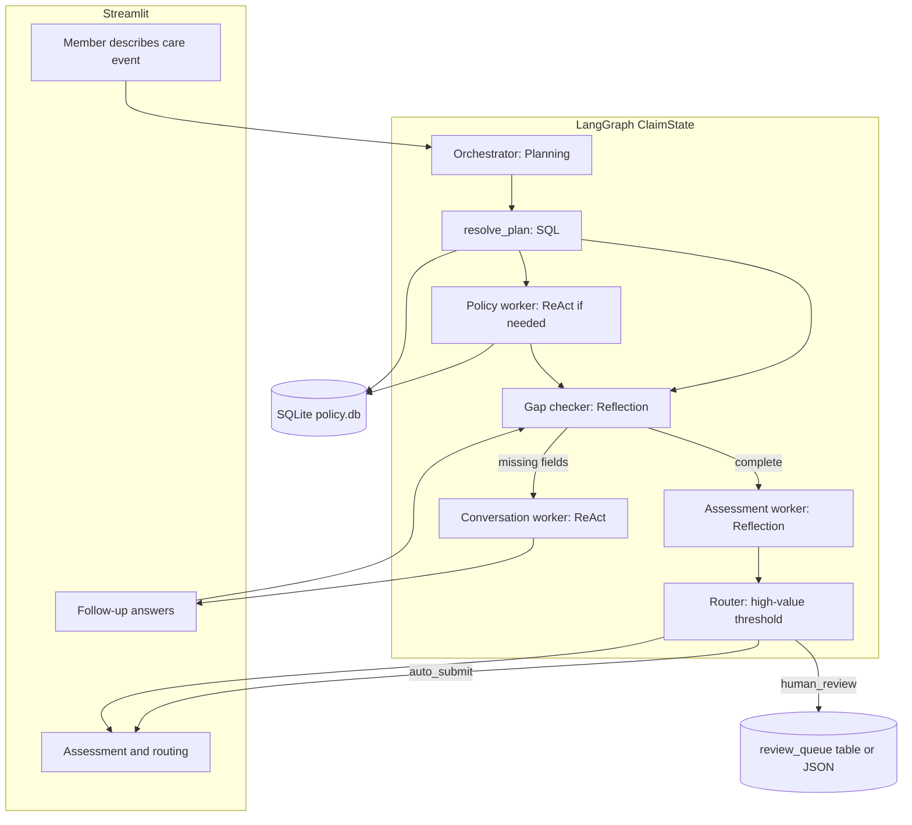
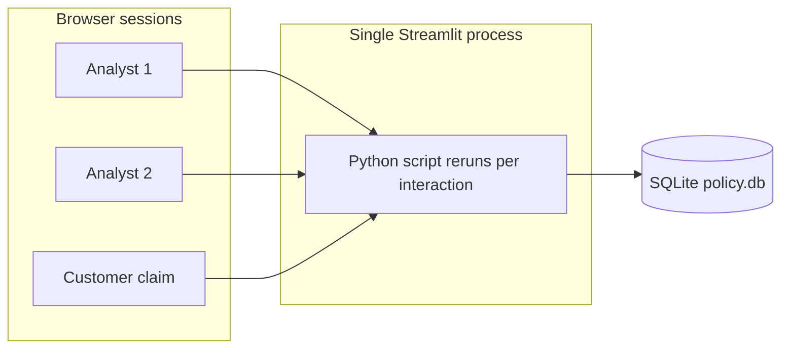

# ClaimFlow AI — multi-agent build plan

## Context

- Workspace today: only [`ClaimFlow AI Requirements.pages`](ClaimFlow AI Requirements.pages) (course material on **Planning, ReAct, Reflection, Routing**, **orchestrator–worker** / MACRS-style specialization). No application code yet.
- Your knowledge-check mapping (Steps 1–4 → patterns; **multi-agent** over single-agent) is the intended architecture; the implementation will **encode that explicitly** in docs and graph node design so it is gradable/demonstrable.
- Locked choices: **Python + LangGraph**, **Streamlit** demo UI.
- **Domain:** **Health insurance** (medical/surgical claims against member plans — synthetic PHI only in seed data and samples; no real patient data).

## Target architecture



| Step (requirement)     | Primary pattern          | Agent / node                                                                                  |
| ---------------------- | ------------------------ | --------------------------------------------------------------------------------------------- |
| 1. Receive description | **Planning**             | Orchestrator: parse intent, extract entities (member/plan hint, dates of service, provider, procedure/diagnosis), build checklist |
| 2. Plan / benefits lookup | **ReAct when ambiguous**; **deterministic SQL when ID resolves** | See [Deterministic vs LLM](#deterministic-vs-llm-when-probabilistic-models-are-actually-needed) below |
| 3. Follow-up questions | **Reflection + ReAct**   | Gap checker reflects on checklist; conversation worker acts (question) → observe (user reply) |
| 4. Assessment + flag   | **Reflection + Routing** | Assessment worker drafts + self-critique; router branches on **allowed amount / billed charges** vs threshold (e.g. high-cost surgery) |

**Why multi-agent (implementation payoff):** separate system prompts and tools per worker ([`agents/policy_agent.py`](agents/policy_agent.py) vs [`agents/conversation_agent.py`](agents/conversation_agent.py)), isolated unit tests for policy SQL tools, and orchestrator-only state slimming so policy clauses are not duplicated in the conversation context.

## Lightweight policy database (recommended: SQLite)

**Recommendation:** **SQLite** (single file [`data/policy.db`](data/policy.db)) — no server, works with ReAct tool calls, easy to reset, sufficient for coursework demos.

| Option              | When to use                                                                 |
| ------------------- | --------------------------------------------------------------------------- |
| **SQLite (chosen)** | Structured policies, limits, exclusions; SQL + optional FTS5 on clause text |
| JSON/YAML only      | Fastest seeding but weak “search database” story for Step 2                 |
| DuckDB              | Same ergonomics as SQLite; pick only if you already use it elsewhere        |
| Chroma/FAISS        | Only if you need semantic search over long policy PDFs (overkill for MVP)   |

**Schema (minimal but realistic — health plans):**

- `members` — `member_id`, `name`, `email`, `date_of_birth`, `policy_number` (plan contract id)
- `policies` — `policy_number`, `plan_name`, `plan_type` (PPO/HMO/EPO), `network`, `effective_date`, `status`, `individual_deductible_usd`, `family_deductible_usd`, `oop_max_usd`, `coinsurance_pct`
- `benefits` — `policy_number`, `benefit_code` (e.g. `INPATIENT`, `OUTPATIENT`, `ER`, `IMAGING`, `MATERNITY`, `MENTAL_HEALTH`), `copay_usd`, `coinsurance_pct`, `annual_limit_usd`, `prior_auth_required`, `description`
- `exclusions` — `policy_number`, `exclusion_code`, `description` (e.g. cosmetic, experimental, weight-loss non-medical, out-of-network elective)
- `claims_review_queue` — flagged pre-adjudication summaries for analyst Streamlit tab

**Seed content:** 4–6 fictional plan products (e.g. Gold PPO, Silver HMO, high-deductible health plan + optional dental rider) with contrasting benefits/exclusions so ReAct search returns different outcomes per scenario.

**Seed script:** [`scripts/seed_policy_db.py`](scripts/seed_policy_db.py) creates DB from [`data/seed/policies.yaml`](data/seed/policies.yaml) (human-readable source of truth) so you can edit policies without writing SQL by hand.

**Policy lookup tools (deterministic — no LLM):**

- `resolve_member_plan(incident_text, extracted_entities)` — **orchestration helper (Python):** regex/heuristics for plan/member id in text; if present → `get_plan(policy_number)`; if single `find_member` match → join to plan; returns `ResolvedPlan | Ambiguous | NotFound`
- `find_member(query: str)` — name, email fragment, member id, or policy/plan number
- `get_plan(policy_number: str)` — plan header, deductibles/OOP, all benefits + exclusions
- `match_benefit_rules(policy_number, care_type, place_of_service)` — **rule/keyword map** (e.g. ER → `ER` benefit row); optional FTS fallback on benefit text — still SQL, not LLM

**LLM policy worker (ReAct) — only when `resolve_member_plan` returns `Ambiguous` or `NotFound`:** e.g. wrong member id, multiple name matches, free-text “I have the Gold PPO through work” with no id — then ReAct loops on tools until resolved or escalates to follow-up.

## Dummy test data (health insurance)

Add two layers: **structured fixtures** (deterministic tool tests) and **synthetic member narratives** (Streamlit demos). All names, dates, and IDs are fictional.

**[`data/seed/members.yaml`](data/seed/members.yaml)** — 6–8 members on different plans (in-network PPO, strict HMO, HDHP, family vs individual).

**[`data/sample_incidents/`](data/sample_incidents/)** — one `.md` or `.yaml` per scenario (`expected_behavior` in header comments):

| Scenario | Purpose |
| -------- | ------- |
| `01_er_visit_complete.md` | Member describes ER visit with date, facility, symptoms; in-network; under analyst threshold; ER benefit + copay applies |
| `02_inpatient_surgery_high_cost.md` | Knee replacement / inpatient stay; billed amount > `HIGH_VALUE_THRESHOLD` → human review; prior auth noted as on file |
| `03_missing_date_of_service.md` | Urgent care visit narrative without service date → follow-up (Reflection gap) |
| `04_cosmetic_exclusion.md` | Elective cosmetic procedure → exclusion match → deny or no medical benefit |
| `05_out_of_network_specialist.md` | OON cardiologist; plan has limited OON coverage → partial / higher member responsibility |
| `06_wrong_member_id.md` | Wrong subscriber ID in text → ReAct retry via name + DOB lookup |
| `07_mental_health_telehealth.md` | Teletherapy sessions; tests `MENTAL_HEALTH` benefit and visit limits |
| `08_imaging_prior_auth.md` | MRI ordered; plan requires prior auth for advanced imaging → follow-up or pend for auth status |

**Required-field checklist (orchestrator / gap checker)** — see full spec in [Gap checker rules](#gap-checker-reflect_gaps-rules-and-benchmarks) below.

**Streamlit:** dropdown “Load sample scenario” + free-text; copy uses **member / care event** language (not “accident incident”).

**Optional CLI:** [`scripts/run_claim.py`](scripts/run_claim.py) `--incident data/sample_incidents/01_er_visit_complete.md`

**Demo disclaimer in UI footer:** “Synthetic demo data only — not for real PHI.”

## Code layout (new under [`ClaimFlow AI/`](ClaimFlow AI/))

```
ClaimFlow AI/
  pyproject.toml          # langgraph, streamlit, pydantic, pyyaml; optional extras: openai, anthropic
  .env.example            # LLM provider settings (see LLM section), HIGH_VALUE_THRESHOLD_USD
  README.md               # setup, patterns map, how to run
  data/
    seed/                   # yaml sources
    sample_incidents/
    policy.db               # gitignored; generated by seed script
  src/claimflow/
    schemas.py              # ClaimAssessment, PolicyContext, MissingFieldEnum
    schemas/intake_requirements.py  # Benchmark A field rules
    state.py                # TypedDict / Pydantic ClaimState for LangGraph
    tools/policy_db.py      # SQLite + resolve_member_plan, get_plan, benefit matching
    services/
      benefit_matcher.py    # deterministic care type → benefit_code mapping
    agents/
      prompts/              # one md per agent (instructions modular)
      orchestrator.py
      policy_agent.py
      conversation_agent.py
      assessment_agent.py
    graph.py                # StateGraph, conditional edges, max ReAct iterations
    config.py               # thresholds, paths
    llm/
      factory.py            # get_llm(role) — provider switch, model names from env
      mock.py               # deterministic fake LLM for tests / offline graph smoke
  app/streamlit_app.py
  app/components/         # wizard, chat, assessment (presentation only)
  app/styles/custom.css
  .streamlit/config.toml   # theme (not committed with secrets)
  tests/
    test_policy_tools.py    # deterministic DB tests (no LLM)
    test_routing.py         # threshold logic
    test_gap_checker.py     # missing_fields vs intake + plan rules
  scripts/
    seed_policy_db.py
    run_claim.py
```

## LangGraph design details

**Shared state (`ClaimState`)** — keep inter-agent contract explicit (addresses course “coordination overhead” point):

- `incident_text`, `plan`, `extracted_entities` (member/plan hint, dates of service, provider/facility, care type, billed/estimated amount, prior_auth_status)
- `policy_context` (structured JSON from policy worker)
- `missing_fields`, `follow_up_history`
- `draft_assessment`, `final_assessment`
- `route_decision`: `auto_submit` | `human_review`
- `react_traces` (optional, for demo/debug panel in Streamlit)

**Graph flow:**

1. `extract` — LLM **or** lightweight parse: pull entities from free text (can use LLM for Planning pattern in coursework; optional `CLAIMFLOW_USE_LLM_EXTRACT=false` + regex for demos)
2. `resolve_plan` — **deterministic** `resolve_member_plan` → populate `policy_context` when successful
3. `policy_react` — **conditional:** run only if step 2 did not resolve; ReAct with max 5 tool iterations
4. `reflect_gaps` → if `missing_fields` non-empty → `conversation` else → `assess`
5. `conversation` → Streamlit-driven re-entry: append user answer, re-run `reflect_gaps` (and re-run `resolve_plan` if member id was collected)
6. `assess` — LLM reflection + structured assessment **grounded on** `policy_context` (facts from DB); optional deterministic pre-check (exclusion code match) before LLM narrative
7. `route` — **deterministic** rules on amounts, prior auth flags, confidence → `claims_review_queue`

## Deterministic vs LLM: when probabilistic models are actually needed

The assignment wording (“search a policy database”) maps to **ReAct** in the course because real intake is messy: wrong ids, nicknames, no id in the narrative, ambiguous which benefit applies. That does **not** mean every production claim stack should use an LLM for a primary-key lookup.

| Task | Prefer | Why |
| ---- | ------ | --- |
| Load plan by `policy_number` / `member_id` | **SQL only** | Exact, auditable, cheap — customer is linked to one row in `members` |
| Map “MRI at hospital” → benefit row | **Rules + SQL** first | Table-driven `benefit_code`; FTS on descriptions if needed |
| Parse unstructured paragraph | **LLM (Planning)** or regex | IDs and dates buried in prose |
| Wrong id / multiple members named “Kim Lee” | **ReAct or follow-up** | Tool loop or ask member — LLM helps choose next tool/question |
| Explain decision to member in plain English | **LLM (Reflection)** | Narrative + consistency check; **numbers and codes must come from DB JSON** |
| High-value / auth routing | **Rules** | Thresholds and flags — not probabilistic |

**ClaimFlow design stance:** **Database-first, LLM-second.** The graph always tries deterministic resolution before any policy ReAct node. Course patterns still appear where they teach intent: **Planning** on intake, **ReAct** on scenario `06_wrong_member_id`, **Reflection** on assessment, **Routing** on analyst queue — without using an LLM to “guess” a policy id when a valid id is already known.

**Streamlit optional field:** member/plan id text box → if filled, **skip LLM for lookup entirely** and call `get_plan` directly (validates the UX point for demos).

## Gap checker (`reflect_gaps`): rules and benchmarks

The gap checker answers one question: **“Do we have enough structured facts to run a grounded assessment?”** It does **not** decide covered vs denied—that is `assess` using `policy_context`. Gaps are measured against **two benchmarks** that merge into a single `missing_fields` list.

### Benchmark A — Universal intake schema (always applies)

Defined in code as [`schemas/intake_requirements.py`](schemas/intake_requirements.py) (Pydantic / enum), not invented by the LLM. Each field has a **severity**: `required` (block assess) vs `recommended` (ask once, can proceed if member declines).

| Field | Required? | Valid if |
| ----- | --------- | -------- |
| `member_or_plan_id` | **Yes** | Valid `policy_number` or `member_id` resolves in DB **or** single unambiguous `find_member` match |
| `date_of_service` | **Yes** | Parseable date (or range) on or before today; not before plan `effective_date` |
| `place_of_service` | **Yes** | One of: ER, inpatient, outpatient, urgent care, telehealth, office, home (enum) |
| `provider_or_facility` | **Yes** | Non-empty name or NPI-like id |
| `reason_for_care` | **Yes** | Symptoms **or** procedure/specialty (e.g. knee replacement, therapy) |
| `billed_or_estimated_amount` | Recommended | Numeric USD; **required** if routing uses dollar threshold |
| `network_status` | Recommended | in_network / out_of_network / unknown — if unknown and plan is HMO/EPO, ask |

**Deterministic validation:** regex/date parsing, enum checks, DB existence for ids — **no LLM** in the core gap list builder (`build_missing_fields(state)`).

### Benchmark B — Plan-conditional rules (from `policy_context` / SQLite)

After `resolve_plan`, merge requirements from the **matched benefit row** and plan type:

| Source in DB | Gap if missing | Example |
| ------------ | -------------- | ------- |
| `benefits.prior_auth_required = true` for matched care | `prior_auth_status` | MRI → must be `approved` / `pending` / `not_required` / `unknown` |
| `plan_type = HMO` and `network_status = out_of_network` | `oon_exception_reason` | Emergency exception vs routine OON |
| `exclusions` might apply (keyword pre-match) | `medical_necessity_note` | Cosmetic scenario: confirm elective vs reconstructive |
| High deductible plan + large amount | `itemized_bill_attached` | Recommended when amount > configurable floor |

Benefit row matching uses **`benefit_matcher`** (deterministic): map `place_of_service` + keywords in `reason_for_care` → `benefit_code` (e.g. ER visit → `ER`). Gap rules read flags on **that row only**.

### How Reflection + LLM fits (without replacing rules)

1. **`build_missing_fields(state)`** — deterministic diff: required schema + plan-conditional rules vs `extracted_entities` + `follow_up_history`.
2. **`reflect_gaps` LLM (optional, `CLAIMFLOW_USE_LLM_GAP_REVIEW=true`)** — second pass: confirm nothing contradictions in free text (e.g. member said “last Tuesday” but entity date empty → suggest re-extract, not a new rule).
3. **`conversation` LLM** — turns **one** top-priority missing field into a member-friendly question (wording only).

**Course pattern:** Reflection **detects** gaps (deterministic list + optional LLM sanity check); ReAct **closes** them via chat.

### Priority order for follow-ups (one question per turn)

1. Cannot resolve plan → member/plan id or name + DOB  
2. `date_of_service`  
3. `place_of_service` + `provider_or_facility`  
4. `reason_for_care` (if still vague)  
5. Plan-conditional: `prior_auth_status`  
6. `billed_or_estimated_amount` (before high-dollar routing)  
7. Other recommended fields  

Stored in `missing_fields` as ordered list of `MissingFieldEnum` values; conversation pops highest priority.

### Explicitly out of scope for gap checker

- Final coverage determination, copay/coinsurance math (assessment + optional deterministic calculator)
- Fraud detection, clinical coding (ICD/CPT) — demo omits or uses free text only
- Analyst routing (separate `route` node after assess)

### Tests

- [`tests/test_gap_checker.py`](tests/test_gap_checker.py): fixture states → expected `missing_fields` for scenarios 01, 03, 08 without LLM.

## LLM configuration (provider and model options)

All **agent nodes** call **`get_llm(role)`** when that role is enabled. **Policy DB resolution and routing do not use an LLM** on the happy path. Roles: `orchestrator` | `policy` | `conversation` | `assessment`.

### When each role uses an LLM

| Role | Graph node(s) | LLM required? | Typical call pattern |
| ---- | ------------- | ------------- | -------------------- |
| `orchestrator` | `extract` / plan | Optional if `CLAIMFLOW_USE_LLM_EXTRACT=true` (default) | Structured extraction from free text |
| `policy` | `policy_react` | **Only if deterministic `resolve_plan` failed** | 1–N× ReAct tool loop |
| `conversation` | `reflect_gaps`, `conversation` | Yes (gap + question wording) | 1× gap analysis; 1× question per turn |
| `assessment` | `assess` | Yes (narrative + critique) | Draft + self-critique grounded on DB facts |

**No LLM nodes:** `resolve_plan`, `match_benefit_rules`, `route`, SQLite tools, review queue writes.

### Provider switch (`CLAIMFLOW_LLM_PROVIDER`)

| Provider | Env vars | LangChain package | Example models |
| -------- | -------- | ----------------- | -------------- |
| **`openai`** (default) | `OPENAI_API_KEY`; optional `OPENAI_API_BASE` | `langchain-openai` | `gpt-4o-mini`, `gpt-4o`, `gpt-4.1-mini` |
| **`anthropic`** | `ANTHROPIC_API_KEY` | `langchain-anthropic` | `claude-sonnet-4-20250514`, `claude-3-5-haiku-latest` |
| **`azure_openai`** | `AZURE_OPENAI_API_KEY`, `AZURE_OPENAI_ENDPOINT`, `AZURE_OPENAI_API_VERSION`, deployment names per role | `langchain-openai` (AzureChatOpenAI) | Your deployment IDs |
| **`ollama`** (local) | `OLLAMA_BASE_URL` (default `http://localhost:11434`) | `langchain-ollama` | `llama3.2`, `mistral` — weaker on tool-use; demo only |
| **`mock`** | none | built-in | Fixed JSON for CI / no API key |

Install only the extras you use, e.g. `pip install claimflow[openai]` or `[openai,anthropic]`.

### Model selection (defaults + overrides)

**Global default** — one cheap model for all roles unless overridden:

```env
CLAIMFLOW_LLM_PROVIDER=openai
CLAIMFLOW_LLM_MODEL=gpt-4o-mini
```

**Per-role overrides** (optional; assessment often stronger):

```env
CLAIMFLOW_LLM_MODEL_ORCHESTRATOR=gpt-4o-mini
CLAIMFLOW_LLM_MODEL_POLICY=gpt-4o-mini
CLAIMFLOW_LLM_MODEL_CONVERSATION=gpt-4o-mini
CLAIMFLOW_LLM_MODEL_ASSESSMENT=gpt-4o          # benefit logic / citations
```

**Temperature:** low for policy + assessment (`0–0.2`); slightly higher for conversation (`0.3–0.5`) — set via `CLAIMFLOW_LLM_TEMPERATURE_<ROLE>` or single `CLAIMFLOW_LLM_TEMPERATURE`.

### Structured outputs

Orchestrator and assessment nodes prefer **JSON / Pydantic binding** (LangChain `with_structured_output` or tool schema) so graph state updates reliably; conversation node returns plain text for `st.chat_message`.

### Mock and offline mode

- `CLAIMFLOW_LLM_PROVIDER=mock` — graph runs end-to-end with canned plan, policy context, one question, and sample assessment (Streamlit demo without billing).
- Unit tests: always mock LLM or test tools/routing only ([`tests/test_policy_tools.py`](tests/test_policy_tools.py), [`tests/test_routing.py`](tests/test_routing.py)).

### Streamlit / ops

- Sidebar or Admin page: show **active provider + model per role** (read-only from env); never display API keys.
- Missing key for chosen provider → clear `st.error` with pointer to `.env.example`.

### `.env.example` (LLM block to document)

```env
# --- LLM (pick one provider) ---
CLAIMFLOW_LLM_PROVIDER=openai
CLAIMFLOW_LLM_MODEL=gpt-4o-mini
# CLAIMFLOW_LLM_MODEL_ASSESSMENT=gpt-4o

OPENAI_API_KEY=
# ANTHROPIC_API_KEY=
# AZURE_OPENAI_API_KEY=
# AZURE_OPENAI_ENDPOINT=
# OLLAMA_BASE_URL=http://localhost:11434

# --- Claim routing ---
HIGH_VALUE_THRESHOLD_USD=25000

# --- Optional: skip LLM for entity extract / use regex + id field only ---
# CLAIMFLOW_USE_LLM_EXTRACT=true
```

**Recommended default for coursework:** OpenAI `gpt-4o-mini` everywhere, or mini + `gpt-4o` on `assessment` only. Switch provider by changing env, not graph code.

## Streamlit UX and styling (user-friendly screens)

### How Streamlit styling works (mental model)

Streamlit is **not** a traditional HTML/CSS app. On each interaction, Python re-runs top-to-bottom and Streamlit **diffs** the widget tree. Styling comes from four layers (use them in this order):

| Layer | What it controls | ClaimFlow use |
| ----- | ---------------- | ------------- |
| **[`st.set_page_config`](https://docs.streamlit.io/develop/api-reference/configuration/st.set_page_config)** | Title, favicon, layout (`wide`), sidebar default | First call in `app/streamlit_app.py`: wide layout, title “ClaimFlow AI” |
| **Built-in widgets** | Most look-and-feel | Prefer `st.columns`, `st.container(border=True)`, `st.expander`, `st.status`, `st.chat_message`, `st.metric`, `st.dataframe` over raw HTML |
| **[Theme in `.streamlit/config.toml`](https://docs.streamlit.io/develop/concepts/configuration/theming)** | Primary color, background, font, base radius | Health-plan palette (trust blue/teal primary, calm light background) |
| **[`st.markdown(..., unsafe_allow_html=True)` + CSS](https://docs.streamlit.io/develop/concepts/design/custom-components)** | Headers, cards, step badges | Small, scoped rules in `app/styles/custom.css` injected once via `st.markdown(f"<style>{css}</style>", unsafe_allow_html=True)` |

**What to avoid for maintainability:** large inline HTML pages, third-party component libraries unless needed, and fighting Streamlit’s rerun model with hidden state hacks.

**Rerun + session state:** claim progress (`claim_state`, `step`, `messages`) lives in `st.session_state` so the wizard and chat do not reset on every click. Long agent runs use `st.spinner` or `st.status` so the UI feels responsive.

### Recommended file split

```
app/
  streamlit_app.py       # entry: page_config, routing, session init
  pages/                 # optional multipage; or single app with st.tabs
    1_Claim.py           # member-facing claim wizard (primary demo)
    2_Review_Queue.py    # claims analyst queue
    3_Admin_Debug.py     # patterns / tool traces (course demo)
  components/
    claim_wizard.py      # step UI only (no graph calls)
    chat_followup.py     # st.chat_message loop
    assessment_view.py   # result cards + routing banner
  styles/
    custom.css           # card, stepper, status chips
    theme_snippet.toml   # copy into .streamlit/config.toml
```

### Screen map (user-friendly flows)

**1. Landing / New claim (wizard — not tabs for the happy path)**

Use a **horizontal step indicator** (CSS or `st.progress` + captions): `Describe care → Plan lookup → Details → Assessment`.

- **Step 1 — Describe your care:** hero + helper text; `selectbox` “Try a sample scenario”; large `text_area` placeholder (“What care you received, date, hospital or doctor, member/plan ID if you know it…”); **Start my claim**.
- **Step 2 — Processing:** `st.status` (“Planning…”, “Looking up your plan…”); summary with plan name, network, deductible/OOP snapshot in `st.metric`.
- **Step 3 — Follow-up (chat):** missing DOS, provider NPI/name, prior auth, itemized bill estimate; sidebar: “We only ask what we need to process your claim.”
- **Step 4 — Assessment:** benefit decision (covered / partial / not covered), member responsibility (copay, deductible, coinsurance), cited `benefit_code` / `exclusion_code`; routing banner for auto-adjudication vs **claims analyst review** (high cost, OON complexity, auth pending).

**2. Review queue (claims analyst screen)**

- Table: claim id, received date, member, plan, care type, billed/allowed estimate, flag reason (high dollar, OON, auth, low confidence).
- Row expander: full incident + assessment JSON; buttons **Mark reviewed** (updates SQLite) for demo completeness.

**3. Admin / Debug (optional fourth page, collapsed by default in sidebar)**

- Expander per agent: plan JSON, ReAct tool trace, pattern label — for grading demos, not end customers.

### `.streamlit/config.toml` (example direction)

```toml
[theme]
primaryColor = "#1E4D8C"
backgroundColor = "#F7F9FC"
secondaryBackgroundColor = "#FFFFFF"
textColor = "#1A1A2E"
font = "sans serif"
base = "light"

[server]
headless = true
```

### Custom CSS (minimal, high impact)

Inject once from `load_css()`:

- `.claim-card` — white background, border-radius, padding (wrap assessment sections)
- `.step-active` — bold primary color for current wizard step
- `.route-human` / `.route-auto` — left border accent for routing outcome

Keep selectors prefixed (e.g. `.claimflow-*`) to avoid breaking Streamlit internals.

### UX principles for ClaimFlow

- **One primary action per step** (Start → Send answer → View summary).
- **Plain language** in labels; avoid “LangGraph node” in customer-facing copy (save that for Debug page).
- **Empty states:** review queue shows friendly “No claims need review” with icon via markdown.
- **Errors:** `st.error` + “Try again” when API key missing or graph fails; do not dump stack traces on the main wizard.

### Dependencies note

Core UI needs only `streamlit`. Optional later: `streamlit-extras` for styled badges — not required for MVP if built-in widgets + CSS suffice.

### Multiple analysts / clients on one server

**Yes — with important limits.** `streamlit run app/streamlit_app.py` starts a **web server** (default `http://localhost:8501`). Many browsers can connect at once: each tab gets its own **session** with isolated **`st.session_state`** (separate claim wizards, separate chat threads).



**What is shared vs isolated**

| Shared (one Python process) | Per-user (safe for parallel UI) |
| --------------------------- | ------------------------------- |
| One running app process; global module-level variables | `st.session_state` |
| Same SQLite file on disk | Each user’s wizard step and chat history |
| Same `OPENAI_API_KEY` / env | Widget values for that session only |
| CPU during LangGraph runs (can queue under load) | |

**Pitfalls for multiple analysts on the review queue**

- **Do not store claim or queue state in global Python variables** — only `st.session_state` or the database; globals leak across users.
- **SQLite concurrent writes:** two analysts clicking **Mark reviewed** at once can hit “database is locked”. Mitigations in MVP: enable **WAL mode** (`PRAGMA journal_mode=WAL`), short transactions, `busy_timeout`; optional `assigned_to` / `reviewed_by` column to reduce double-work.
- **Refresh visibility:** Streamlit does not push live updates to other tabs; another analyst’s queue may look stale until **Refresh** or rerun. Acceptable for coursework; for live ops use polling (`st.fragment` + timer on queue page) or move queue UI to FastAPI + WebSockets later.
- **Scale:** one Streamlit process handles moderate concurrent users (tens, not thousands). Heavy parallel LLM calls share one machine’s CPU/GPU and API rate limits.

**Deployment pattern for a small analyst team (course / internal demo)**

- Run on a VM or shared host: `streamlit run app/streamlit_app.py --server.address 0.0.0.0 --server.port 8501`
- Put **TLS + auth** in front (Streamlit has no built-in multi-user login): reverse proxy (nginx/Caddy) with SSO/basic auth, or Streamlit Cloud team space.
- **Role separation (optional):** query param or simple login flag in session state to show only **Review queue** page for analysts vs full wizard for customers — or split into two deployed apps pointing at the same DB.

**When to outgrow Streamlit for analysts**

- Many concurrent adjusters, strict auth/audit, or real-time shared queue → keep LangGraph as **API** (FastAPI), Streamlit or a proper frontend as one client among many. Not required for ClaimFlow MVP.

## Documentation deliverables (assignment-aligned)

In [`README.md`](README.md):

- Table mapping Steps 1–4 → patterns (your write-up, tightened)
- Single vs multi-agent justification (short)
- How ClaimFlow mirrors **orchestrator–worker** (MACRS / course orchestrator pattern)
- Setup: `python scripts/seed_policy_db.py`, `streamlit run app/streamlit_app.py`

## Implementation order

1. Schemas + seed YAML + SQLite tools + tests (no LLM) — validates Step 2 tools early
2. LangGraph skeleton + **`llm/factory.py`** with `mock` provider — then enable real provider via `.env`
3. Specialist agents + prompts
4. Streamlit session loop for follow-ups
5. Assessment + routing + review queue
6. README and sample **health claim** walkthrough (e.g. ER + high-cost surgery paths)

## Risks / mitigations

- **Follow-ups in LangGraph:** use Streamlit session state as the “customer channel” and re-enter graph from `reflect_gaps` rather than fighting stdin interrupts — simpler for demos.
- **Multi-analyst queue:** WAL + transactional updates; no global in-memory queue; document refresh behavior or add periodic rerun on review page.
- **Hallucinated policy cites:** assessment prompt must only cite coverage/exclusion rows present in `policy_context`; reflection node checks for orphan citations.
- **Wrong LLM for tools:** local/small models may fail ReAct tool calling — document provider recommendations in README; fall back to OpenAI + mini for policy node if Ollama misbehaves.
- **`.pages` requirements:** not machine-readable; course alignment comes from your pasted pattern mapping + extracted orchestrator/MACRS themes from sibling course docs.
