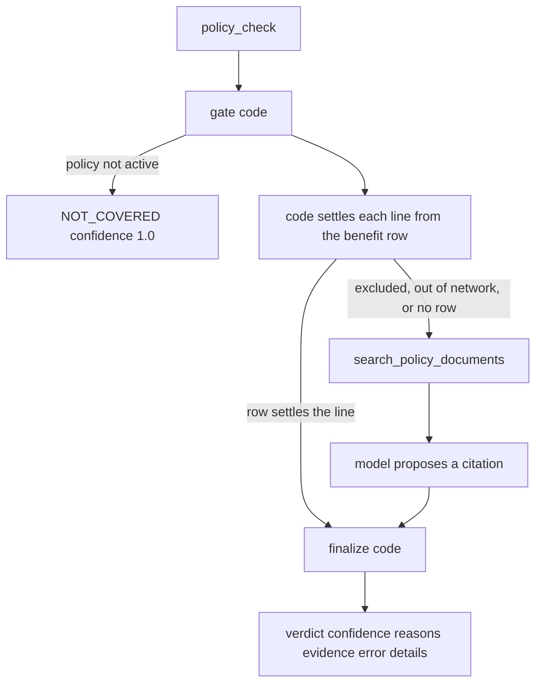

# Phase 10 — Policy compliance agent

Done when: a covered line and a not-covered line each get the verdict the seed plan says they should.

Out of scope: fraud (phase 11), medical necessity (phase 12), reviewer screens (phase 13), line-level `claim_line.line_status` and partial denials (design open question 3), prior-auth lookup, payment, letters, and notifications. No new port, schema, or SQL file. Fraud and medical necessity stay stand-ins.

## Behavior

`plan_benefit`, `claim_line.prior_auth_number`, and `adjudication.payer_doc_chunk` already exist. Seed rows in [`db/seed.py`](db/seed.py) match the policy design. [`GET /reference/plan-benefits/{plan_code}/{cpt_code}`](src/backend/payer_service/app/api.py) already returns one row or 404 and writes `claims.audit_event`. [`search_policy_documents`](src/backend/adjudicator/tools/documents.py) already filters `doc_type = 'eoc'` and `plan_code`.

The agent lives in the adjudicator process (47113), as a subgraph invoked by [`policy_check`](src/backend/adjudicator/nodes/run.py). It does not import the payer repository. It reads the claim already loaded in graph state (`reference_snapshot`, `service_from`, `service_to`, lines, diagnosis codes). A new HTTP helper on [`tools/payer.py`](src/backend/adjudicator/tools/payer.py) calls the benefit endpoint with actor `adjudicator:policy_compliance` and the run correlation id. A 404 becomes `found: false`, not an error.

**Gate (code).** Same date rule as payer `_covers`: snapshot policy `status` is active and the dates span `service_from` through `service_to`. Inactive returns `NOT_COVERED` at confidence 1.0 and does not call the model. Network status is the snapshot provider’s `in` or `out`.

**What code settles without the model.** A benefit row with `is_covered`, in-network, and no prior auth is `covered` at confidence 1.0. The same row with `requires_prior_auth` and a `prior_auth_number` is `covered`. The same row with no number is `needs_info` (`PRIOR_AUTH_REQUIRED`), still confidence 1.0, so the existing join sends `PENDING_INFO` rather than review. Evidence for these lines is `plan_benefit {plan}/{cpt}` and the row’s `policy_section`.

**What the model may propose.** Only lines the row does not settle: `is_covered` false, out of network, or no row. Code calls `search_policy_documents` for that plan and section. The model, `POLICY_MODEL` defaulting to `gpt-4o-mini` at temperature 0, returns a structured proposal (`status`, `reason_code`, `section`, `explanation`) via `with_structured_output`. Claim text and passages are data in the prompt. The model does not choose the stored verdict. Langfuse runs only when the three `LANGFUSE_*` variables are set, through a new [`adjudicator/LLMS/tracing.py`](src/backend/adjudicator/LLMS/tracing.py). A trace is not an audit row.

**Finalize (code) keeps or drops the proposal.**

- A line code already settled keeps that status. A citation is kept only when it equals the row’s `policy_section`.
- A proposal that differs from the row is kept only when its section was in this search result. Otherwise retry the model once, then set `error`. `error` is not a denial. The existing join sends it to human review.
- Every `not_covered` line needs evidence. Missing evidence retries once, then `error`.
- Confidence is computed: 1.0 from the row alone, 0.8 when a retrieved passage is accepted, 0.5 when nothing settles the line (`BENEFIT_UNDETERMINED`).
- Roll-up: any `needs_info` becomes claim `NEEDS_INFO`; else every line `not_covered` becomes `NOT_COVERED`; else `COVERED`. Claim confidence is the lowest line. `details` carries `plan_code`, `network_status`, `covered_lines`, `lines`, and `missing_info`. `NEEDS_INFO` also sets `details.issues` (`field_path`, `issue_code`, `message`) so [`issues_of`](src/backend/adjudicator/nodes/routing.py) keeps working. Routing is unchanged.

Shared result fields stay `verdict`, `confidence`, `reasons`, `evidence`, `error`, plus `details`. [`policy_check`](src/backend/adjudicator/nodes/run.py) records `AGENT_RESULT` from that object. A phase 9 `set_stand_in` for `policy_compliance` still wins, so the routing tests stay scripted. With no script, the real agent runs. Tests that today rely on the default covered stand-in (`test_covered_clear_necessary_pauses_then_approves`, `test_not_necessary_waits_for_the_reviewer`, `test_flagged_claim_waits_for_investigation`, `test_redelivery_does_not_start_a_second_run`) get an explicit covered script.

Seed verdicts used as the proof: `SILVER-PPO-01` / `99213` / in-network is `COVERED`. `BRONZE-HMO-01` / `43644` / in-network is `NOT_COVERED` (`EXCLUDED_SERVICE`, section `§5.3`).

## Test from the UI

No new screen. Staff already see the policy verdict on the claim status page: [`ClaimStages`](src/frontend/src/components/ClaimStages.tsx) labels the `policy_compliance` `AGENT_RESULT` as **Policy check**. A provider login does not show that step. The form has two lines and no way to delete one, so both CPTs have to match the case. Do not submit **Clean example** as-is: line 2 is `83036`, which has no benefit row.

Postgres, RabbitMQ, portal (47110), payer (47111), adjudicator (47113), and Vite (47117) are running. Sign in at Vite as `ops@example.test` / `sentinel`, open **Knowledge**, and click **Index seed documents** once so the not-covered claim can retrieve `§5.3`. The adjudicator process has `OPENAI_API_KEY`. The covered claim does not call the model. The not-covered claim does, because an exclusion can have an exception.

1. Sign in as `provider@example.test` / `sentinel`. Open **Submit**.
2. Covered claim. Keep Jane Doe (`MBR-100231`, group `GRP-7781`, billing NPI `1234567893`, dates `2026-10-20`). Set line 1 CPT to `99213` and line 2 CPT to `99214`. Leave prior auth empty. Amounts stay `185.00` and `45.00`, total `230.00`. Submit. Wait until the chip says **Validated**. Copy the submission id.
3. Sign in as `ops@example.test` / `sentinel`. Open **Look up**, paste that id, and click **Start adjudication**. The page polls. When it settles: **Policy check** says `COVERED`, **Fraud check** says `CLEAR`, **Medical necessity** says `NECESSARY`, the chip says **In review**, and history reaches `PENDING_REVIEW`. It does not say **Denied**.
4. Sign back in as the provider. Submit a second claim for Sam Rivera: member `MBR-200001`, first `Sam`, last `Rivera`, date of birth `1979-07-22`, group `GRP-2201`. Keep the same in-network billing NPI and dates. Set line 1 CPT to `43644` and line 2 CPT to `97810`. Both are excluded on `BRONZE-HMO-01`. Diagnosis `E11.9`, pointers `1`. Same amounts and total. Wait for **Validated**.
5. As ops, look up that submission and start adjudication. When it settles: **Policy check** says `NOT_COVERED`, **Medical necessity** says `Skipped`, the chip says **Denied**, **In review** is skipped, and the history row into `DENIED` shows the policy reason. If the model is down or cites a section the search did not return, the chip says **In review** and the claim is not **Denied**.

## Checks

Pytest in `src/backend/tests/test_policy_compliance.py`. The model and the document search are stubbed. Then walk the two claims above. A screenshot of the status page is not the check. The policy step must read `COVERED` on the first claim and `NOT_COVERED` on the second.

- Silver `99213`, in-network, no prior auth: `COVERED`, confidence 1.0, evidence `SILVER-PPO-01/99213`. The model is not called.
- Bronze `43644`, in-network, search returns `§5.3`: `NOT_COVERED`, confidence 1.0 when the proposal cites `§5.3`. A proposal that cites a section the search did not return retries once, then `error`, and the graph does not request `DENIED` from that error.
- Inactive snapshot policy: `NOT_COVERED`, confidence 1.0, model not called.
- `72148` with no `prior_auth_number`: claim `NEEDS_INFO` and `details.issues` points at `lines[n].prior_auth_number`.
- Phase 9 routing tests still pass with scripted policy results.
