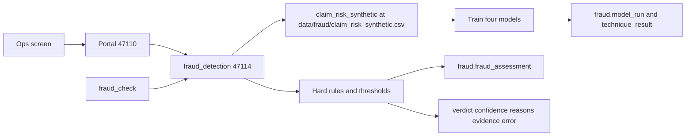

# Phase 11 — Fraud detection model

Done when: a clean claim is clear and a planted suspicious claim is flagged, and the graph routes each one correctly.

Out of scope: medical necessity (phase 12), reviewer and investigator screens (phase 13), payment, letters, and notifications. Also deferred from [docs/fraud-detection-agent-design.md](docs/fraud-detection-agent-design.md): the Kaggle provider model, nightly peer-stat jobs, SHAP, the LLM narrator, Optuna, and referral memos. A flag is still not a denial. The existing review assistant stays as it is.

The fraud design left retraining as a manual step. This phase adds the 15-day refresh and the Ops screen you asked for. The score and the hard rules still set the verdict. No model output is stored as a status until that code runs.

## Behavior

Use the Phase 1 package [src/backend/fraud_detection/](src/backend/fraud_detection/). It already has empty `app.py`, `graph/`, `nodes/`, `state/`, `tools/`, and `LLMS/`, the same layout as `policy_compliance`. This phase fills those files. `app.py` becomes the process on port **47114** (`python -m fraud_detection.app`). That process is the only writer of `fraud.model_run`, `fraud.technique_result`, and new `fraud.fraud_assessment` rows. It does not write `claims.*`. The browser still talks only to the portal (47110). The adjudicator (47113) calls this process over HTTP and does not import its repository. Policy stayed in-process because it writes no schema. A scripted fraud stand-in still wins, so the phase 9 routing tests stay scripted.

Schema change is a new [db/sql/007_fraud_model.sql](db/sql/007_fraud_model.sql) (`CREATE TABLE IF NOT EXISTS`, no drops):

- `fraud.model_run`: when it trained, row count, fraud count, active technique, version, thresholds, status
- `fraud.technique_result`: one row per technique with threshold, tp, tn, fp, fn, precision, recall, f1, and whether code selected it

**Dataset.** The training file is `claim_risk_synthetic`, written to [data/fraud/claim_risk_synthetic.csv](data/fraud/claim_risk_synthetic.csv) each time a run starts. One shared `build_features` in `fraud_detection` builds those rows and the live claim vector, so train and score cannot drift. A fixed seed writes about 2,000 rows, about 4% labeled fraud, with a little label noise. Schemes the features can actually show: upcoding (level-5 visit billed far above the typical amount), excessive units, unbundling pair, and near-duplicate count. Clean rows sit near a normal 99213. The split is grouped by synthetic provider. Typical amounts live in that feature code.

**Techniques, all trained every run.** Logistic regression (baseline), random forest, XGBoost, and a soft-voting ensemble of those three. For each one, code picks the threshold that maximizes F1 on the held-out providers and records the confusion matrix at that threshold: tp, tn, fp, fn, precision, recall, f1. Code activates the highest F1. Ties go to the ensemble, then XGBoost, then random forest. The joblib and thresholds are written under `models/fraud/<version>/` and are not committed. A failed run keeps the previous active model.

**Refresh.** On startup, if there is no successful model, train once. A loop in `fraud_detection/app.py` checks every 24 hours and trains again when the active run is 15 days old or older. A platform lead can also press **Train now**. Tests check the 15-day predicate; they do not wait 15 days.

**Ops screen.** New route `/ops/fraud-model`, ops role only, next to Knowledge in [src/frontend/src/App.tsx](src/frontend/src/App.tsx) and the home cards. The portal proxies `GET /ops/fraud-model` and `POST /ops/fraud-model/train` to `fraud_detection` on 47114. The page shows the last trained time, the next refresh date, and every technique’s precision, recall, F1, tp, tn, fp, fn, and a 2×2 confusion matrix, with the active technique marked.

**Who may train.** The role people see is **Platform lead**. The sign-in key stays `ops`, and the roles stay `provider`, `member`, `reviewer`, `investigator`, and `ops`. No admin role and no separate tech role. Email stays `ops@example.test`. The label changes in three places: the login card in [LoginPage.tsx](src/frontend/src/pages/login/LoginPage.tsx), a `roleLabel` used by the header, the profile, and [HomePage.tsx](src/frontend/src/pages/home/HomePage.tsx), and the `OPS-01` display name in [db/seed.py](db/seed.py), which already updates `display_name` on conflict. API checks keep using `ops`. **Train now** refreshes the model. It does not flag a claim and it does not deny one. Reviewers and investigators still own the claim decision.

**What the agent does.** [fraud_check](src/backend/adjudicator/nodes/run.py) posts the claim already in graph state to `fraud_detection` `POST /score`. That service applies hard rules first (excluded provider, service after coverage end, more than 24 hours of units in one day). A rule hit is `FLAGGED` at confidence 1.0 and the model still scores it. Otherwise the active model’s probability is banded: at or above `t_high` is `FLAGGED`, below `t_low` is `CLEAR`, and the middle is the gray band at confidence 0.6 so the existing join sends it to human review. Reasons come from the fired rule or a filled feature template (`narrative_source = "template"`). There is no LLM on this path. The service inserts `fraud.fraud_assessment`. The envelope fields the graph already routes on stay `verdict`, `confidence`, `reasons`, `evidence`, `error`, plus `details` (`risk_score`, `band`, `model_version`, `technique`, `rule_hits`). If the service is down or no model exists, `error` is set and the claim is not cleared.

Graph tests that are not about this agent get an explicit fraud `CLEAR` script, the same way phase 10 scripted policy.

## Test from the UI

Postgres, RabbitMQ, portal, payer, adjudicator, `fraud_detection` (47114), and Vite are running. Sign in as `ops@example.test` / `sentinel`. Open **Fraud model**. If the startup train has finished, four techniques are listed with a confusion matrix each and one is marked active. **Train now** runs again and replaces those numbers.

Then the two claims, same sign-in path as phase 10. Fraud check is the step that must change. Policy and medical necessity stay as they are today.

1. As `provider@example.test`, submit Jane Doe (`MBR-100231`, group `GRP-7781`, billing NPI `1234567893`, dates `2026-10-20`) with both lines at ordinary 99213 amounts and 1 unit. Wait until **Validated**.
2. As ops, look the submission up and start adjudication. **Fraud check** says `CLEAR`. The claim is not sent to investigation and is not denied for fraud.
3. Submit a second Jane Doe claim with CPT `99215`, units above the typical visit, and a billed amount far above the typical level-5 amount. It must not be an excluded NPI and must not exceed 24 hours, so a hard rule is not what flags it.
4. As ops, start adjudication. **Fraud check** says `FLAGGED`. The claim waits for investigation. It is not auto-denied.

## Checks

Pytest in `src/backend/tests/test_fraud_model.py`, with the model fit in-process on the fixed seed. No screenshot is the check.

- All four techniques have tp, tn, fp, fn, precision, recall, and f1. The selected technique is the best F1.
- The ordinary 99213 vector is `CLEAR` with confidence at least 0.7. The planted 99215 vector is `FLAGGED` with confidence at least 0.7. An excluded NPI is `FLAGGED` at confidence 1.0.
- A missing model or a down service returns `error` and does not return `CLEAR`.
- The refresh predicate is false at 14 days and true at 15.
- With the fraud HTTP call stubbed, `FLAGGED` pauses for investigation and `CLEAR` with a covered policy script continues to medical necessity. Existing routing tests still pass with a scripted fraud result.
