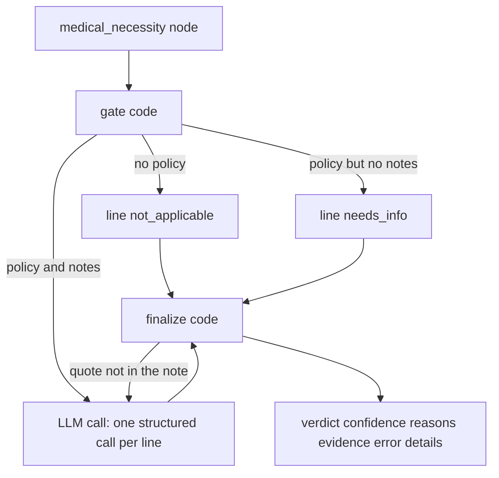

# Phase 12 — Medical necessity agent

Done when: a necessary and an unnecessary planted case each reach human review with the matching recommendation, and a failure does not auto-deny.

Out of scope: reviewer pickup, the 30-minute lease, and the decision callback (phase 13), the golden path (phase 14), payment, letters, and notifications. No new port, schema, or SQL file. Policy and fraud stay as they are. A scripted medical-necessity stand-in still wins, so the phase 9 routing tests stay scripted.

## Behavior

The graph already routes a covered, clear claim into [`medical_necessity`](src/backend/adjudicator/nodes/run.py), sends `NECESSARY` and `NOT_NECESSARY` to human review, sends `NEEDS_INFO` back as `PENDING_INFO`, and sends `error` or confidence under 0.7 to review. [`recommendation`](src/backend/adjudicator/nodes/routing.py) already maps `NECESSARY` to approve and `NOT_NECESSARY` to deny. [`GET /claims/{claim_id}/medical-records`](src/backend/payer_service/app/api.py) already returns the PDF text and writes `claims.audit_event`. [`get_medical_policy`](src/backend/adjudicator/tools/documents.py) already loads `doc_type = 'medical_policy'` by CPT, in section order, with no similarity search. Seed policies are [data/medical_policies/MP-001.md](data/medical_policies/MP-001.md), `MP-002.md`, and `MP-003.md`. The index strips the front matter, so `logic` is not in `payer_doc_chunk`.

The agent is a package next to policy compliance, `src/backend/medical_necessity/` (`graph/`, `nodes/`, `state/`, `LLMS/`). It runs inside the adjudicator (47113). It does not import the payer repository and it writes no schema. The payer service remains the only writer of `claims.*`.

The LLM call is the only model step. Gate and finalize are code. A line with no policy, or a policy and no notes, skips the call. A quote that is not in the cited note sends that line back for one more call, then `error`.

**Gate (code).** Keep only line numbers in `policy_result.details.covered_lines`. For each of those, call `get_medical_policy`. No rows means `not_applicable` and no model call. Read `logic` from the front matter of `data/medical_policies/<doc_id>.md` with the parser already in [`adjudicator/index.py`](src/backend/adjudicator/index.py) (`any_of(...)` or `all_of(...)`). If any covered line has a policy, call a new `get_medical_records` on [`adjudicator/tools/payer.py`](src/backend/adjudicator/tools/payer.py) once, actor `adjudicator:medical_necessity`. A policy with no records is `needs_info` and no model call. A payer outage or unreadable `logic` sets `error`.

**What the model may propose.** One structured call per line that has a policy and notes. `MEDICAL_MODEL` defaults to `gpt-4o-mini` at temperature 0. Output is one finding per criterion: `criterion_id`, `status` (`met`, `not_met`, `not_documented`), `quote`, `document_id`. The prompt says the policy and the notes are data, quote the note exactly, and use `not_documented` when the notes are silent. Langfuse uses the same pattern as [`policy_compliance/LLMS/tracing.py`](src/backend/policy_compliance/LLMS/tracing.py), tagged for this agent, and only when the three `LANGFUSE_*` variables are set. A trace is not an audit row.

**Finalize (code) keeps or drops the proposal.** The model does not choose the line status.

- A `met` or `not_met` quote must occur in the cited note after case and whitespace are collapsed. A miss retries that line once, then `error`. `error` is not a denial.
- `any_of`: one verified `met` is `meets`; every criterion `not_met` is `does_not_meet`; anything still `not_documented` is `needs_info`. `all_of`: every criterion `met` is `meets`; any `not_met` is `does_not_meet`; otherwise `needs_info`.
- `does_not_meet` carries CARC `CO-50`.
- Roll-up: any `needs_info` becomes `NEEDS_INFO`; else any `does_not_meet` becomes `NOT_NECESSARY`; else `NECESSARY`. `not_applicable` is confidence 1.0. Verified quotes are 0.8. Claim confidence is the lowest line. `NEEDS_INFO` sets `details.issues` (`field_path`, `issue_code`, `message`) from `missing_info` so [`issues_of`](src/backend/adjudicator/nodes/routing.py) still posts `PENDING_INFO`.
- Provider flag: `quality_rating` of 2 or lower on `reference_snapshot.provider` adds `details.review_flags`, for example `Low-quality provider: rating 2/5, Rochester, MN.` The seeded low-quality row is `PRV-0101` (`1678901236`). The flag does not change the verdict.

Shared fields stay `verdict`, `confidence`, `reasons`, `evidence`, `error`, plus `details` (`lines`, `missing_info`, `review_flags`). [`medical_necessity`](src/backend/adjudicator/nodes/run.py) records `AGENT_RESULT` from that object. Graph tests that are not about this agent get an explicit `NECESSARY` script: `test_covered_clear_necessary_pauses_then_approves`, `test_scored_clear_continues_to_medical_necessity`, and `test_redelivery_does_not_start_a_second_run`.

The existing case page already shows the medical verdict and the recommendation. Show `review_flags` on that same summary in [`CasePage.tsx`](src/frontend/src/pages/review/CasePage.tsx). No new queue behavior.

`72148` on `SILVER-PPO-01` requires prior auth. Without a prior-auth number, policy returns `NEEDS_INFO` and this agent never runs. The submit form has two lines: line 2 is `99213`, which is covered and has no medical policy, so it stays `not_applicable` and does not change the roll-up.

## Test from the UI

Postgres, RabbitMQ, portal, payer, adjudicator, fraud detection (47114), and Vite are running. The adjudicator has `OPENAI_API_KEY`. As ops, open **Knowledge** and index the seed documents once so `72148` resolves to MP-001. Fraud must stay `CLEAR`; an ordinary amount and 1 unit is the path that reaches this agent. A fraud flag waits for investigation and skips medical necessity.

1. As `provider@example.test`, submit Jane Doe (`MBR-100231`, group `GRP-7781`, billing NPI `1234567893`, dates `2026-10-20`). Line 1 CPT `72148` with a prior-auth number. Line 2 CPT `99213`, no prior auth. Upload a one-page PDF whose text layer contains `8 weeks of PT and NSAIDs, pain unchanged`. Wait until **Validated**.
2. As ops, look the submission up and start adjudication. **Medical necessity** says `NECESSARY`. Open the review case. The recommendation is **Approve**. The claim is **In review**. It is not **Denied**.
3. Submit the same claim with a PDF whose text is `Back pain for 1 week. No neuro deficit.` Start adjudication. **Medical necessity** says `NOT_NECESSARY`. The recommendation is **Deny**. The claim stays **In review** until a person decides.

## Checks

Pytest in `src/backend/tests/test_medical_necessity.py`. The model and the medical-records call are stubbed. Then walk the two claims above. A screenshot is not the check. The review recommendation must be Approve on the first claim and Deny on the second, and neither claim is `DENIED` before a reviewer acts.

- `72148` notes with the 8-week PT sentence, quotes present: `NECESSARY`, confidence 0.8, human review, recommendation `approve`.
- `72148` notes `Back pain for 1 week. No neuro deficit.`: `NOT_NECESSARY`, the line carries `CO-50`, human review, recommendation `deny`, and the graph does not request `DENIED`.
- A quote that is not in the cited note retries once, then `error`, human review, and the graph does not request `DENIED`.
- `99213` has no policy: `NECESSARY`, confidence 1.0, model not called.
- A policy and no medical record: `NEEDS_INFO`, model not called, transition is `PENDING_INFO`.
- Provider rating 2 adds the Rochester flag and leaves the verdict unchanged.
- Phase 9 routing tests still pass with a scripted medical-necessity result.
