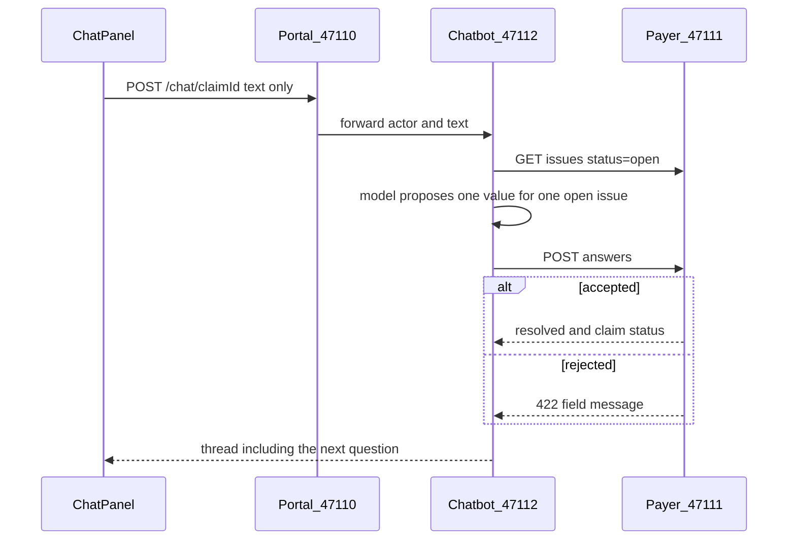

# Phase 7 — Missing-info chatbot

A `PENDING_INFO` claim, such as [`data/fixtures/pending.json`](data/fixtures/pending.json) (line 2 CPT `8303`), can be corrected in the portal chat and move to `VALIDATED`. The bot never writes `claims.*`. It only calls the APIs from [docs/payer-service-design.md](docs/payer-service-design.md) section 8.

The docked panel in [`ChatPanel.tsx`](src/frontend/src/pages/status/ChatPanel.tsx) and the portal routes in [`ui.py`](src/backend/portal/app/ui.py) already echo each issue message and post the raw text. That is not the bot: history disappears on reload, the browser picks `issue_id`, and [`_coerce`](src/backend/portal/app/ui.py) guesses the value. Those routes become a proxy. The empty package at [`src/backend/chatbot/`](src/backend/chatbot/) is filled in the same layout as the other agents (`graph`, `LLMS`, `nodes`, `state`, `tools`, `app.py`).

## Conversation log

Add a `chatbot` schema in [`db/sql/001_schema.sql`](db/sql/001_schema.sql) and the same statements in a new additive [`db/sql/004_chatbot.sql`](db/sql/004_chatbot.sql) so the running database is not rebuilt.

- `chatbot.conversation`: `claim_id` primary key, `submitter_id`, `conversation_id`, `respond_by`, `created_at`.
- `chatbot.message`: `message_id`, `claim_id`, `role` (`assistant` or `user`), `text`, optional `issue_id`, `created_at`.

`conversation_id` is `{submitter_id}:{claim_id}`. That still satisfies the payer check in [`answer_issue`](src/backend/payer_service/app/repository.py) (`conversation_id` must start with `submitter_id`). The chatbot service is the only writer of these two tables. No LangGraph checkpoint tables; each user message is one graph run loaded from this log plus the open issues. Checkpoints stay for the adjudicator in phase 9.

## Queue hand-off

In [`infra/rabbitmq_topology.py`](infra/rabbitmq_topology.py), declare quorum queue `chatbot.info_requested` bound to `claims.events` with routing key `claim.info_requested`, with the same dead-letter shape as the payer queue. The chatbot process consumes it, and on first sight of a claim writes the opening question. A repeat delivery does not add a second opening. Ack after that insert. Email links and `respond_by` reminders stay out; there is no notification channel yet.

## Graph

One run per claimant message. State holds the claim id, submitter id, conversation id, prior turns, open issues, the new user text, and the reply to show.

Nodes:

- **load** — `GET /claims/{id}/issues?status=open` and the message rows. The current issue is the oldest open one.
- **propose** — one structured model call. Output is `say` (plain language), `action` (`ask`, `submit`, or `clarify`), `issue_id`, and `value`. The system prompt treats claimant text as data, not instructions, and allows a value only for an open issue on this claim.
- **act** — code, not the model, decides the tool call. `submit` runs only when `issue_id` is in the open set. It calls `POST /claims/{id}/issues/{issue_id}/answers` with `value`, `conversation_id`, `claimant_text`, and `submitter_id`. A `422` is kept as the payer’s message and the issue stays open. Any other action, or an issue that is not open, does not call the payer.

Model: `langchain-openai` using `OPENAI_API_KEY` from `.env` (it is already set). Model name comes from `CHATBOT_MODEL`, default `gpt-4o-mini`. The service and the tests both call this model. There is no stand-in model. Add `langgraph`, `langchain-openai`, and `langfuse` to [`src/backend/requirements.txt`](src/backend/requirements.txt).

Tools in `chatbot/tools` are HTTP calls to the payer service only. They do not import the claims repository and they do not call the transitions API.

After a successful answer, the reply includes the next open issue’s question, or that the claim is now validated or rejected. A new issue from revalidation is asked the same way. The opening question on `claim.info_requested` uses the same propose step with no user text, so the issue message becomes a question (for the seed claim: line 2’s procedure code `8303` is not a valid CPT).

## Observability

Use Langfuse. [docs/consolidated-design.md](docs/consolidated-design.md) already says Langfuse traces are for debugging and are not the audit record. This is the first model call in the repo, so the callback is wired here and later agents reuse it.

- Pass Langfuse’s LangChain callback into each graph invoke. Trace the claim id and conversation id as metadata. Do not put the trace into `audit_event` or `claim_amendment`.
- Read `LANGFUSE_PUBLIC_KEY`, `LANGFUSE_SECRET_KEY`, and `LANGFUSE_BASE_URL` from this project’s `.env`. Those three are not in that file today. Add them locally and do not commit them. If they are missing, the turn still runs and no trace is sent.
- `LANGSMITH_TRACING` is already true in `.env`. Leave it. LangChain may also send a trace there. Langfuse is the trace this project keeps.

## Portal and panel

[`ui.py`](src/backend/portal/app/ui.py) `GET/POST /chat/{claim_id}` proxy to the chatbot on port **47112**, still limited to provider and member. The POST body is `{ "text": "..." }` only. Remove `_coerce` and the client-supplied `issue_id`. Document upload stays on the portal: it stores the PDF and calls `POST /claims/{id}/documents`, then asks the chatbot to append a note that the file is attached and does not by itself close an issue.

[`ChatPanel.tsx`](src/frontend/src/pages/status/ChatPanel.tsx) sends free text, renders the saved thread, and shows a payer rejection inside the thread. The status page already polls every 2 seconds and mounts the panel only while status is `PENDING_INFO`, so a move to `VALIDATED` closes the panel and the stepper shows queued for adjudication.

The browser never talks to port 47112. The Vite `/chat` proxy stays on the portal.

## Checks

Tests load `.env` and call OpenAI. They need the network.

- A sentence such as "the procedure code should be 83036" on the seed pending claim ends `VALIDATED`, with one `claim_amendment` whose source is `chatbot`.
- An answer that is not a procedure code stays `PENDING_INFO`. The assistant text asks again and includes the payer message when the model did submit a value and the payer returned `422`.
- Claimant text that tells the bot to approve the claim or skip validation leaves the issue open. The answers API is called only when the model proposed a value for the open CPT issue.
- The act node still refuses a proposal whose `issue_id` is not open. That check calls `act` with a proposal object. It does not replace the model.
