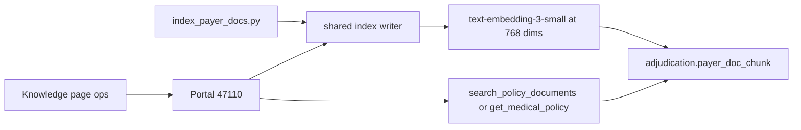

# Phase 8 — Document index (pgvector)

Done when: a query for a known policy section returns that section from Postgres.

Out of scope: the adjudicator graph (phase 9), the policy and medical-necessity agents (phases 10 and 12), payment, letters, and notifications. No new port and no adjudicator HTTP server. The browser still talks only to the portal (47110).

## Behavior

The column already exists in [`db/sql/001_schema.sql`](db/sql/001_schema.sql): `adjudication.payer_doc_chunk.embedding vector(768)`. No new SQL file. The corpus is a few dozen sections, so there is no ANN index.

Source text comes from [policy-compliance-agent-design.md](docs/policy-compliance-agent-design.md) appendices A and B and [medical-necessity-agent-design.md](docs/medical-necessity-agent-design.md) section 8. Copy it into:

- `data/plan_documents/SILVER-PPO-01.md` and `data/plan_documents/BRONZE-HMO-01.md` (`doc_type = eoc`, `doc_id` and `plan_code` are the plan code, `cpt_codes` null)
- `data/medical_policies/MP-001.md` (CPT `72148`), `MP-002.md` (`43644`), `MP-003.md` (`97110`)

One markdown heading per numbered section (`§5.2`, `MP-001.1`). The decision logic (`any_of` / `all_of`) stays in the policy file’s front matter for phase 12. It is not a chunk and not a new column.

[`scripts/index_payer_docs.py`](scripts/index_payer_docs.py) and the Knowledge page share one writer. It uses `DATABASE_URL` (the owner URL in [`src/backend/db_url.py`](src/backend/db_url.py)), not `payer_app`, and it does not write `claims.*`. For each document it deletes that `doc_type` + `doc_id` and inserts the new chunks in one transaction. A second run does not duplicate sections. The existing audit insert on [`POST /ops/documents`](src/backend/portal/app/ui.py) stays. The seed reindex does not add another `claims` write.

The embedding model only proposes a vector. `OpenAIEmbeddings` with `EMBEDDING_MODEL` (default `text-embedding-3-small`) and `dimensions=768`, using `OPENAI_API_KEY`. Code stores that vector on the row. The same model embeds the query. A failed embedding call returns 503 and does not insert a row with a null vector. Add the `pgvector` package so the vector can be bound.

Search functions live in [`src/backend/adjudicator/tools/documents.py`](src/backend/adjudicator/tools/documents.py), with `db.py` on the owner URL (same shape as [`chatbot/db.py`](src/backend/chatbot/db.py)). No graph and no adjudicator server. The portal routes call these functions. Today [`GET /ops/chunks`](src/backend/portal/app/ui.py) matches with `ILIKE`, and [`POST /ops/documents`](src/backend/portal/app/ui.py) stores text only. Both switch to the shared functions.

- `search_policy_documents(plan_code, query)` — `doc_type = 'eoc'` and `plan_code`, cosine distance (`<=>`), limit 3. Returns `section`, `heading`, `text`, `doc_id`, and `embedded` (true when the vector is stored).
- `get_medical_policy(cpt_code)` — `doc_type = 'medical_policy'` and `:cpt = ANY(cpt_codes)`, ordered by `section`. No similarity search. Unknown CPT returns an empty list.

## Run embeddings from the UI

Sign in at the Vite app (47117) as `ops@example.test` / `sentinel`. Open **Knowledge** (`/ops/knowledge`). Postgres must be up and `OPENAI_API_KEY` must be set. The portal process reads `.env`.

Two buttons on [`KnowledgePage.tsx`](src/frontend/src/pages/ops/KnowledgePage.tsx):

- **Index seed documents** calls `POST /ops/documents/reindex`. That runs the shared writer over the five files above. The success alert names the document count and the section count. This is the path for the known corpus. You do not paste those files.
- **Index document** stays for one markdown body (typed or chosen with the file input). It still posts `doc_type`, `doc_id`, `plan_code`, `cpt_codes`, and `text` to `POST /ops/documents`, and that route now embeds each section before insert. Evidence of coverage still requires a plan code. A medical policy still requires at least one CPT. The alert stays `Indexed N sections.`

Each result row shows the section and a short marker that an embedding was stored. The page does not render the 768 numbers.

## Test from the UI

Same sign-in. After **Index seed documents** succeeds:

1. Plan `SILVER-PPO-01`, Text `cosmetic exclusion for upper eyelid surgery when skin blocks the visual field`, leave CPT empty, **Search**. The first row is section `§5.2` and shows that it is embedded. This calls `search_policy_documents`.
2. Plan `BRONZE-HMO-01`, Text `bariatric surgery and surgical treatment of obesity are excluded`, **Search**. The first row is `§5.3`. Repeat the same text with plan `SILVER-PPO-01`. `§5.3` is not in those three rows. Silver has no bariatric exclusion.
3. Clear Text. CPT `72148`, **Search**. The list is `MP-001.1` then `MP-001.2`, and no Evidence of Coverage row. This calls `get_medical_policy`.
4. CPT `99213`, **Search**. The list is empty.
5. Click **Index seed documents** again. Search step 1 still returns one `§5.2` row, not two.

A text search with no plan code returns 422. The screen says a plan is required. CPT search does not need a plan.

## Checks

Pytest in `src/backend/tests/test_doc_index.py` loads `.env`, runs the indexer, and calls OpenAI. It needs the network and a running Postgres. It covers the same four cases as the UI steps: Silver `§5.2`, Bronze `§5.3` not returned for Silver, CPT `72148` versus `99213`, and a second index run leaving one row per Silver section.

Then walk the UI steps above in the browser. A screenshot of the Knowledge page is not the check. The search must return `§5.2` after indexing.
