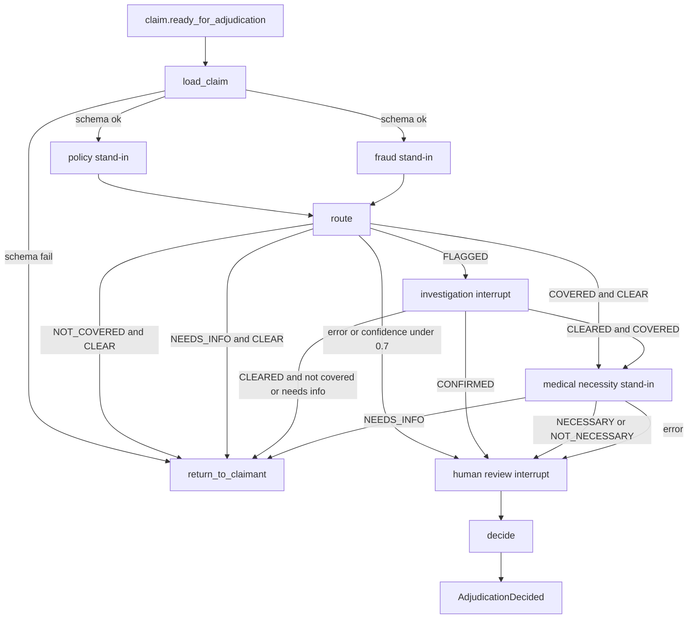

# Phase 9 — Adjudicator skeleton

Done when: a validated claim walks the graph with stand-in results and finishes in the status the routing table says it should.

Out of scope: the policy, fraud, and medical-necessity agents (phases 10–12), the reviewer and investigator screens and their pick-up lock (phase 13), payment, letters, and notifications. No model calls. The browser still talks only to the portal (47110).

The empty files [app.py](src/backend/adjudicator/app.py), [graph/graph_builder.py](src/backend/adjudicator/graph/graph_builder.py), and [state/state.py](src/backend/adjudicator/state/state.py) are filled in. Phase 8 search in [tools/documents.py](src/backend/adjudicator/tools/documents.py) stays unused by this graph.

## Behavior

A new FastAPI process, package `adjudicator`, listens on **47113**. Add that row to [.cursor/rules/backend.mdc](.cursor/rules/backend.mdc) and the port line in [.cursor/rules/project.mdc](.cursor/rules/project.mdc). `/health` uses `platform_status()`. The lifespan starts the consumer and a small outbox relay, and stops both on shutdown.

**Who writes what.** The payer service stays the only writer of `claims.*`. The adjudicator calls `GET /claims/{id}` and `POST /claims/{id}/transitions` through [tools/payer.py](src/backend/adjudicator/tools/payer.py) (httpx, actor headers, body `actor` starting with `adjudicator:run/{claim_id}:{attempt}`). It does not import the payer repository. It writes `adjudication.*` with the owner URL in [db.py](src/backend/adjudicator/db.py). Portal review routes in [ui.py](src/backend/portal/app/ui.py) are left as they are: a decision there still records a row and does not resume the graph. That resume wiring is phase 13.

**Start.** Staff **Start adjudication** already republishes `claim.ready_for_adjudication` (v1.1, with `adjudication_attempt`) from [repository.py](src/backend/payer_service/app/repository.py). [infra/rabbitmq_topology.py](infra/rabbitmq_topology.py) gains `adjudicator.ready`, bound to that routing key, plus the same retry and dead-letter queues the chatbot uses. Ack only after the run has a checkpoint. `thread_id` is `{claim_id}:{adjudication_attempt}`.

- No checkpoint: start the graph.
- Interrupted: ack. Callbacks resume it.
- Finished: ack.
- In progress after a crash: continue that same thread. Do not start a second run.

**Graph.** Postgres checkpointer (`langgraph-checkpoint-postgres`), `search_path=adjudication`, `setup()` once at startup. Library checkpoint tables are not hand-written SQL. State is a `TypedDict`: `claim`, `policy_result`, `fraud_result`, `investigation`, `med_result`, `summary`, `decision`, `status`. Nodes: `load_claim`, `policy_check`, `fraud_check`, `route`, `investigation`, `medical_necessity`, `human_review`, `decide`, `return_to_claimant`. `load_claim` fans out to both checks; `add_edge(["policy_check", "fraud_check"], "route")` waits for both (this LangGraph version supports that).

Stand-ins return the shared result and do not call a model: `verdict`, `confidence`, `reasons`, `evidence`, `error`, plus `details`. Tests register a script per claim id. With no script the result is policy `COVERED` 0.95, fraud `CLEAR` 0.95, medical necessity `NECESSARY` 0.95. `RetryPolicy(max_attempts=2)` sits on the three stand-in nodes. A result that still has `error` set, or confidence under 0.7, is routed to human review. Routing reads those shared fields only.

`load_claim` requests `VALIDATED → IN_ADJUDICATION`, then checks required fields, CPT and ICD-10 shape, and a positive amount. A failed check goes to `return_to_claimant` as `PENDING_INFO` with one issue. A failure is not a denial. Investigation leaves the claim `IN_ADJUDICATION` (consolidated design, item 1). Human review requests `IN_ADJUDICATION → PENDING_REVIEW` before it pauses.

`ROUTE_DENIALS_TO_REVIEW` defaults to false, so not-covered and fraud-clear requests `IN_ADJUDICATION → DENIED` and skips review. `NEEDS_INFO` requests `IN_ADJUDICATION → PENDING_INFO` and passes `details.issues` (`field_path`, `issue_code`, `message`). An empty issue list still sends one issue, so the claim is not denied and not left stuck. Idempotency key is `{claim_id}:{attempt}:{from}->{to}`.

Pauses call `interrupt()` after inserting `adjudication.review_tasks` (`REVIEW` or `INVESTIGATION`, status `OPEN`). The worker returns. Resume is `Command(resume=...)` on that thread:

- `POST /adjudications/{claim_id}/{attempt}/investigation-result` body `{outcome: CLEARED|CONFIRMED, notes}`
- `POST /adjudications/{claim_id}/{attempt}/review-decision` body `{decision: APPROVED|DENIED, allowed_amount, reviewer, notes}`

A second callback for a finished pause is ignored. `decide` requests `PENDING_REVIEW → APPROVED` or `DENIED` from the reviewer’s decision. The stand-in recommendation is stored on the summary; it is not the status.

**Events.** Each step inserts `adjudication.adjudication_event` (`RUN_STARTED`, `AGENT_RESULT`, `ROUTED`, `INVESTIGATION_REQUESTED`, `INVESTIGATION_RESULT`, `REVIEW_REQUESTED`, `REVIEW_DECIDED`, `DECIDED`, `RETURNED_TO_CLAIMANT`). A new [db/sql/006_adjudicator.sql](db/sql/006_adjudicator.sql), mirrored into [db/sql/001_schema.sql](db/sql/001_schema.sql), adds an append-only trigger on that table and `adjudication.outbox` (same shape as `claims.outbox`). `APPROVED` and `DENIED` insert one outbox row, message id `{claim_id}:{attempt}:AdjudicationDecided`, payload `event`, `claim_id`, `decision`, `allowed_amount`, `reasons`, `correlation_id`. The relay publishes it to `claims.events`. Nothing consumes it in this phase. `PENDING_INFO` does not emit it.

## Checks

Pytest in `src/backend/tests/test_adjudicator_graph.py`. The route table is pure. Graph cases use the Postgres checkpointer and a stub of the payer client that records transitions, so each case names the status requested:

- Covered, clear, necessary: pauses at review, transition `PENDING_REVIEW`, no `AdjudicationDecided`. Resume `APPROVED` requests `APPROVED` and writes one outbox row.
- Not necessary: same pause, summary recommendation deny. Resume `DENIED` requests `DENIED`. The graph does not deny before the resume.
- Policy `NEEDS_INFO`, fraud clear: `PENDING_INFO` with the scripted issues. No outbox decision.
- Not covered, fraud clear: `DENIED`, no review task, one `AdjudicationDecided`.
- Fraud flagged: stays `IN_ADJUDICATION`, investigation task. Resume `CONFIRMED` goes to review, not to `DENIED`.
- Confidence `0.6` or `error` set: review, no denial.
- Schema fail (amount not positive): `PENDING_INFO`, not `DENIED`.
- A second `claim.ready_for_adjudication` for the same attempt does not insert a second `RUN_STARTED`. Medical necessity does not run on the not-covered path or before investigation clears.

Then, with Postgres, RabbitMQ, and the payer on 47111: submit a clean claim, start adjudication from the claim page as staff. The status page moves to pending review and an open `REVIEW` task is listed. `curl` the review-decision callback on 47113, refresh the claim page, and the status is `APPROVED`. The portal **Decide** button still does not do that; phase 13 connects it.
