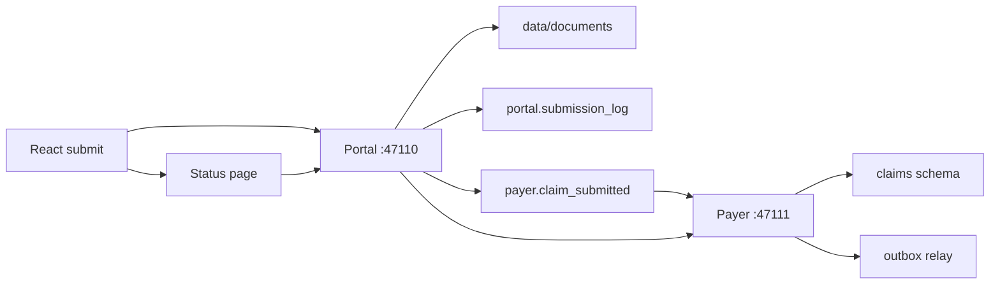

# Phases 3–6 — intake through the Block A check

Phases 1 and 2 are done: Postgres schemas in [`db/sql/001_schema.sql`](db/sql/001_schema.sql), RabbitMQ topology in [`infra/rabbitmq_topology.py`](infra/rabbitmq_topology.py), health apps on ports **47110** (portal), **47111** (payer), and **47117** (React). This plan adds behavior only. No chatbot UI, no LangGraph, no pgvector loads, no fraud-schema rows.

Building this is a large change, mostly the payer service. The phase 6 check is the stop point.

## Left out on purpose

- Chat panel (phase 7). Phase 6 corrects a claim by calling the issues API directly.
- Plan-document and medical-policy text, embeddings, and the fraud schema (phases 8–12). `plan_benefit` rows are reference data, so they are seeded now.
- Full CMS ICD-10 file. Phase 3 asks for a small world. Seed only the codes the fixtures and rule tests use, including one non-billable category (`E11`) so `INVALID_CODE` can fire.
- Live LLM extraction. The pipeline, cache, and ground-check are built. The extractor is a deterministic reader of a plain-text synthetic form, so Block A runs with no API key. A model can replace that reader later without changing validation.
- Hash chain (payer service design 12.6), `replaces_claim_id`, payment, and `PENDED` / `RETURNED`. A claim waiting on investigation stays `IN_ADJUDICATION`. `claim.ready_for_adjudication` is published as **v1.1** with `adjudication_attempt`, which fixes consolidated-design inconsistency 3 now.
- No consumer yet for `claim.ready_for_adjudication`, `claim.info_requested`, or `claim.rejected`. Confirm those in `claims.outbox` (`published_at` set). The exchange publish is enough; phase 9 adds the adjudicator queue.

## Phase 3 — seed data

Idempotent script [`db/seed.py`](db/seed.py), run with `DATABASE_URL` (the owner). Re-running does not wipe claims. One `audit_event` with `action = reference.load` records who loaded the file.

Reference rows:

- Members: Jane Doe `MBR-100231` (DOB 1984-03-12) on `SILVER-PPO-01` / `GRP-7781`, active and open-ended; one member on `BRONZE-HMO-01`; one member whose policy is already terminated; one member with two active policies so `POLICY_AMBIGUOUS` can be tested.
- Providers: Lakeside `PRV-0042` in-network (use an NPI that passes the Luhn check over `80840` + the first 9 digits — verify the design’s `1234567893` before inserting it); one out-of-network provider (intake must not reject this); one provider with `quality_rating` 2, plus `city` and `state`. No excluded-provider or fraud rows.
- `ref_cpt`: every CPT in the policy design seed, plus `93000` (in the code table, absent from `plan_benefit`) and `83036` (the portal example’s lab line).
- `ref_icd10`: `E11.9` and `I10` billable, `E11` not billable.
- `plan_benefit`: the exact `SILVER-PPO-01` and `BRONZE-HMO-01` rows from [`docs/policy-compliance-agent-design.md`](docs/policy-compliance-agent-design.md).

Three fixtures under `data/fixtures/`, not inserted as claims. The tester submits them in phase 6.

- `clean.json` — Jane, Lakeside, `99214` + `83036`, diagnoses `E11.9` and `I10`, amounts that sum, service date inside the last year. Expected: `VALIDATED`.
- `pending.json` — same claim with procedure code `8303`. Expected: `PENDING_INFO`, issue `INVALID_CODE`.
- `rejected.json` — same claim with `service_to` more than 365 days ago. Expected: `REJECTED`, issue `TIMELY_FILING`.

**Done when:** the reference tables have those rows and the three files are valid against the shared contract model.

## Phase 4 — payer portal

Shared Pydantic models in `src/backend/contracts/` (`ClaimSubmitted`, `ClaimDraft`, the three outbound events). Money is `Decimal` (JSON decimal strings). Dates are ISO. Both apps import this package.

Portal stays on `DATABASE_URL`. It owns `portal.submission_log` only. Widen CORS in [`src/backend/portal/app/main.py`](src/backend/portal/app/main.py) to `POST`. Point the Vite proxy at `/submissions` and `/partner` as well as `/health`.

Intake, shape only:

- `POST /submissions` accepts multipart JSON plus optional files. The portal generates `submission_id` (`SUB-YYYYMMDD-######`). A client-supplied id that already exists returns **409** and writes nothing.
- Reject bad JSON, missing required fields, a non-PDF upload, or a file over 10 MB. Do not check member, NPI, codes, or amounts.
- Save files under `DOCUMENT_ROOT/{submission_id}/`. The message carries `storage_uri` (a `file://` path) and `sha256`, never bytes.
- In one transaction: insert `submission_log` with `publish_status = pending` and `payload_sha256`. A publisher loop in the same process publishes `claim.submitted` to `claims.events` (persistent, AMQP `message_id`, `correlation_id = submission_id`) and sets `published_at`. A crash after the insert retries the row.
- `GET /submissions/{submission_id}/status` calls the payer service and returns that body. The portal does not store claim status.

Screens, replacing the health-only page in [`src/frontend/src/App.tsx`](src/frontend/src/App.tsx) with routes (keep a small health link):

- Submit: professional claim fields, optional PDF, shows the new `submission_id`.
- Status: polls the portal status endpoint and lists open issues in plain language.

After that path works, same message from two more channels:

- `POST /partner/submissions` with `channel = api`.
- A watcher on `data/inbox/`. A dropped PDF becomes `extraction_required: true`, `claim: null`, `channel = email`.

**Done when:** one React submit creates one log row and one `claim.submitted` message, and repeating the id returns 409.

## Phase 5 — payer service

One process on 47111: API, consumer, outbox relay, and sweeper as asyncio tasks. Connect as `payer_app` (`PAYER_APP_PASSWORD` is already applied by [`db/apply.sh`](db/apply.sh)) so the append-only grants are real. If the foreign key to `portal.submission_log` rejects the insert, add `GRANT SELECT ON portal.submission_log TO payer_app` in a small follow-up SQL file. Log `message_id`, `submission_id`, `claim_id`, and `correlation_id` only — never the claim body.

Consumer (manual ack, prefetch 1), matching the handler in [`docs/payer-service-design.md`](docs/payer-service-design.md) section 4:

- Permanent (bad JSON, bad schema, unsupported major version, sha256 mismatch): publish to `claims.dlx` with `x-error-class`, `x-error`, `x-attempts`, `x-failed-at`, write `intake_error`, ack.
- Transient: republish to the 10s then 60s retry queue with `x-attempt`. After 3 attempts, dead-letter. Business-rule failures are not failures: write `PENDING_INFO` or `REJECTED` and ack.
- A second delivery of the same `submission_id` acks and does not create a second claim.

Pipeline, network and files before the transaction:

- Portal claim (`extraction_required: false`): keep the claim as the draft; store documents only.
- Document intake: verify sha256, reuse `document_extraction` on `(document_id, sha256, extractor_version)`, classify, read the PDF text layer with `pypdf`, fill `ClaimDraft` with page and quote evidence, normalise (ISO dates, `Decimal`, 10-digit NPI, dotted ICD-10, 5-character CPT). A field is confirmed only if the quote is in the text and the format check passes. Otherwise `UNCONFIRMED_FIELD`. Save the extraction in its own short transaction before the claim write.

Rules, all of them, from payer service design section 6. Skip a rule whose inputs are missing. Any `REJECT` wins over `MISSING_INFO`; flags (`GROUP_MISMATCH`, `POSSIBLE_DUPLICATE`) do not block. `transition()` is the only status writer: `UPDATE ... WHERE status = from_status`, then append history. Copy `reference_snapshot` into history `details`.

One transaction: claim (draft and immutable `source_message` always; relational columns and `claim_line` only when `VALIDATED`), documents, issues, history `NULL → RECEIVED → outcome`, and one outbox row. `respond_by` defaults to 14 days (`PENDING_INFO_DAYS`). `adjudication_attempt` starts at 1 and increments each time the claim reaches `VALIDATED` again.

HTTP API, each read writes `audit_event` first and fails the request if that insert fails:

- `GET /submissions/{submission_id}/status` — `PROCESSING`, `FAILED_PROCESSING`, or status + history + open issues.
- `GET /claims/{claim_id}` — claim, lines, diagnoses, `reference_snapshot`.
- `GET /claims/{claim_id}/issues`
- `POST /claims/{claim_id}/issues/{issue_id}/answers` — only an open issue, on that claim. Patch the draft, insert `claim_amendment`, resolve the issue, revalidate the whole draft in the same transaction. `200` or `422` with the rule message. When the last issue clears, emit a new ready event.
- `POST /claims/{claim_id}/documents` — attach a file already in the document store.
- `POST /claims/{claim_id}/transitions` — allowed pairs from the design, including `IN_ADJUDICATION → PENDING_INFO` with an `issues` array (orchestrator section 5.1). `200` if the idempotency key was already applied, `409` with the current status, `422` if the pair or `reason_code` is illegal.
- `GET /claims/{claim_id}/medical-records` — text of `medical_record` PDFs.
- `GET /reference/plan-benefits/{plan_code}` and `GET /reference/plan-benefits/{plan_code}/{cpt_code}` (`404` when missing).

Sweeper every 15 minutes (`SWEEPER_INTERVAL_SECONDS`): `PENDING_INFO` past `respond_by` becomes `REJECTED` / `INFO_TIMEOUT` through `transition()`. Scripts `dlq_inspect` and `dlq_replay --message-id --actor --reason`. Replay without `--reason` exits without publishing. Both write `audit_event`.

**Done when:** the three fixtures finish as validated, pending info, and rejected, and the status page shows that.

## Phase 6 — check Block A

No new features. Start RabbitMQ, both APIs, and the Vite app. Run `db/seed.py` if the reference rows are missing.

1. **Clean claim.** Submit `clean.json` from the React form, with one small PDF. The page shows a `submission_id`. `portal.submission_log` has one row, `pending` then `published`. `payer.claim_submitted` returns to 0. `claims.claim` is `VALIDATED` with lines, a document row whose sha256 matches the file, history `RECEIVED` then `VALIDATED`, and one outbox row `claim.ready_for_adjudication` with `adjudication_attempt = 1` and `published_at` set. The status page shows `VALIDATED`.
2. **Duplicate.** Submit the same `submission_id` again. Portal returns 409. Still one log row and one claim.
3. **Pending claim.** Submit `pending.json`. Status page shows `PENDING_INFO` and the plain-language CPT issue. `claim_line` has no rows. Outbox routing key is `claim.info_requested`.
4. **Answer.** `POST /claims/{id}/issues/{issue_id}/answers` with value `83036`. The issue is resolved, an amendment row exists, status becomes `VALIDATED`, lines are written, and exactly one new ready event is published (`adjudication_attempt = 2`). A second answer on the same issue returns 422.
5. **Rejected claim.** Submit `rejected.json`. Status is `REJECTED`, issue `TIMELY_FILING`, outbox key `claim.rejected`. No lines.
6. **Read audit.** The status and claim reads each have an `audit_event`. `claims.claim_audit_trail` for the pending claim lists intake, the issue, the amendment, and both status changes in time order.

Stop and review here before any agent work.

Automated tests in `src/backend/tests/` cover the design section 13 cases the click-through cannot:

- Redelivery of the same message creates one claim. A unique violation is acked.
- Malformed JSON is dead-lettered on the first attempt with `intake_error`. Three transient failures end in the DLQ; `dlq_replay` then succeeds; replay without `--reason` refuses.
- One test per validation rule, and `REJECT` beats `MISSING_INFO`.
- Extraction cache hit on retry, and a quote that is not in the text becomes `UNCONFIRMED_FIELD`.
- Answer and sweeper racing the same claim: one wins, the other gets 409. Use a `respond_by` already in the past so the test does not wait 14 days.
- `payer_app` cannot update `claim_status_history`; the trigger also blocks the owner. Editing a policy after validation does not change `reference_snapshot`.
- If the `audit_event` insert fails, the claim read fails.
