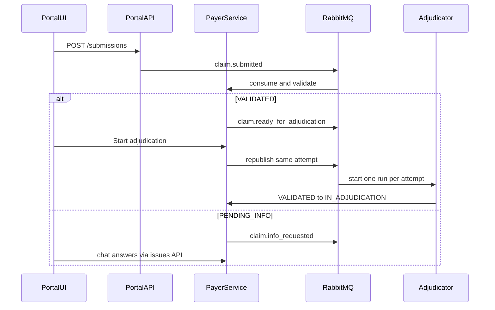

# ClaimsAI Sentinel frontend

One React app in [`src/frontend`](src/frontend), replacing the inline-styled shell in [`src/frontend/src/App.tsx`](src/frontend/src/App.tsx). Vite stays on port **47117**. Add `react-router` and Material UI. Keep the existing submit and status behavior; restyle it into the new shell.

Local learning build: no identity provider. A role switcher in the header sets `X-Actor-Id`, `X-Actor-Role`, and `X-Actor-Type`, which [`actor_from`](src/backend/payer_service/app/api.py) already reads for the audit log. Roles match the design: **provider**, **member**, **reviewer**, **investigator**, **ops**.

Payment, member letters, and notifications stay out. Those consume `AdjudicationDecided` in a later session.

## Styling

Material UI supplies the look and feel. CSS modules keep each screen's layout in its own file.

**Components.** `@mui/material` and `@mui/icons-material` for the controls: buttons, text fields, selects, chips, app bar, drawer, dialogs, tables, alerts, tabs, and lists. `CssBaseline` resets the page. `@fontsource/roboto` is the typeface. Do not rebuild those controls in raw HTML.

**Theme.** One `createTheme` in `src/frontend/src/theme.ts`, with `cssVariables: true` and two `colorSchemes`: `light` and `dark`. `ThemeProvider` in `main.tsx` applies it. Palette, type, radius, and density live there. Status colors (processing, pending, approved, denied, rejected) are palette entries in both schemes, used by `Chip`. Pages do not set their own hex colors.

The app bar has a light/dark control next to the role switcher, using Material UI `useColorScheme`. Until the user picks one, the scheme follows the system preference. The choice is stored in the browser and kept on the next visit. `CssBaseline` and MUI controls switch with the scheme.

CSS modules do not hard-code background or text colors. Where a layout needs a surface or border, it uses the theme CSS variables (`--mui-palette-background-default`, `--mui-palette-divider`, `--mui-palette-text-primary`) so the same module works in both schemes.

**Per-file layout.** Every `.tsx` file still has a sibling `*.module.css` for that file only:

- [`src/frontend/src/App.tsx`](src/frontend/src/App.tsx) imports `App.module.css`
- `pages/submit/SubmitPage.tsx` imports `SubmitPage.module.css`
- `components/StatusChip.tsx` imports `StatusChip.module.css`

The module holds layout for that page or form: page grid, section gaps, the chat dock, the queue split. A component does not import another component's module. Class names are `styles.form`, `styles.dock`, and so on, passed as `className` on a MUI component or a wrapper.

Do not use the `sx` prop or inline `style` objects for layout. MUI owns the control's appearance through the theme. The CSS module owns how that screen is arranged.

## How a claim moves, and who starts the agent

The browser does not call LangGraph. A staff **Start adjudication** button asks the payer service to publish `claim.ready_for_adjudication`. The payer service stays unaware of LangGraph and starts work by that outbox event.

That emit already exists in [`_emit`](src/backend/payer_service/app/repository.py): a `VALIDATED` outcome writes `claim.ready_for_adjudication` with `adjudication_attempt` in the same transaction as the claim. The relay publishes it. The adjudicator (Block B, not this UI) consumes it, then asks the payer service for `VALIDATED → IN_ADJUDICATION`.

**Start adjudication button.** On the claim page, when status is `VALIDATED`, reviewer, investigator, and ops see a Material UI button labeled **Start adjudication**. Provider and member do not. The click calls `POST /claims/{claim_id}/adjudication-start` on the payer service. That endpoint republishes `claim.ready_for_adjudication` for the current attempt. It does not increment the attempt and it does not move the claim itself. The adjudicator still performs `VALIDATED → IN_ADJUDICATION`. A second click for the same attempt is safe: the run key is `claim_id:adjudication_attempt`. If the claim is not `VALIDATED`, the API returns 409 and the button stays disabled. The call writes an `audit_event` with the staff actor. The button hides once the status leaves `VALIDATED`.

## App shell

- Left nav changes with the role. Provider and member see Submit, My claims, and the open claim. Reviewer and investigator see the shared queue. Ops sees Knowledge, Intake failures, Audit, Reference data, and Health.
- Shared pieces: status chip, a stage stepper, money as a decimal string, monospace ids, empty and error states, a timeline component used by both the claimant status page and the ops audit page.
- Fraud scores, narratives, and "flagged" verdicts never appear on provider or member screens. The fraud assistant lives only inside a picked-up review or investigation case.

## Claimant screens (provider and member)

Rebuild [`SubmitPage.tsx`](src/frontend/src/pages/submit/SubmitPage.tsx) and [`StatusPage.tsx`](src/frontend/src/pages/status/StatusPage.tsx).

- **Submit.** CMS-1500 style form: member, group, billing and rendering NPI, dates, diagnoses, lines (CPT, units, amount, pointers, optional prior-auth number), running total, document drop (PDF, type and size checked by the portal). Keep the three seed presets (clean, fixable code, timely-filing reject). Member role sets `submitter_type` to `member`.
- **My claims.** List of this submitter's submissions, linking to status. Needs a small list endpoint on the portal; today only lookup-by-id exists.
- **Claim.** Polls `GET /submissions/{id}/status` (already proxied to the portal, which reads the payer service). Shows claim id, open issues in plain language, history, `respond_by` when pending, a stage stepper (below), and the **Start adjudication** button for staff when the claim is `VALIDATED`. Statuses the stepper reads: `PROCESSING`, `FAILED_PROCESSING`, `PENDING_INFO`, `REJECTED`, `VALIDATED`, `IN_ADJUDICATION`, `PENDING_REVIEW`, `APPROVED`, `DENIED`. Rejected means resubmit as a new claim. Denied means adjudicated and refused, with claimant-safe reasons only.
- **Missing-info chat** (phase 7). A docked panel on the claim page, open when status is `PENDING_INFO`. The bot reads open issues, asks in plain language, and posts answers. It never writes the claim. The panel calls a chat route that uses the payer APIs already built: `GET /claims/{id}/issues?status=open` and `POST /claims/{id}/issues/{issue_id}/answers`. A document the claimant attaches in chat is stored by the portal, then registered with `POST /claims/{id}/documents`. When the last issue resolves, the payer service revalidates and may emit `claim.ready_for_adjudication` again. The panel closes and the timeline moves to Queued for adjudication.

## Stage stepper

Every claim page shows progress with a Material UI `Stepper` (`ClaimStages.tsx` and `ClaimStages.module.css`). The current step is highlighted. Finished steps stay marked. A branch that did not run (for example medical necessity on a not-covered line) is shown as skipped, not as a failure.

What is on screen depends on the role, because fraud results are never sent to a provider or member.

**Provider and member** see the public path only:

- Submitted
- Validating
- Needs information, when the claim is or was `PENDING_INFO`
- Queued for adjudication (`VALIDATED`)
- Adjudication in progress (`IN_ADJUDICATION`) — one step, not a breakdown of policy, fraud, or medical necessity
- In review (`PENDING_REVIEW`) — waiting, then a reviewer has the claim, then decided. No reviewer name, notes, or recommendation
- Approved, denied, or rejected

**Reviewer, investigator, and ops** see the same spine plus the checks inside adjudication, filled from `adjudication_event` once that log exists:

- Policy check — running, covered, not covered, or needs info
- Fraud check — running, clear, or flagged
- Medical necessity — skipped, running, necessary, not necessary, or needs info
- Investigation — only if fraud is flagged: waiting, picked up, lease time left, cleared, or confirmed
- Human review — waiting in the queue, picked up (assignee and lease), or decided

Until the adjudicator writes those events, staff still see the public stepper. Sub-steps are not invented. A claim sitting in `IN_ADJUDICATION` reads as adjudication in progress, and a claim sitting in `VALIDATED` reads as queued, meaning the adjudicator has not picked the event up.

The case page uses the same stepper, and under the active human-review or investigation step it shows the live queue state (open, picked up, lease countdown).

## Reviewer and investigator (phase 13)

One queue, two task types (`REVIEW` and `INVESTIGATION`), sorted by `risk_score`. This is the screen the orchestrator doc left open.

- Queue lists `OPEN` tasks. Pick up is atomic (`OPEN → IN_REVIEW`). A second person gets a clear "already taken" state. A 30-minute lease countdown is shown; only the assignee sees the decision form.
- **Review case.** One combined summary: coverage (line verdicts, citations, benefit row), fraud score and narrative, medical-necessity criteria with quotes and the low-quality provider flag, recommendation, and risk. Decision: `APPROVED` or `DENIED`, allowed amount, notes. That posts the review callback, which resumes the graph. The payer service is what sets the claim to `APPROVED` or `DENIED`.
- **Investigation case.** Referral memo (headline, reasons, suggested checks). Outcome: `CLEARED` or `CONFIRMED`, plus notes. Confirmed goes to review with a deny recommendation. Cleared continues or returns to the claimant, per the join rules. The investigator does not approve payment.
- **Fraud assistant.** A second chat, visually separate from the claimant bot, on the case page only. `POST /fraud/assessments/{claim_id}/ask`. It can explain the score. It cannot clear or deny the claim; the decision form is the only way to decide. Questions and answers are logged.

These screens wait on adjudicator endpoints that do not exist yet (`GET /review-tasks`, claim, decision). The UI is built against that contract; the graph itself is a later phase.

## Ops console

Ops is the admin role from the design (`actor_role = ops`).

- **Knowledge.** Ingest the two document kinds that share `adjudication.payer_doc_chunk`:
  - Evidence of Coverage (`doc_type = eoc`): exclusions and exceptions, keyed by `plan_code` (`SILVER-PPO-01`, `BRONZE-HMO-01`). One chunk per numbered section.
  - Clinical guidelines (`doc_type = medical_policy`): medical policies such as `MP-001`, with the CPT codes they govern.
  - Upload a markdown file or paste text, then reindex. A chunk browser searches by plan or CPT and shows section, heading, and text, so an admin can confirm a known section comes back before agents use it. This is the UI over the indexer described in the policy and medical-necessity docs (`scripts/index_payer_docs.py`). The UI calls an ingest API; it does not embed documents in the browser.
- **Intake failures.** Rows from `intake_error` (`FAILED_PROCESSING` on the claimant side). Replay requires an actor and a reason, matching `dlq_replay`. Discard is the same.
- **Audit.** One timeline for a claim: status history, issues, amendments, extraction evidence, outbox events (including `claim.ready_for_adjudication`), and reads. This is the `claim_audit_trail` view.
- **Reference data.** Read-only members, policies, providers (network and quality rating), plan benefits, CPT and ICD-10. Useful when checking why a claim was rejected or why a line was not covered.
- **Health.** Move the current health page here: portal, Postgres, RabbitMQ.

## Build order

The shell and claimant screens can land now, on APIs that already exist. Chat, knowledge, and the workbench land as their backend phases do. Do not stub fake adjudication results in the UI.

1. App shell, role switcher, light and dark Material UI schemes, CSS modules, router. Restyle submit and claim status, including the Start adjudication button. Add My claims once the portal can list submissions for a submitter.
2. Missing-info chat panel wired to the existing issues and answers APIs, behind a thin chat route so the model never writes the claim.
3. Ops knowledge screen and chunk browser, plus the ingest API that fills `payer_doc_chunk`.
4. Review and investigation workbench, plus the fraud assistant panel, when review-task and fraud-ask endpoints exist.
5. Staff stepper fills in policy, fraud, medical necessity, investigation, and human-review progress from adjudication events. The claimant stepper stays on the public path and shows the final `APPROVED` or `DENIED` with no fraud wording.

## Left out of this UI

- Payment, letters, and notifications.
- Showing fraud scores, memos, or SHAP reasons to a provider or member.
- Editing reference data in the browser. Seed scripts remain the writer; ops only reads them.
