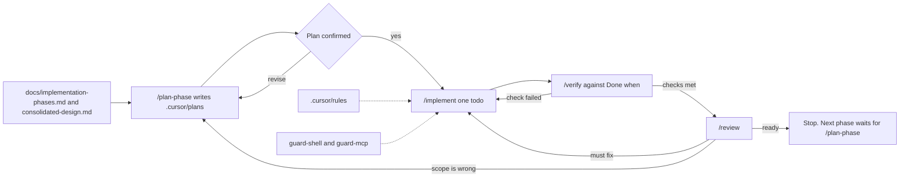

# ClaimsAI Sentinel

Local learning build. Design: `docs/consolidated-design.md`. Build order: `docs/implementation-phases.md`. Invariants that apply to every change are in `.cursor/rules/project.mdc`. File-scoped rules live next to it (`frontend`, `backend`, `api`, `database`, `agentic-ai`, `chatbot`).

## SDLC

One phase at a time. Do not start the next phase in `docs/implementation-phases.md` until its **Done when** is met.

| Step | Command | Skill | Agent |
|---|---|---|---|
| Plan, no code | `/plan-phase` | `.cursor/skills/plan-phase/SKILL.md` | `phase-planner` |
| Build the agreed plan | `/implement` | `.cursor/skills/implement-phase/SKILL.md` | — |
| Check **Done when** | `/verify` | `.cursor/skills/verify-phase/SKILL.md` | — |
| Gate the next phase | `/review` | `.cursor/skills/review-change/SKILL.md` | `phase-reviewer` |

Plans go in `.cursor/plans/`. `phase-planner` and `phase-reviewer` do not edit application code.

## Cost

`.cursor/skills/model-cost/SKILL.md` picks the model when a subagent is launched. `/usage` runs `.cursor/skills/model-cost/scripts/usage_report.py` for one person or the team. Spend comes from the Cursor Admin API, not from a guessed price list.

## Hooks

`.cursor/hooks.json` runs two checks before the agent acts. `guard-shell.sh` blocks schema drops, force push, `git reset --hard`, and `git clean -f`, and asks before a command reads or stages `.env`. `guard-mcp.sh` blocks writes through the Postgres MCP and asks before a Langfuse tool that can change project data.

## MCP

`.cursor/mcp.json` connects read-only Postgres, Langfuse, and Langfuse docs. Postgres MCP is not a writer of `claims.*`. Do not add a server for payment, mail, or a second database until that phase exists.
