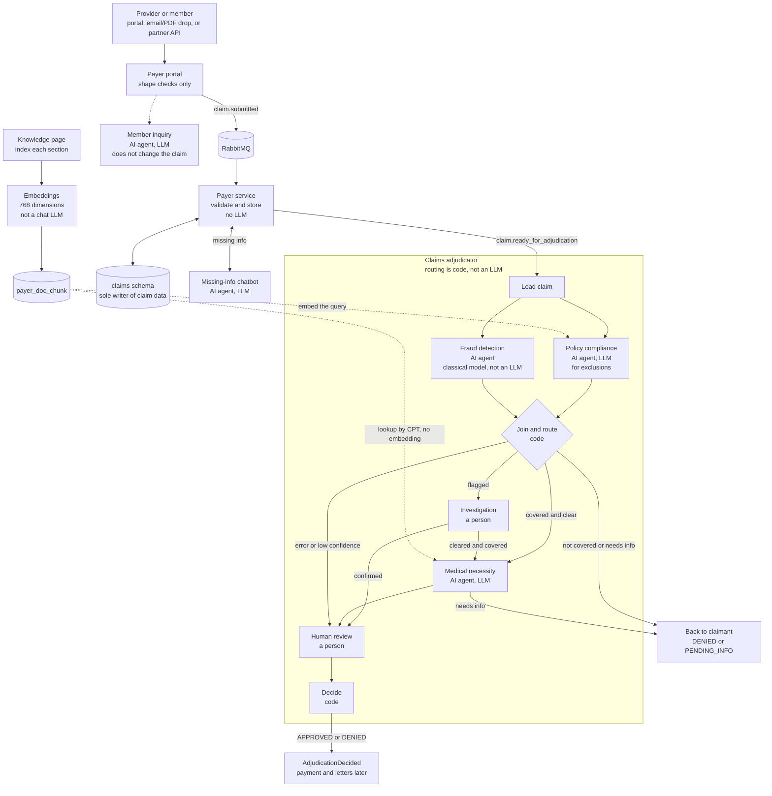
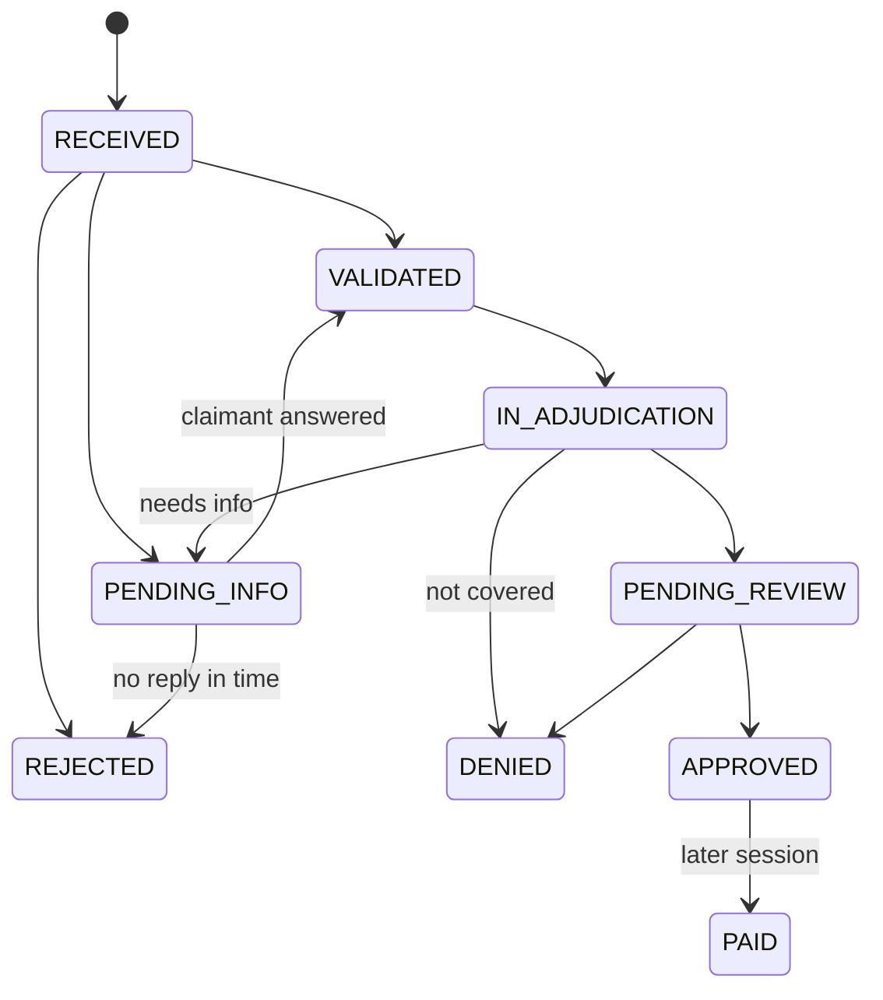
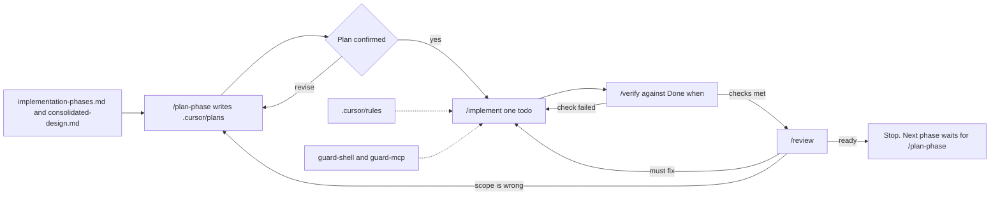

# ClaimsAI Sentinel

Local learning build for synthetic US professional claims (CPT, ICD-10, NPI). A claim can be submitted, checked, and adjudicated through **APPROVED** or **DENIED**. Payment, member letters, and notifications are out of scope. They would consume an `AdjudicationDecided` event in a later session.

All data is synthetic. The build is meant to be correct on one machine. It does not add scaling, an auth provider, or a second database.

Design: [`docs/consolidated-design.md`](docs/consolidated-design.md). Build order: [`docs/implementation-phases.md`](docs/implementation-phases.md). Component docs are listed at the end.

## How it fits together

The browser talks only to the portal. The payer service is the only writer of `claims.*`. An LLM output is not a status, a verdict, or a stored fact until deterministic code checks it. A failure never auto-denies or auto-clears a claim. Asking for information is never a denial.

| Service | Port | Schema it writes |
|---|---|---|
| Portal (FastAPI) | 47110 | `portal` |
| Payer service | 47111 | `claims` |
| Chatbot | 47112 | `chatbot` |
| Adjudicator | 47113 | `adjudication` |
| React portal (Vite) | 47117 | — |

Postgres is one local instance with pgvector. RabbitMQ carries claim events. Documents live in a local folder. Messages store a path and a `sha256`, never the file bytes. LangGraph checkpoints live in the same Postgres instance. Each service writes only its own schema. Fraud detection, when built, writes `fraud`.



The four AI agents are the missing-info chatbot, member inquiry, policy compliance, and medical necessity, plus fraud detection. The first four call a chat LLM. Fraud detection scores with a trained classical model, and its narrative is a template. The document index embeds text for storage and for policy search. It is not one of the agents, and the adjudicator graph does not call it as a step. Medical necessity reads the same table by procedure code.

Every status change, including a return to the claimant, is requested from the payer service. The adjudicator does not update `claims.claim.status` itself.

## A claim, step by step

### 1. Submit

A provider or member sends a professional claim through one of three channels. All three produce the same `claim.submitted` message.

- **Portal form.** The React app posts to the portal API. The browser never calls the payer service or the chatbot directly.
- **Folder drop.** A file placed in the inbox is picked up by the portal watcher and treated as the same kind of submission.
- **Partner API.** Another system posts a claim to the portal. The portal still only checks shape.

The portal checks the JSON shape, the file type, and the file size. It rejects a repeated `submission_id`. It stores uploaded files under `data/documents` and writes `portal.submission_log`. The queue message carries `storage_uri` and `sha256`. Publishing goes through an outbox so the log row and the message are not lost independently.

The portal does not decide whether the member, the policy, the codes, or the amounts are valid.

### 2. Validate

The payer service consumes `claim.submitted`. It acknowledges the message only after the database commit. Failures retry, then land on a dead-letter queue. Ops can inspect and replay those messages.

If the submission is a document, the service extracts a draft first. Each extracted field needs evidence that appears in the document. That extraction is stored as an append-only `document_extraction` row. If the portal already sent a structured claim, the service stores the documents and skips extraction.

Business rules then run in one transaction: member, active policy, valid CPT and ICD-10 codes, amounts, dates, and timely filing. The claim, lines, documents, issues, status history, and the outbox event are written together.

| Outcome | Status | What happens next |
|---|---|---|
| All checks pass | `VALIDATED` | `claim.ready_for_adjudication` (IDs only) |
| The claimant can fix it | `PENDING_INFO` | `claim.info_requested`, then the chatbot |
| It cannot be fixed | `REJECTED` | `claim.rejected`. The claim was never adjudicated and can be resubmitted |

`REJECTED` is an intake failure. `DENIED` is a later adjudication decision. They are not the same status.

A sweeper marks `PENDING_INFO` claims that pass their reply deadline (`PENDING_INFO_DAYS` in `.env`).

### 3. Missing information

The chatbot reads the open issues and asks in plain language. The claimant answers in the status chat. The bot posts the answer to the payer service. The payer service checks the answer, writes an append-only amendment, and revalidates. The bot never writes `claims.*`.

A good answer moves the claim to `VALIDATED` and emits `claim.ready_for_adjudication`. A bad answer stays `PENDING_INFO`. Asking is not a denial.

Members also have a separate inquiry chat. That conversation is not the missing-info thread on a claim. It is stored in the `chatbot` schema and does not change claim status by itself.

### 4. Start adjudication

The adjudicator consumes `claim.ready_for_adjudication`. One LangGraph run is one claim attempt. A repeat delivery of the same attempt does not start a second run. The adjudicator loads the claim through the payer HTTP API and asks for a transition to `IN_ADJUDICATION`.

Waiting later (for a claimant, an investigator, or a reviewer) is a Postgres checkpoint. The worker is not held open for the wait, and a restart can resume the run.

### 5. Policy and fraud, together

Policy compliance and fraud detection run at the same time on every claim that enters adjudication.

**Policy compliance** is an AI agent. Code checks the policy dates, network status, and `plan_benefit` rows first. When a line is not settled by that row, search embeds the query and ranks Evidence of Coverage chunks in `adjudication.payer_doc_chunk`. A chat LLM may then explain and cite. Code checks that citation against the benefit table before the verdict is kept.

**Fraud detection** is an AI agent that does not call a chat LLM. A trained classical model produces a score, and hard rules plus that score set the verdict. The narrative is filled from those reasons. The assessment is stored in the `fraud` schema. The reviewer assistant reads that stored row and does not change the verdict.

Both agents return one shape: `verdict`, `confidence`, `reasons`, `evidence`, `error`, plus their own `details`. Routing uses that shape and does not depend on how an agent works inside.

### 6. Join and route

| Policy result | Fraud result | Next step |
|---|---|---|
| COVERED | CLEAR | Medical necessity |
| NOT_COVERED | CLEAR | Denied, back to the claimant, with no human review |
| NEEDS_INFO | CLEAR | `PENDING_INFO`, back to the chatbot. The answered claim returns as a new attempt |
| any | FLAGGED | Investigation. The run pauses until an investigator responds |
| error, timeout, or confidence below 0.7 | — | Human review |

After investigation:

| Investigation | Policy result | Next step |
|---|---|---|
| CLEARED | COVERED | Medical necessity |
| CLEARED | NOT_COVERED or NEEDS_INFO | Back to the claimant |
| CONFIRMED | — | Human review, with a deny recommendation |

A failure never auto-denies and never auto-clears. The one automatic denial in the design is "not covered, and fraud is clear."

### 7. Medical necessity

This step runs only on lines that are already covered. It reads medical-policy chunks from the same pgvector table and compares the clinical notes to those criteria. The model must quote the note. Code drops a quote that is not actually in the note. A low quality rating on the provider is a flag for the reviewer, not a denial by itself.

| Result | Next step |
|---|---|
| NECESSARY | Human review, with an approve recommendation |
| NOT_NECESSARY | Human review, with a deny recommendation. Never automatic |
| NEEDS_INFO | `PENDING_INFO`, back to the claimant |
| error | Human review |

### 8. Human review and investigation

Review and investigation share one queue (`review_tasks`), distinguished by task type. The screen shows open tasks sorted by risk. Pickup is atomic. The assignee holds a lease, and only that person can decide. A second reviewer cannot take the same task.

The reviewer sees one combined summary: coverage, fraud score and narrative, medical rationale, flags, and a recommendation. The recommendation is not the decision. The person approves or denies.

An investigation result or a review decision is an HTTP callback. It resumes the paused LangGraph run.

### 9. Decide

The adjudicator asks the payer service to set `APPROVED` or `DENIED`, then emits `AdjudicationDecided`. That event is the end of the current design. Nothing in this repo pays the claim, writes a member letter, or sends a notification.

## Status lifecycle



Only the payer service changes status. Callers use `POST /claims/{id}/transitions` with `from_status`, `to_status`, an actor, a reason code, and an idempotency key. Issue answers use `POST /claims/{id}/issues/{issue_id}/answers`. The conversation id is `{submitter_id}:{claim_id}`.

Every payer read of claim data writes `claims.audit_event` in the same transaction. Status history, amendments, extractions, and audit rows are inserts. Langfuse traces are for debugging. They are not the audit record.

## Who does what

| Component | Its job | What the model may do | What code decides |
|---|---|---|---|
| Payer portal | Accept every channel and publish one message | Nothing | Shape, file type, size, duplicate `submission_id` |
| Payer service | Turn a submission into a claim | Extract fields, with evidence in the document | Member, policy, codes, amounts, dates, timely filing, and every status change |
| Missing-info chatbot | Ask about open issues | Phrase the question | Whether the answer is valid |
| Adjudicator | Order the checks and wait for people | Nothing | Parallelism, join rules, pauses, the final request to change status |
| Policy compliance | Is the line covered? | Explain and cite plan text | Benefit table, policy dates, network, citation check |
| Fraud detection | Does the claim look genuine? | A classical score. The narrative is a template, and the assistant reads the stored row | Score plus hard rules |
| Medical necessity | Do the notes meet the policy? | Judge each criterion and quote the note | Quote check, line verdict, provider flag |
| Human review | Approve or deny from one summary | — | Queue, pickup lock, only the assignee decides |

## How the parts talk

| From | To | How | Payload |
|---|---|---|---|
| Portal | Payer service | RabbitMQ `claim.submitted` | One shape for the form, the folder drop, and the partner API |
| Payer service | Chatbot | RabbitMQ `claim.info_requested` | The issues to ask about |
| Chatbot | Payer service | HTTP | Answers. The payer service validates them |
| Payer service | Adjudicator | RabbitMQ `claim.ready_for_adjudication` | IDs only |
| Adjudicator | Payer service | HTTP | Read the claim, records, and benefits. Request a status transition |
| Investigator or reviewer | Adjudicator | HTTP callback | Result that resumes the paused run |
| Adjudicator | Later payment and letters | Event `AdjudicationDecided` | Not consumed in this repo |

Exchanges are `claims.events`, `claims.retry`, and `claims.dlx`. Queues retry, then dead-letter. Idempotency keys are `submission_id`, the conversation id, and the transition key.

HTTP calls between services send `X-Actor-Type`, `X-Actor-Id`, `X-Actor-Role`, and `X-Correlation-ID`. A service does not import another service's repository.

## Where data lives

| Store | Only writer | Holds |
|---|---|---|
| `portal` | Portal | `submission_log`, `app_user`, `login_session` |
| `claims` | Payer service | Members, policies, providers, benefits, code lists, claims, lines, documents, issues, amendments, extractions, status history, outbox, intake errors, audit events |
| `adjudication` | Adjudicator | `payer_doc_chunk` (plan documents and medical policies), `review_tasks`, `adjudication_event`, LangGraph checkpoints |
| `fraud` | Fraud detection | Assessments, provider and code statistics, labels, memos, assistant log |
| `chatbot` | Chatbot | Missing-info conversations and member inquiries |
| `data/documents`, `data/inbox` | Portal | Files. The database stores the path and the hash |
| RabbitMQ | — | The events in the table above |

`claim_audit_trail` is a view over the append-only history so one query can show a claim from submission to decision. Reference rows (two plans, `SILVER-PPO-01` and `BRONZE-HMO-01`, plus members, providers, CPT, and ICD-10) come from `db/seed.py`. Claim fixtures for a clean claim, a fixable claim, and a rejected claim live in `data/fixtures/`.

## Portal screens

Sign in at `/login`. The nav depends on the role. Unknown paths go back to that role's home.

| Path | Who | What it is |
|---|---|---|
| `/` | Everyone | Home |
| `/submit` | Everyone | Submit a claim and upload a document |
| `/claims` | Everyone | Claims the signed-in person can see |
| `/claims/:submissionId` | Everyone | Status, and the missing-info chat when the claim is pending |
| `/inquiry` | Member | Ask about coverage without filing a correction on a claim |
| `/claims/lookup` | Reviewer, investigator, ops | Look up a claim |
| `/review` | Reviewer, investigator | Shared queue |
| `/review/:taskId` | Reviewer, investigator | One case, including the fraud assistant |
| `/ops/health` | Ops | Platform health |
| `/ops/knowledge` | Ops | Indexed plan documents and medical policies |
| `/ops/failures` | Ops | Dead-lettered intake |
| `/ops/audit` | Ops | Audit events |
| `/ops/reference` | Ops | Members, policies, providers, and code lists |

## Rules that apply to every change

1. **One writer of claim data.** Other services call the payer HTTP API.
2. **AI proposes, code decides.**
3. **Humans own adverse decisions.** Fraud confirmation, a medical-necessity denial, and anything uncertain go to a person.
4. **Nothing twice.** Events leave through an outbox. Reuse the existing idempotency keys.
5. **Append-only history.** Do not update status history, amendments, extractions, or audit rows in place.
6. **One result shape for agents** that the adjudicator routes on.

## Run locally

Needs local Postgres (with pgvector), RabbitMQ, Python 3, and Node.

```sh
cp .env.example .env
python3 -m venv src/backend/.venv
src/backend/.venv/bin/pip install -r src/backend/requirements.txt
./db/apply.sh
src/backend/.venv/bin/python db/seed.py
src/backend/.venv/bin/python infra/rabbitmq_topology.py
```

`db/apply.sh` applies `db/sql/001_schema.sql` through `003_app_user.sql`. Apply `004_chatbot.sql`, `005_inquiry.sql`, and `006_adjudicator.sql` the same way when those services are in use. The script calls Postgres 18 at `/Library/PostgreSQL/18/bin/psql`.

Seeded demo logins use password `sentinel`:

| Email | Role |
|---|---|
| provider@example.test | provider |
| member@example.test | member |
| reviewer@example.test | reviewer |
| investigator@example.test | investigator |
| ops@example.test | ops |

Start each process from `src/backend` (the portal UI from `src/frontend`):

```sh
cd src/backend
.venv/bin/python -m portal.app.main
.venv/bin/python -m payer_service.app.main
.venv/bin/python -m chatbot.app
.venv/bin/python -m adjudicator.app
```

```sh
cd src/frontend
npm install
npm run dev
```

Open the portal at http://127.0.0.1:47117. Tests run from `src/backend` with `.venv/bin/pytest`.

Copy `.env.example` and fill in Langfuse keys if you want traces. The apps still run when those keys are empty. PDF, Word, CSV, and Pages files are ignored by git.

## Cursor agents

This section is how the repo is built in Cursor. It is not part of the running claims system. The claims agents (policy, fraud, medical necessity, chatbot) are application code. The Cursor agents below plan and review that code.

Work is one phase from [`docs/implementation-phases.md`](docs/implementation-phases.md) at a time. The next phase does not start until the current phase's **Done when** is met.



### Commands

| Command | Skill | What it does |
|---|---|---|
| `/plan-phase` | `.cursor/skills/plan-phase/SKILL.md` | Plan one named phase, or the first phase whose Done when is not met. Writes a plan file only. Does not implement. |
| `/implement` | `.cursor/skills/implement-phase/SKILL.md` | Build the agreed plan, or the latest open plan in `.cursor/plans/`. One todo at a time. Does not start the next phase. |
| `/verify` | `.cursor/skills/verify-phase/SKILL.md` | Run the checks and mark each Done when line pass, fail, or skipped. |
| `/review` | `.cursor/skills/review-change/SKILL.md` | Compare the diff to the plan and the design invariants. Verdict is ready or not ready. Does not edit code. |
| `/usage` | `.cursor/skills/model-cost/SKILL.md` | Print Cursor spend from the Admin API for one person (`--scope me`) or the team. Does not invent dollar amounts. |

### Subagents

| Agent | File | Writes code? |
|---|---|---|
| `phase-planner` | `.cursor/agents/phase-planner.md` | No. Reads the phase skill, the phase list, and the design. Writes `.cursor/plans/phase_N_<slug>.plan.md`, copies that phase's Done when, and stops for confirmation. |
| `phase-reviewer` | `.cursor/agents/phase-reviewer.md` | No. Reads the plan, the Done when, and the diff. Checks the one-writer rule, propose-then-decide, and scope. Ready only when every Done when line is met. |

Plans stay in `.cursor/plans/`. Application code, SQL, tests, and config are out of bounds for both agents.

### Rules

Always-on project rules are in `.cursor/rules/project.mdc`. File-scoped rules sit next to it:

| Rule | Applies when editing |
|---|---|
| `frontend.mdc` | React portal. Calls go through the portal. Roles gate the nav. |
| `backend.mdc` | FastAPI services, ports, and which schema each process writes |
| `api.mdc` | JSON contracts, actor headers, transitions, and issue answers |
| `database.mdc` | Schemas, grants, append-only history, and numbered SQL files |
| `agentic-ai.mdc` | LangGraph layout under `graph/`, `nodes/`, `state/`, `tools/`, and `LLMS/` |
| `chatbot.mdc` | Missing-info chat and member inquiry |

### Hooks and MCP

`.cursor/hooks.json` runs two checks before the agent acts.

- `guard-shell.sh` blocks schema drops, force push, `git reset --hard`, and `git clean -f`. It asks before a command reads or stages `.env`.
- `guard-mcp.sh` blocks writes through the Postgres MCP and asks before a Langfuse tool that can change project data.

`.cursor/mcp.json` connects read-only Postgres (from `DATABASE_URL`), Langfuse, and Langfuse docs. The Postgres MCP is not a writer of `claims.*`.

### Model cost

`.cursor/skills/model-cost/SKILL.md` picks a model when a subagent is launched. Spend figures come from `usage_report.py` and the Cursor Admin API (`CURSOR_ADMIN_API_KEY`), not from a guessed price list. The key is not an application secret and is not written into the repo.

## Further reading

| Doc | Covers |
|---|---|
| [`docs/consolidated-design.md`](docs/consolidated-design.md) | The system in one place, including the table list |
| [`docs/implementation-phases.md`](docs/implementation-phases.md) | Phases 1–14 and each Done when |
| [`docs/payer-portal-design.md`](docs/payer-portal-design.md) | Intake and the `claim.submitted` contract |
| [`docs/payer-service-design.md`](docs/payer-service-design.md) | Extraction, validation, transitions, audit |
| [`docs/claims-adjudicator-orchestrator.md`](docs/claims-adjudicator-orchestrator.md) | The graph, routing, and pauses |
| [`docs/policy-compliance-agent-design.md`](docs/policy-compliance-agent-design.md) | Coverage checks and plan documents |
| [`docs/fraud-detection-agent-design.md`](docs/fraud-detection-agent-design.md) | Score, rules, and the reviewer assistant |
| [`docs/medical-necessity-agent-design.md`](docs/medical-necessity-agent-design.md) | Policy criteria and the provider flag |
| [`Agents.md`](Agents.md) | The same Cursor workflow, shorter, for the agent |
