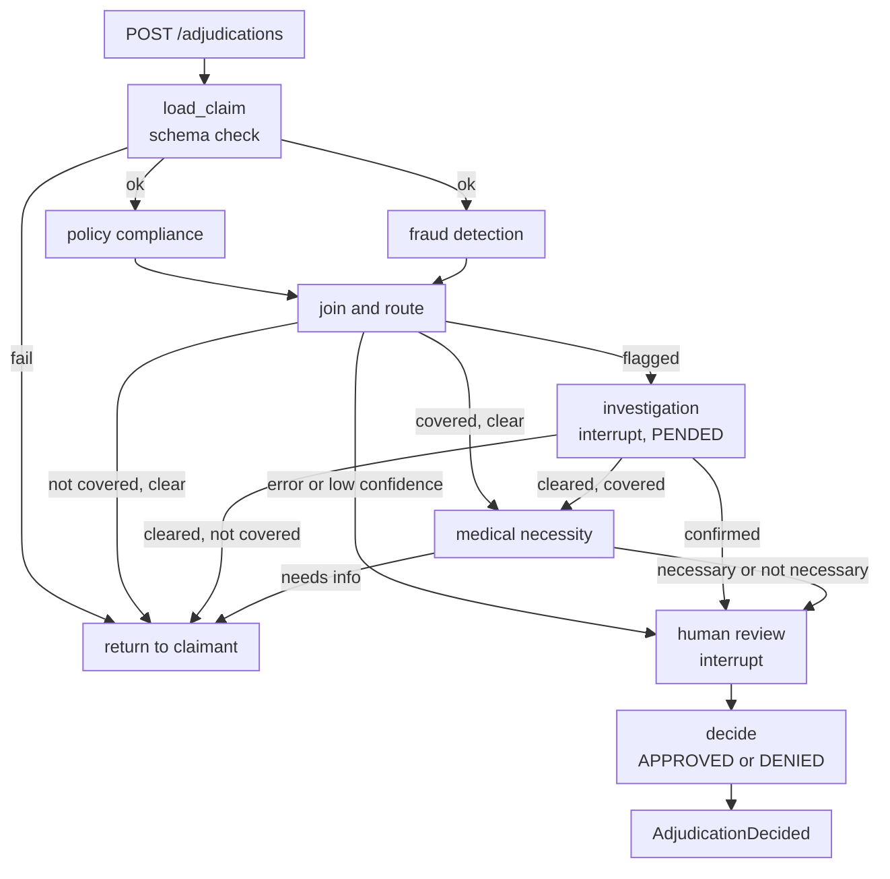

# Claims Adjudicator — Orchestrator Design

**Scope:** Orchestration of claim adjudication, from the moment the payer service hands over a claim until a decision is ready.
**Out of scope:** Final payment and customer notification. These are covered in a separate session and consume the `AdjudicationDecided` event.
**Framework:** LangGraph.
**Build context:** A local learning build. It is designed to be robust, but it is not production-scale.

---

## 1. Design principles

- **The orchestrator is deterministic code.** All LLM reasoning lives inside the specialist agents: policy compliance, fraud detection, and medical necessity. Sequencing and routing are done by plain rules.
- **The payer service is the sole writer of the claims master DB.** The adjudicator never writes claim data directly. It changes claim status only by calling the payer service API.
- **All agents share one result contract.** Because of this, the join and routing logic never depends on how an agent works internally.
- **State is persisted after every step.** This lets runs survive long human waits and local restarts.

---

## 2. Boundaries and interfaces

### Inbound (from the payer service)

| Endpoint                                           | Purpose                                                                                                                                               |
| -------------------------------------------------- | ----------------------------------------------------------------------------------------------------------------------------------------------------- |
| `POST /adjudications` `{claim_id, correlation_id}` | Starts a run and returns `202 Accepted`. The call is idempotent on `claim_id`: if a run already exists, it is returned instead of starting a new one. |
| `POST /adjudications/{id}/investigation-result`    | Callback from investigation. Payload: `{outcome: CLEARED \| CONFIRMED, notes}`                                                                        |
| `POST /adjudications/{id}/review-decision`         | Callback from human review. Payload: `{decision: APPROVED \| DENIED, allowed_amount, reviewer, notes}`                                                |

### Outbound (to the payer service)

| Call                        | When it is made                                                                       |
| --------------------------- | ------------------------------------------------------------------------------------- |
| `GET /claims/{id}`          | Loads the claim, member, and policy context                                           |
| `PATCH /claims/{id}/status` | At every status change: `IN_ADJUDICATION`, `PENDED`, `RETURNED`, `APPROVED`, `DENIED` |

### Outbound event (handoff to the next session)

```json
{
  "event": "AdjudicationDecided",
  "claim_id": "...",
  "decision": "APPROVED | DENIED",
  "allowed_amount": 0.0,
  "reasons": ["..."],
  "correlation_id": "..."
}
```

---

## 3. Flow

1. **Accept.** Create the run record and return `202`.
2. **Load and mark.** Fetch the claim from the payer service and set its status to `IN_ADJUDICATION`.
3. **Schema check.** This is deterministic, with no LLM involved. It checks that required fields are present, that CPT and ICD-10 codes are well-formed, and that amounts are positive. If the check fails, the claim goes back to the claimant.
4. **Fan out.** The policy compliance and fraud detection agents run in parallel. Each has a timeout and one retry.
5. **Join and route.** The results are routed using the rules table in section 5.
6. **Investigation.** This step only runs when fraud is flagged. The payer service sets the claim to `PENDED`, and the graph interrupts and waits for the investigation callback.
7. **Medical necessity.** The medical necessity agent runs on the covered lines. NEEDS_INFO goes back to the claimant as PENDING_INFO (section 5.1); NECESSARY and NOT_NECESSARY go to human review. See `medical-necessity-agent-design.md`.
8. **Human review.** The orchestrator builds one summary containing all agent verdicts, the evidence behind them, a risk score, and a recommended decision. The graph then interrupts and waits for the review callback.
9. **Decide.** The orchestrator sets the claim to `APPROVED` or `DENIED` through the payer service and emits `AdjudicationDecided`.



---

## 4. Agent result contract

Every specialist agent returns the same structure:

```json
{
  "agent": "policy_compliance | fraud_detection | medical_necessity",
  "verdict": "COVERED | NOT_COVERED | NEEDS_INFO | CLEAR | FLAGGED | NECESSARY | NOT_NECESSARY",
  "confidence": 0.0,
  "reasons": ["..."],
  "evidence": ["policy §4.2", "..."],
  "error": null
}
```

---

## 5. Routing rules (join)

| Policy                                                         | Fraud   | Route                              |
| -------------------------------------------------------------- | ------- | ---------------------------------- |
| COVERED                                                        | CLEAR   | Medical necessity                  |
| NOT_COVERED / NEEDS_INFO                                       | CLEAR   | Return to claimant, with reason    |
| Any                                                            | FLAGGED | Investigation                      |
| Agent error, timeout, or confidence below threshold (e.g. 0.7) | —       | Human review, with partial results |

**After investigation:**

| Investigation outcome | Policy verdict           | Route                                    |
| --------------------- | ------------------------ | ---------------------------------------- |
| CLEARED               | COVERED                  | Medical necessity                        |
| CLEARED               | NOT_COVERED / NEEDS_INFO | Return to claimant                       |
| CONFIRMED             | —                        | Human review, with a deny recommendation |

**After medical necessity:**

| Medical necessity | Route |
|---|---|
| NECESSARY | Human review, approve recommendation |
| NOT_NECESSARY | Human review, deny recommendation (never an automatic denial) |
| NEEDS_INFO | Return to claimant as PENDING_INFO (section 5.1) |
| Error | Human review |

**Decision on denials:** Denials that come from "Not covered, fraud clear" go **straight back to the claimant** and skip human review. A config flag (`ROUTE_DENIALS_TO_REVIEW`, default `false`) can switch them to go through review later.

### 5.1 Returning NEEDS_INFO to the claimant (decided 2026-10-25)

NOT_COVERED and NEEDS_INFO both route to `return_to_claimant`, but they are handled differently. NEEDS_INFO is not a denial: the claim waits for the claimant and then comes back for a fresh adjudication.

| Policy verdict | What `return_to_claimant` does | Claim status |
|---|---|---|
| NOT_COVERED | Requests `IN_ADJUDICATION → DENIED` with the reasons | `DENIED` |
| NEEDS_INFO | Requests `IN_ADJUDICATION → PENDING_INFO`, passing the policy agent's `missing_info` as issues | `PENDING_INFO` |

**The adjudicator decides, the payer service delivers.** The adjudicator owns the decision to ask the claimant, and it builds the questions. It does not contact the claimant itself, and it does not write the claim. The transition request carries the issues:

```json
{
  "from_status": "IN_ADJUDICATION",
  "to_status": "PENDING_INFO",
  "actor": "adjudicator:run/CLM-20261025-000087:1",
  "reason_code": "ADJUDICATION_NEEDS_INFO",
  "reason": "Prior authorization required for line 3",
  "idempotency_key": "CLM-20261025-000087:1:IN_ADJUDICATION->PENDING_INFO",
  "issues": [
    {
      "field_path": "lines[3].prior_auth_number",
      "issue_code": "PRIOR_AUTH_REQUIRED",
      "message": "Line 3 (MRI brain, CPT 70553) needs a prior authorization under SILVER-PPO-01 §6. Please provide the authorization number."
    }
  ]
}
```

In the same transaction, the payer service writes one `claim_issue` row per issue, sets `respond_by`, and emits `claim.info_requested`. From there, the existing missing-info flow is reused unchanged: the chatbot asks the claimant, answers are validated and recorded as amendments, and the sweeper rejects the claim if no reply comes in time.

**Coming back.** When the last issue is answered, the payer service revalidates the claim, moves it to `VALIDATED`, and emits `claim.ready_for_adjudication` again. The adjudicator starts a **new run**, so every agent sees the updated claim; fraud detection runs again too, since the claim changed.

**Run identity.** Because one claim can now be adjudicated more than once, the run key is `claim_id` plus an attempt number, not `claim_id` alone:

- `claim.ready_for_adjudication` gets a new field `adjudication_attempt` (1, 2, …), which is a minor bump of the event to v1.1. The payer service increments it each time the claim reaches `VALIDATED`.
- `thread_id = f"{claim_id}:{adjudication_attempt}"`. A redelivered event still finds the existing thread and is ignored, while a re-adjudication gets a fresh thread.
- The earlier attempt's thread stays in the checkpointer as part of the audit trail.

---

## 6. Run states

```
RECEIVED → CHECKS_RUNNING → ROUTED → (AWAITING_INVESTIGATION)
        → MED_NECESSITY_RUNNING → AWAITING_REVIEW → DECIDED
```

The terminal states are `DECIDED`, `RETURNED_TO_CLAIMANT` (denied, or sent back as PENDING_INFO), and `FAILED`. A PENDING_INFO claim that is answered starts a new run (section 5.1).

---

## 7. LangGraph mapping

| Concept              | LangGraph construct                                                                                                                                           |
| -------------------- | ------------------------------------------------------------------------------------------------------------------------------------------------------------- |
| Run state            | A `TypedDict` state holding `claim`, `policy_result`, `fraud_result`, `investigation`, `med_result`, `summary`, `decision`, and `status`                      |
| Each step            | One node per step: `load_claim`, `policy_check`, `fraud_check`, `route`, `investigation`, `medical_necessity`, `human_review`, `decide`, `return_to_claimant` |
| Parallel fan-out     | Two edges from `load_claim` to `policy_check` and `fraud_check`, which both lead into `route`. LangGraph waits for both branches before running `route`.      |
| Routing              | `add_conditional_edges("route", route_fn)`, where `route_fn` is a pure Python function implementing section 5                                                 |
| Waiting for humans   | `interrupt()` inside the `investigation` and `human_review` nodes. The callback endpoints resume the graph with `Command(resume=payload)`.                    |
| Persistence          | A `SqliteSaver` checkpointer, with `thread_id = f"{claim_id}:{adjudication_attempt}"` (section 5.1). This gives idempotency and restart safety for free.          |
| Timeouts and retries | A `RetryPolicy(max_attempts=2)` on the agent nodes. If they still fail, the node writes `error` to the result, and routing sends the claim to human review.   |
| Handoff              | The `decide` node emits `AdjudicationDecided`. For local use, this can be a simple write to a queue table or a log.                                           |

### Graph skeleton

```python
from typing import TypedDict, Optional
from langgraph.graph import StateGraph, START, END
from langgraph.checkpoint.sqlite import SqliteSaver

class AdjState(TypedDict, total=False):
    claim_id: str
    claim: dict
    policy_result: dict
    fraud_result: dict
    investigation: Optional[dict]
    med_result: Optional[dict]
    summary: Optional[dict]
    decision: Optional[dict]
    status: str

g = StateGraph(AdjState)
for name, fn in [
    ("load_claim", load_claim), ("policy_check", policy_check),
    ("fraud_check", fraud_check), ("route", route_node),
    ("investigation", investigation), ("medical_necessity", medical_necessity),
    ("human_review", human_review), ("decide", decide),
    ("return_to_claimant", return_to_claimant),
]:
    g.add_node(name, fn)

g.add_edge(START, "load_claim")
g.add_conditional_edges("load_claim", schema_ok,
    {"ok": ["policy_check", "fraud_check"], "fail": "return_to_claimant"})
g.add_edge(["policy_check", "fraud_check"], "route")
g.add_conditional_edges("route", route_fn, {
    "medical_necessity": "medical_necessity",
    "return": "return_to_claimant",
    "investigation": "investigation",
    "review": "human_review",
})
g.add_conditional_edges("investigation", after_investigation, {
    "medical_necessity": "medical_necessity",
    "return": "return_to_claimant",
    "review": "human_review",
})
g.add_edge("medical_necessity", "human_review")
g.add_edge("human_review", "decide")
g.add_edge("decide", END)
g.add_edge("return_to_claimant", END)

graph = g.compile(checkpointer=SqliteSaver.from_conn_string("adjudicator.db"))
```

---

## 8. Async behavior and review queue

### The orchestrator never blocks on humans

`interrupt()` is a pause, not a blocking wait:

1. The `human_review` node publishes the review task, then calls `interrupt(summary)`.
2. LangGraph saves the claim's state to the checkpointer, and the run returns immediately. The worker is free to process other claims.
3. Later, the decision callback resumes that claim with `graph.invoke(Command(resume=decision), config={"thread_id": f"{claim_id}:{attempt}"})`, and the graph continues into `decide`.

Each claim attempt is its own thread (`thread_id = claim_id:adjudication_attempt`), so any number of claims can sit paused at the same time. Paused claims are just saved checkpoints, with nothing held in memory. This is why the persistent `SqliteSaver` is needed once review is wired up.

Investigation uses the same interrupt-and-resume mechanism, with its own queue.

### Event-driven reviewer pool

```
human_review node
   │ publishes ReviewRequested {claim_id, summary, risk_score}
   │ then interrupt()  ← graph pauses, worker freed
   ▼
Review service ── stores task in review_tasks (status = OPEN)
   ▼
Dashboard (5–6 reviewers) ── all see OPEN tasks, sorted by risk
   │ Reviewer A clicks "Pick up"
   ▼
Atomic claim: OPEN → IN_REVIEW, assignee = A
   (other reviewers' pick-up attempts fail)
   │ A approves / denies
   ▼
ReviewDecided → adjudicator resumes graph with Command(resume=…)
   ▼
decide → payer status update → AdjudicationDecided
```

### Atomic pick-up (the lock)

This stops two reviewers from taking the same claim:

```sql
UPDATE review_tasks
SET status = 'IN_REVIEW', assignee = :reviewer, picked_at = now
WHERE task_id = :id AND status = 'OPEN';
-- rows_affected = 1 → you got it; 0 → someone else already did
```

`review_tasks` columns: `task_id`, `claim_id`, `summary` (JSON), `risk_score`, `status` (`OPEN | IN_REVIEW | DONE`), `assignee`, `picked_at`, `created_at`.

### Safety additions

- **Lease timeout.** If a reviewer picks a claim up and walks away, a sweeper returns the task to `OPEN` after 30 minutes. The sweeper runs: `UPDATE review_tasks SET status='OPEN', assignee=NULL WHERE status='IN_REVIEW' AND picked_at < now - 30 min`.
- **Idempotent resume.** If a decision arrives twice, the second call is ignored. The graph has already moved past `human_review`, and the task is already `DONE`.
- **Only the assignee can decide.** The decision endpoint rejects a decision unless `assignee = :reviewer` and `status = 'IN_REVIEW'`.

### Endpoints (review service)

| Endpoint                           | Purpose                                                                                                    |
| ---------------------------------- | ---------------------------------------------------------------------------------------------------------- |
| `GET /review-tasks?status=OPEN`    | Dashboard list, sorted by `risk_score` (the dashboard polls this; it can move to server-sent events later) |
| `POST /review-tasks/{id}/claim`    | Atomic pick-up                                                                                             |
| `POST /review-tasks/{id}/decision` | Sets the task to `DONE` and resumes the graph                                                              |

### Local build choice

The `review_tasks` table acts as both the queue and the event bus. "Publishing" a task is just an insert. You can swap in Redis Streams or Kafka later without changing the graph, because only the publish and resume calls at the edges would change.

---

## 9. Error handling

- **Agent timeout or failure:** retry once. If it fails again, record `error` and route to human review. Claims are never auto-denied because of a failure.
- **Payer service API failure:** retry with backoff. If it still fails, the run is marked `FAILED` and can be resumed from the last checkpoint.
- **Duplicate start request:** `thread_id = claim_id:adjudication_attempt` means the existing run is returned instead of a new one starting. A re-adjudication after PENDING_INFO has a new attempt number, so it starts a new run.

---

## 10. Open items for later sessions

- ~~Policy compliance agent design~~ Done: `policy-compliance-agent-design.md`
- ~~Fraud detection agent design~~ Done: `fraud-detection-agent-design.md`
- ~~Medical necessity agent design~~ Done: `medical-necessity-agent-design.md`
- Human review UI and queue
- Payment and customer notification (consumes `AdjudicationDecided`)
