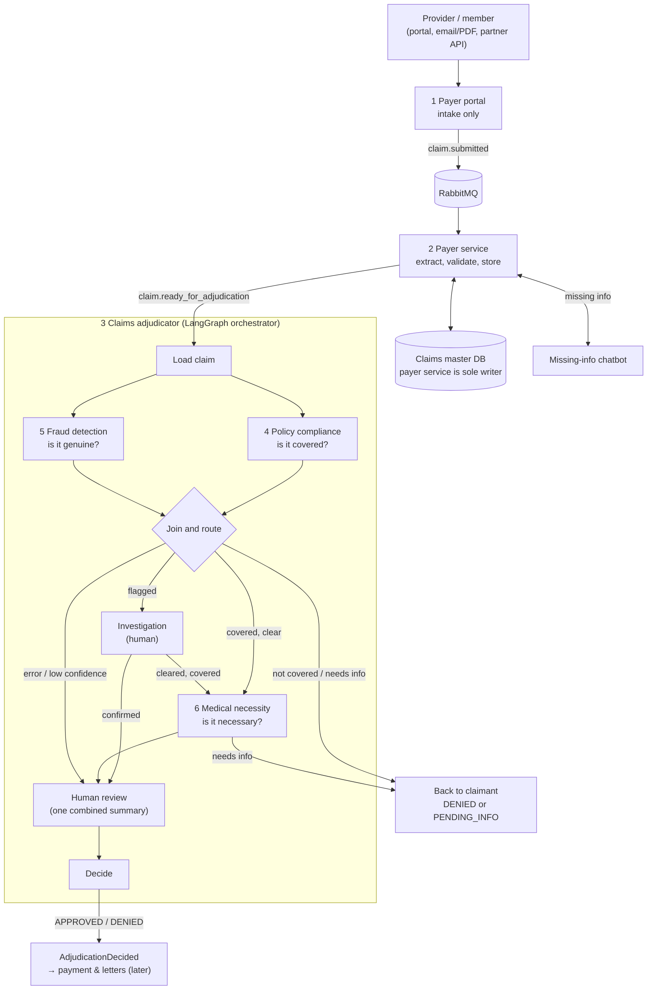
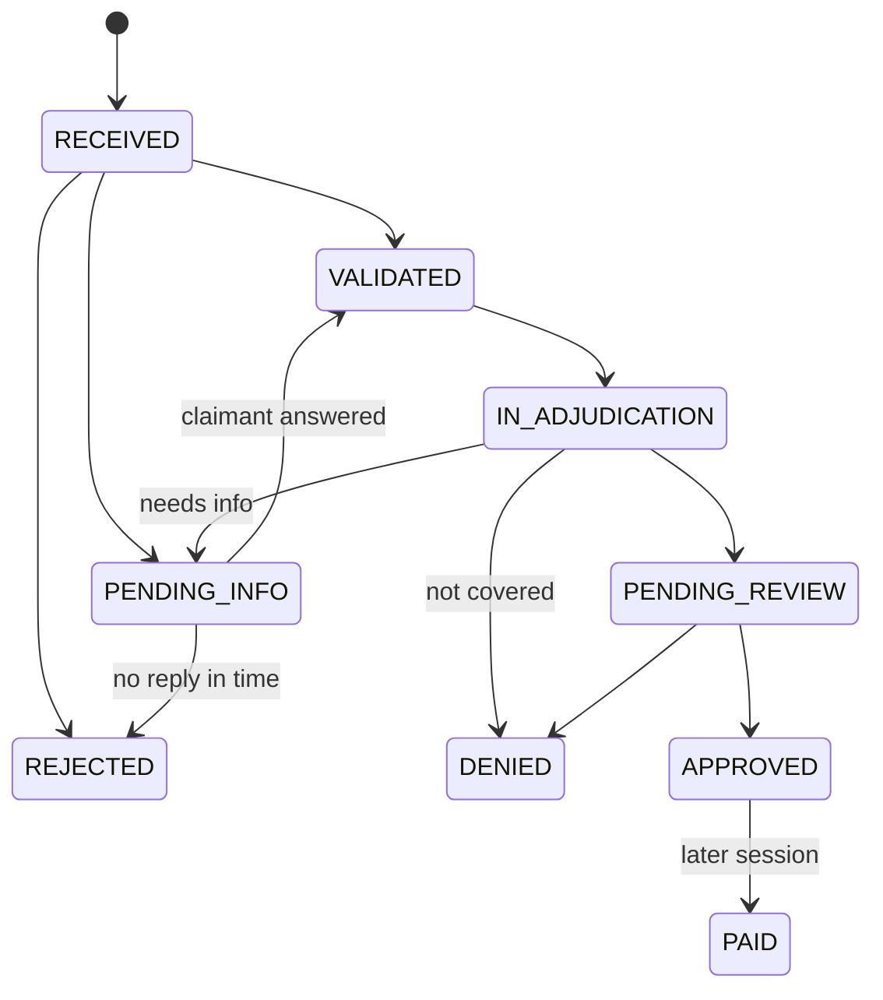
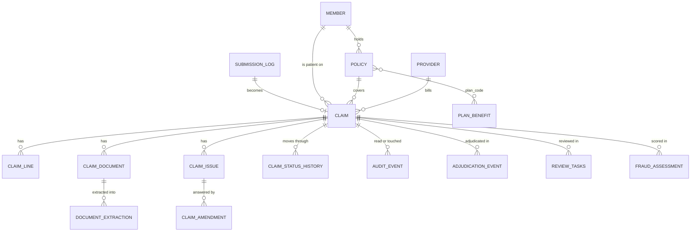

# ClaimsAI Sentinel — Consolidated Design (high level)

Part of the Claims Adjudication Autonomous AI Agent (ClaimsAI Sentinel).
Date: 2026-10-26. Status: design agreed up to the adjudication decision; implementation not started.

This is a one-place summary of the component designs. It stays at the level of "what each part does and how they connect". The details live in the component docs (see section 11).

**Scope:** from a claim being submitted to the claim being **APPROVED for payment** (or denied / sent back).
**Out of scope for now:** payment, the member letter and notifications. They will consume the `AdjudicationDecided` event in a later session.
**Build context:** local learning build. US-style professional claims (CPT, ICD-10, NPI). All data is synthetic. Robust and correct, but no scaling or availability work.

---

## 1. The system in one picture

Every status change in the adjudicator (including "back to claimant") is requested from the payer service, which writes it to the claims master DB.

---

## 2. The components at a glance

| # | Component | Its one job | What the AI does | What code decides |
|---|---|---|---|---|
| 1 | **Payer portal** | Accept submissions from every channel and put one standard message on the queue | Nothing | Shape checks only (schema, file type, duplicate submission) |
| 2 | **Payer service** | Turn a submission into a valid claim in the claims master DB | Extracts fields from PDFs/emails (with evidence); the chatbot asks for missing info | All business validation; claim status changes |
| 3 | **Claims adjudicator** | Run each claim through the checks and route it | Nothing (pure orchestration) | Order, parallelism, routing rules, waiting for humans |
| 4 | **Policy compliance agent** | Is each line covered by the member's plan? | Reads plan documents (RAG) for exclusions and exceptions; explains with citations | Policy active, network status, benefit table lookups, invariant checks |
| 5 | **Fraud detection agent** | Does the claim show signs of fraud? | Writes the reviewer summary and answers reviewer questions | ML model score + hard rules set the verdict |
| 6 | **Medical necessity agent** | Do the clinical notes meet the medical policy for each line? | Judges each policy criterion against the notes, quoting them | Quote check, line verdicts from the policy logic, provider flag |
| — | **Human review** | One person approves or denies, using one combined summary | — | Queue, pick-up lock, only the assignee can decide |

The common rule: **AI proposes, code decides.** No LLM output becomes a fact or a decision without a deterministic check.

---

## 3. A claim's journey, step by step

1. **Submit.** A provider or member submits through the portal, an email/PDF drop, or a partner API. The portal stores documents, logs the submission and publishes `claim.submitted` (one message shape for every channel).
2. **Validate.** The payer service consumes the message. If it came as a document, it extracts the claim first. It runs the business rules (member, active policy, valid codes, amounts, dates, timely filing) and writes the claim in one transaction:
   - fixable problems → `PENDING_INFO`, and the chatbot asks the claimant;
   - unfixable problems → `REJECTED`;
   - all good → `VALIDATED`, and it emits `claim.ready_for_adjudication`.
3. **Start adjudication.** The adjudicator starts a LangGraph run (one per claim attempt), loads the claim and moves it to `IN_ADJUDICATION`.
4. **Two checks in parallel.** Policy compliance and fraud detection run at the same time on every claim.
5. **Join and route** (rules in section 4):
   - covered and clear → medical necessity;
   - not covered and clear → **denied**, straight back to the claimant;
   - needs info → `PENDING_INFO`, back to the chatbot; the answered claim comes back as a new attempt;
   - fraud flagged → **investigation**, and the run pauses until an investigator responds.
6. **Medical necessity.** Runs only on covered lines. Checks the notes against the medical policy and flags low-quality providers for the reviewer.
7. **Human review.** The adjudicator builds one summary (coverage, fraud score and narrative, medical rationale, flags, recommendation). The run pauses until a reviewer decides.
8. **Decide.** The claim is set to `APPROVED` or `DENIED`, and `AdjudicationDecided` is emitted. **This is where the current design ends.**

---

## 4. Routing rules (the adjudicator's join)

| Policy result | Fraud result | Next step |
|---|---|---|
| COVERED | CLEAR | Medical necessity |
| NOT_COVERED | CLEAR | Denied, back to claimant (no human review) |
| NEEDS_INFO | CLEAR | PENDING_INFO, back to claimant |
| any | FLAGGED | Investigation |
| error, timeout or confidence below 0.7 | — | Human review |

| After investigation | Policy result | Next step |
|---|---|---|
| CLEARED | COVERED | Medical necessity |
| CLEARED | NOT_COVERED / NEEDS_INFO | Back to claimant |
| CONFIRMED | — | Human review, with a deny recommendation |

| Medical necessity result | Next step |
|---|---|
| NECESSARY | Human review, approve recommendation |
| NOT_NECESSARY | Human review, deny recommendation (never automatic) |
| NEEDS_INFO | PENDING_INFO, back to claimant |
| error | Human review |

Two safety rules sit underneath: **a failure never auto-denies or auto-clears a claim** (it goes to a human), and **asking for information is never a denial**.

---

## 5. Claim status lifecycle

- **Rejected** = failed intake checks, never adjudicated, can be resubmitted.
- **Denied** = adjudicated and refused.
- Only the payer service changes status. The adjudicator asks through `POST /claims/{id}/transitions`.

---

## 6. Design principles that apply everywhere

1. **One writer for claim data.** The payer service is the only component that writes the claims master DB. Everyone else reads through its API, and every read is logged.
2. **AI proposes, code decides.** Extraction needs evidence that appears in the document; policy verdicts are checked against the benefit table; fraud verdicts come from the ML model; medical necessity quotes must exist in the notes.
3. **Nothing is lost, nothing is done twice.** Outbox pattern for every event, idempotency keys everywhere (`submission_id`, claim attempt, transition key), retries then a dead-letter queue for messages that can't be processed.
4. **One result shape for all agents.** Every agent returns `verdict`, `confidence`, `reasons`, `evidence`, `error` (plus its own `details`), so routing never depends on how an agent works inside.
5. **Pauses are cheap.** Waiting for an investigator, reviewer or claimant is a saved LangGraph checkpoint, not a blocked worker, so runs survive restarts.
6. **Humans own adverse decisions.** Fraud confirmation, medical necessity denials and anything uncertain go to a person. The one automatic denial is "not covered, fraud clear" (a config flag can route it to review).
7. **Full audit trail.** Every step leaves an append-only record: intake, validation and status changes in the claims DB; agent results and human actions in the adjudication log. One view shows a claim's whole story (section 8).

---

## 7. Where data lives and the data model

One local Postgres instance with one schema per owner. Each component writes only to its own schema; the others read through APIs (or, for the fraud stats job, a read-only role).

| Store | Owner (only writer) | Holds |
|---|---|---|
| `portal` schema | Payer portal | Submission log |
| `claims` schema (claims master DB) | Payer service | Claims and everything about them, reference data, events, audit events |
| `adjudication` schema (pgvector enabled) | Claims adjudicator | Document index, review queue, adjudication log, LangGraph checkpoints |
| `fraud` schema | Fraud detection agent | Assessments, statistics, labels, memos, assistant log |
| Document store (local folder / MinIO) | Payer portal | Uploaded files (messages carry references, not bytes) |
| RabbitMQ | — | `claim.submitted`, `claim.ready_for_adjudication`, `claim.info_requested`, `claim.rejected` |

### 7.1 How the main tables relate

### 7.2 All tables

**`portal` schema** — written by the payer portal

| Table | Columns | Notes |
|---|---|---|
| `submission_log` | `submission_id` PK, `channel`, `submitter_type`, `submitter_id`, `payload_sha256`, `publish_status`, `created_at`, `published_at` | Idempotency key and outbox for `claim.submitted` |

**`claims` schema, reference data** — written by the payer service (seed scripts)

| Table | Columns | Notes |
|---|---|---|
| `member` | `member_id` PK, `first_name`, `last_name`, `dob`, `gender` | |
| `policy` | `policy_id` PK, `member_id` FK, `plan_code`, `group_number`, `effective_date`, `termination_date`, `status` | |
| `provider` | `provider_id` PK, `npi` unique, `name`, `taxonomy_code`, `network_status` (in/out), **`quality_rating`** (1–5, nullable), **`city`**, **`state`** | Last three added for the medical necessity agent's low-quality provider flag |
| `plan_benefit` | `plan_code` + `cpt_code` PK, `benefit_category`, `is_covered`, `requires_prior_auth`, `policy_section` | Added for policy compliance. No `plan` table: `plan_code` links policy, benefits and plan documents |
| `ref_cpt` | `code` PK, `description`, `active` | Only the codes the synthetic data uses |
| `ref_icd10` | `code` PK, `description`, `billable` | Full public list from CMS |

**`claims` schema, claim data** — written by the payer service

| Table | Columns | Notes |
|---|---|---|
| `claim` | `claim_id` PK, `submission_id` unique, `member_id`, `policy_id`, `billing_provider_id`, `rendering_npi`, `place_of_service`, `diagnosis_codes`, `service_from`, `service_to`, `total_billed`, `status`, `received_at`, `draft`, `source_message`, `channel`, `submitter_type`, `submitter_id`, `flags`, `respond_by`, `version`, `reference_snapshot` | Relational columns are nullable until `VALIDATED`; `draft` is the working copy; `reference_snapshot` keeps the member, policy and provider rows used at validation |
| `claim_line` | `claim_id` + `line_no` PK, `cpt_code`, `modifiers`, `units`, `billed_amount`, `service_date`, `diagnosis_pointers`, **`prior_auth_number`** (nullable) | `prior_auth_number` added by policy compliance. Planned: `allowed_amount`, `line_status` (for partially covered claims) |
| `claim_document` | `document_id` PK, `claim_id`, `doc_type`, `storage_uri`, `sha256`, `uploaded_at` | `doc_type = 'medical_record'` is what medical necessity reads |
| `claim_issue` | `issue_id` PK, `claim_id`, `field_path`, `issue_code`, `severity`, `message`, `status`, `created_at`, `resolved_at` | One row per problem the claimant must fix |
| `claim_amendment` | `amendment_id` PK, `claim_id`, `issue_id`, `field_path`, `old_value`, `new_value`, `source`, `conversation_id`, `claimant_text`, `created_at` | Append-only; each chatbot correction |
| `document_extraction` | `document_id` + `sha256` + `extractor_version` PK, `doc_class`, `result`, `created_at` | Append-only; what the AI extracted, with evidence |
| `claim_status_history` | `id` PK, `claim_id`, `from_status`, `to_status`, `actor`, `reason_code`, `reason`, `details`, `changed_at` | Append-only; every status change |

**`claims` schema, plumbing and audit** — written by the payer service

| Table | Columns | Notes |
|---|---|---|
| `outbox` | `id` PK, `message_id` unique, `routing_key`, `claim_id`, `payload`, `created_at`, `published_at` | Events committed with the claim change |
| `intake_error` | `message_id` PK, `submission_id`, `error_class`, `error`, `attempts`, `dead_lettered_at`, `resolved_at` | Dead-lettered messages, for the status view |
| `audit_event` | `event_id` PK, `occurred_at`, `actor_type`, `actor_id`, `actor_role`, `action`, `claim_id`, `submission_id`, `correlation_id`, `reason`, `details` | Append-only; reads of claim data and operator actions |
| `claim_audit_trail` (view) | — | One timeline per claim (section 8) |

**`adjudication` schema** — written by the claims adjudicator

| Table | Columns | Notes |
|---|---|---|
| `payer_doc_chunk` | `id` PK, `doc_type` (eoc / medical_policy), `doc_id`, `plan_code`, `cpt_codes`, `section`, `heading`, `text`, `embedding` | Shared by policy compliance (plan documents) and medical necessity (medical policies) |
| `review_tasks` | `task_id` PK, `claim_id`, `summary`, `risk_score`, `status` (OPEN / IN_REVIEW / DONE), `assignee`, `picked_at`, `created_at` | Human review queue |
| `adjudication_event` | `event_id` PK, `claim_id`, `adjudication_attempt`, `correlation_id`, `occurred_at`, `actor`, `event_type`, `payload`, `versions` | **Proposed** (section 8). Append-only |
| LangGraph checkpoint tables | managed by the library | Run state per `claim_id:adjudication_attempt`; use the Postgres checkpointer so it lives here |

**`fraud` schema** — written by the fraud detection agent

| Table | Columns | Notes |
|---|---|---|
| `fraud_assessment` | `claim_id`, `model_version`, `risk_score`, `band`, `verdict`, `confidence`, `fact_sheet`, `narrative`, `narrative_source`, `created_at` | One row per scoring |
| `provider_stats` | `npi`, `as_of`, `specialty`, feature columns, `provider_risk` | Nightly batch |
| `cpt_stats` | `cpt_code`, `as_of`, `p50_units`, `p99_units`, `p50_billed`, `p99_billed` | Nightly batch |
| `dx_cpt_cooccurrence` | `icd10`, `cpt_code`, `prob` | Nightly batch |
| `excluded_provider` | `npi`, `excluded_from`, `reason` | Synthetic exclusion list |
| `fraud_label` | `claim_id`, `outcome`, `scheme`, `source`, `labelled_at` | Ground truth from investigations |
| `referral_memo` | `memo_id`, `claim_id`, `body`, `created_at` | Investigator memos |
| `assistant_log` | `claim_id`, `user_id`, `role`, `question`, `answer`, `tools_used`, `created_at` | Reviewer and investigator Q&A |

---

## 8. Audit trail

### 8.1 What is covered today

| Part | What is recorded | Covered? |
|---|---|---|
| Portal | Every submission (`submission_log`), document hashes | Yes |
| Payer service | Original message, extraction with evidence, issues, amendments, every status change, events, failures, reads and operator actions | Yes, append-only and enforced by the database |
| Policy compliance / medical necessity | Their reads of claim data, plan benefits and medical records (logged by the payer service) | Reads yes; **their results no** |
| Fraud detection | Assessment, narrative, memo, assistant questions and answers | Yes, in the `fraud` schema |
| Adjudicator routing | Which rule sent the claim where | **No** |
| Investigation and human review | Outcome and decision reach the claim as a status change only; who picked up a task, the notes, the allowed amount and who viewed the summary are not kept | **Partly** |

The gap is in the middle of the flow. Agent results, routing decisions and human actions live only in the LangGraph checkpoints and the mutable `review_tasks` table. Checkpoints are run state, not an audit record: they are opaque, can be pruned, and can't be queried for "why was this claim denied?"

### 8.2 Proposed fix: one append-only table

`adjudication.adjudication_event`, written by the adjudicator, one row per step:

| `event_type` | Written when | `payload` holds |
|---|---|---|
| `RUN_STARTED` | A run begins | Attempt number, trigger event |
| `AGENT_RESULT` | Each agent returns | The full agent result (verdict, confidence, reasons, evidence, details) |
| `ROUTED` | After the join, investigation or medical necessity | The rule applied and the next step |
| `INVESTIGATION_REQUESTED` / `INVESTIGATION_RESULT` | Pause and resume | Outcome, notes, investigator |
| `REVIEW_REQUESTED` | Summary created | The summary shown to the reviewer, risk score, recommendation |
| `REVIEW_VIEWED` / `REVIEW_PICKED_UP` / `REVIEW_RELEASED` | Reviewer activity, lease timeout | Reviewer ID |
| `REVIEW_DECIDED` | Reviewer decides | Decision, allowed amount, notes, reviewer |
| `DECIDED` / `RETURNED_TO_CLAIMANT` | Run ends | Final outcome, reasons |

- `versions` records what produced the step: agent prompt version, LLM model, fraud model version, document index version. This answers "what produced this result?" months later.
- Append-only, the same way as the payer service tables: insert-only grants for the adjudicator's role and a trigger that blocks updates and deletes.
- `claim_audit_trail` adds this table to its union (possible because everything is in one Postgres instance), so one query shows a claim from submission to decision.
- Langfuse traces stay as debugging and observability; they are not the audit record.

---

## 9. How the parts talk

| From → To | How | What |
|---|---|---|
| Portal → payer service | RabbitMQ event | `claim.submitted` |
| Payer service → chatbot | RabbitMQ event | `claim.info_requested` (the issues to ask about) |
| Chatbot → payer service | HTTP | Answers to issues; the payer service validates them |
| Payer service → adjudicator | RabbitMQ event | `claim.ready_for_adjudication` (IDs only) |
| Adjudicator → payer service | HTTP | Read claim, medical records, plan benefits; request status transitions |
| Investigator / reviewer → adjudicator | HTTP callback | Investigation result, review decision (resumes the paused run) |
| Adjudicator → later components | Event | `AdjudicationDecided` |

---

## 10. Test data approach

There is no real data, so a synthetic data generator builds a small world with **planted answers**: members, two plans (`SILVER-PPO-01`, `BRONZE-HMO-01`), providers (some low-quality, some fraudulent, some honest outliers), claims with planted problems, and three synthetic medical policies. Every component doc has a test-scenario table with the expected result, and together they form the golden test set. Fraud uses this synthetic data for the claim-level model and the Kaggle provider-fraud dataset for a provider-risk feature.

---

## 11. Component docs

| Doc | Covers |
|---|---|
| `payer-portal-design.md` | Intake, `claim.submitted` contract, base data model |
| `payer-service-design.md` | Queue handling, extraction, validation rules, transitions API, chatbot hand-off, audit trail |
| `claims-adjudicator-orchestrator.md` | LangGraph graph, routing rules, pauses, human review queue |
| `policy-compliance-agent-design.md` | Coverage tools, plan benefits, plan documents |
| `fraud-detection-agent-design.md` | Two ML models, thresholds, explanations, reviewer assistant |
| `medical-necessity-agent-design.md` | Medical policies, criterion checks, provider flag |

---

## 12. Small inconsistencies to tidy up

Found while consolidating. None of these changes the design.

1. **Status update call.** The orchestrator's section 2 still says `PATCH /claims/{id}/status` with `PENDED` and `RETURNED`. The agreed mechanism is `POST /claims/{id}/transitions`, and those two statuses aren't in the payer service's status list. Decide which status a claim has while it waits for investigation (staying `IN_ADJUDICATION` is simplest).
2. **Checkpointer.** The orchestrator uses `SqliteSaver`; the payer service doc says a Postgres checkpointer. With the single Postgres instance in section 7, the Postgres checkpointer is the better fit.
3. **`adjudication_attempt`.** The `claim.ready_for_adjudication` example in the payer service doc doesn't show the v1.1 field yet.
4. **Partially covered claims.** Denying the non-covered lines needs `claim_line.line_status` and a way to send line results through the transitions API (policy compliance open question 3).
5. **Investigation queue.** The orchestrator says investigation has "its own queue" but no table is defined. Simplest: add `task_type` (REVIEW / INVESTIGATION) to `review_tasks`.
6. **Provider RAG.** The original notes had a RAG store for provider quality and location; the agreed design uses three columns on the `provider` table instead. The older Design Notes .docx still shows the RAG.

## 13. Next sessions

- Human review UI (the queue is designed, the screen isn't)
- Payment, member letter and notifications (consume `AdjudicationDecided`)
- Synthetic data generator (shared by every component)
