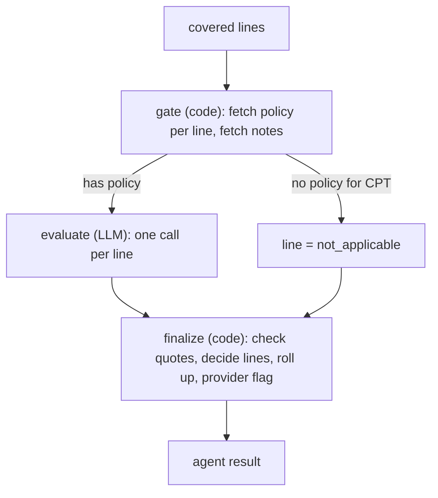

# Medical Necessity Agent — Design

**Scope:** Decides, line by line, whether the provider's clinical notes meet the payer's medical policy criteria for the service billed. Flags low-quality providers for the reviewer.
**Runs:** After policy compliance and fraud detection, only on the lines policy compliance marked covered (`covered_lines`).
**Build context:** A local learning build. Kept deliberately small.

---

## 1. Design in one screen

| Piece | Choice |
|---|---|
| Medical policies | Stored in the **same pgvector table** as the plan documents (`payer_doc_chunk`, `doc_type = 'medical_policy'`). Fetched by CPT code, not searched. |
| Clinical notes | Read from the payer service and passed to the LLM **whole**. No RAG: a claim's notes are a few pages. |
| Provider quality and location | Three new columns on the existing `provider` table. Read by code. **No RAG.** |
| LLM work | One structured-output call per line that has a policy. No ReAct loop: the LLM always needs the same two inputs, so code fetches them. |
| Safety rule | Every "met" or "not met" criterion must quote the notes, and code checks the quote is really there. |
| Line verdicts | `meets`, `does_not_meet`, `needs_info`, `not_applicable` (no policy for this CPT) |
| Claim verdict | `NECESSARY`, `NOT_NECESSARY`, `NEEDS_INFO` |

---

## 2. Data

### Shared document index (one table for both agents)

Policy compliance already indexes the plan documents. Medical policies go into the same table with a `doc_type` column:

```sql
CREATE TABLE payer_doc_chunk (
    id         BIGSERIAL PRIMARY KEY,
    doc_type   TEXT NOT NULL,      -- 'eoc' | 'medical_policy'
    doc_id     TEXT NOT NULL,      -- plan_code for eoc, 'MP-001' for a medical policy
    plan_code  TEXT,               -- eoc only
    cpt_codes  TEXT[],             -- medical_policy only: CPTs the policy governs
    section    TEXT NOT NULL,      -- '§5.2' or 'MP-001.2' (citable)
    heading    TEXT NOT NULL,
    text       TEXT NOT NULL,
    embedding  VECTOR(768)
);
```

- Source files: `data/plan_documents/<plan_code>.md` and `data/medical_policies/<policy_id>.md`.
- One script, `scripts/index_payer_docs.py`, indexes both. One chunk per numbered section.
- Policy compliance always filters `doc_type = 'eoc' AND plan_code = X`.
- Medical necessity filters `doc_type = 'medical_policy' AND <cpt> = ANY(cpt_codes)` and reads the whole policy in section order. No similarity search is needed, because the CPT is known.

### Provider: three new columns

On the existing `provider` table (payer portal data model):

| Column | Type | Notes |
|---|---|---|
| `quality_rating` | smallint | 1–5, nullable (unrated) |
| `city` | text | |
| `state` | text | two-letter code |

They travel to the adjudicator inside the claim's existing `reference_snapshot`, so no new endpoint is needed.

### Clinical notes

Already stored by the payer service as `claim_document` rows with `doc_type = 'medical_record'`. Records sent later in answer to a NEEDS_INFO request are attached the same way.

---

## 3. Endpoints

| Endpoint | Owner | Used for |
|---|---|---|
| `GET /claims/{claim_id}` (existing) | Payer service | Claim, lines, diagnoses, `reference_snapshot` (provider quality and location) |
| `GET /claims/{claim_id}/medical-records` (**new**) | Payer service | `[{document_id, received_at, text}]` for every `medical_record` document. Text comes from the PDF text layer (synthetic notes are plain text). Each read writes an `audit_event` with actor `adjudicator:medical_necessity`. |

The shared index is queried directly by the adjudicator, as policy compliance already does.

---

## 4. How the agent runs

LangGraph subgraph used as the orchestrator's `medical_necessity` node. Three nodes, same shape as policy compliance.



### Gate (code)

1. For each covered line, load the medical policy for its CPT. None → `not_applicable`, no LLM call.
2. If any line has a policy, load the medical records once.
3. If a line has a policy but the claim has **no** medical records → `needs_info` directly, no LLM call.

### Evaluate (LLM)

Input per line: the policy's numbered criteria, the claim's diagnosis codes, and the full notes. Output, one entry per criterion:

```python
class CriterionFinding(BaseModel):
    criterion_id: str                       # "MP-001.2"
    status: Literal["met", "not_met", "not_documented"]
    quote: str | None                       # verbatim from the notes; required unless not_documented
    document_id: str | None
```

The prompt says: judge each criterion only from the notes; quote the exact words; if the notes don't mention it, say `not_documented`. Never guess.

### Finalize (code)

1. **Quote check.** Every `met` / `not_met` quote must appear in the cited document (case and whitespace normalised). Fails → retry that line once, then `error` (orchestrator sends the claim to human review).
2. **Line verdict is computed by code, not taken from the LLM**, using the policy's logic (`all of` / `any of`, written in the policy file):
   - criteria satisfied → `meets`
   - a required criterion is `not_met` → `does_not_meet`
   - otherwise (something `not_documented`) → `needs_info`, listing what to send
3. **Roll-up:** any `needs_info` → `NEEDS_INFO`; else any `does_not_meet` → `NOT_NECESSARY`; else `NECESSARY`.
4. **Provider flag.** Read `quality_rating`, `city`, `state` from the snapshot. If the rating is **2 or lower**, add to `review_flags`: *"Low-quality provider: rating 2/5, Austin, TX."* The flag **never changes a verdict**.

Silence in the notes is a request for records, never a denial.

### Confidence (computed)

| Line settled by | Confidence |
|---|---|
| `not_applicable` | 1.0 |
| LLM findings, all quotes verified | 0.8 |

Claim confidence = lowest line confidence.

---

## 5. Output: the shared agent result contract

```json
{
  "agent": "medical_necessity",
  "verdict": "NEEDS_INFO",
  "confidence": 0.8,
  "reasons": ["Line 1: conservative therapy duration not documented (MP-001.1)"],
  "evidence": ["MP-001.1", "DOC-7781"],
  "error": null,
  "details": {
    "lines": [
      {
        "line_no": 1,
        "cpt_code": "72148",
        "policy_id": "MP-001",
        "status": "needs_info",
        "carc": null,
        "criteria": [
          {"criterion_id": "MP-001.1", "status": "not_documented", "quote": null, "document_id": null},
          {"criterion_id": "MP-001.2", "status": "not_met", "quote": "No numbness, strength 5/5 bilaterally.", "document_id": "DOC-7781"}
        ]
      }
    ],
    "missing_info": ["Line 1 (MRI lumbar spine): notes showing at least 6 weeks of conservative therapy (MP-001.1)"],
    "review_flags": ["Low-quality provider: rating 2/5, Austin, TX"]
  }
}
```

`does_not_meet` lines carry CARC `CO-50` (not medically necessary).

---

## 6. Routing (orchestrator)

| Verdict | Route |
|---|---|
| `NECESSARY` | Human review with an **approve** recommendation (as today) |
| `NOT_NECESSARY` | Human review with a **deny** recommendation. Never an automatic denial: an adverse medical necessity decision is a clinician's call. |
| `NEEDS_INFO` | `return_to_claimant` → `PENDING_INFO`, passing `missing_info` as issues (reuses orchestrator section 5.1). The claim comes back as a new attempt. |
| `error` | Human review |

`review_flags` are shown in the review summary.

---

## 7. Code sketch

```python
def gate(state):
    lines = [l for l in state["claim"]["lines"] if l["line_no"] in state["policy_result"]["details"]["covered_lines"]]
    policies = {l["line_no"]: get_medical_policy(l["cpt_code"]) for l in lines}   # None if no policy
    notes = get_medical_records(state["claim_id"]) if any(policies.values()) else []
    return {"mn_lines": lines, "mn_policies": policies, "mn_notes": notes}

def evaluate(state):
    findings = {}
    for line in state["mn_lines"]:
        policy = state["mn_policies"][line["line_no"]]
        if policy and state["mn_notes"]:
            findings[line["line_no"]] = llm.with_structured_output(LineFindings).invoke(
                build_prompt(policy, state["claim"]["diagnosis_codes"], state["mn_notes"]))
    return {"mn_findings": findings}

def finalize(state):
    ...  # quote check, compute line verdicts from policy logic, roll up, provider flag

g = StateGraph(MNState)
g.add_node("gate", gate); g.add_node("evaluate", evaluate); g.add_node("finalize", finalize)
g.add_edge(START, "gate"); g.add_edge("gate", "evaluate")
g.add_edge("evaluate", "finalize"); g.add_edge("finalize", END)
medical_necessity = g.compile()
```

---

## 8. Seed medical policies (synthetic)

Saved as `data/medical_policies/<id>.md`. The front matter holds the CPTs and the decision logic.

### MP-001 — MRI of the lumbar spine
`cpt_codes: [72148]` · `logic: any_of(MP-001.1, MP-001.2)`

- **MP-001.1 Conservative therapy.** At least 6 weeks of documented conservative treatment (physical therapy, medication, or activity modification) without adequate improvement.
- **MP-001.2 Red flags.** Any of: progressive neurological deficit, history of cancer, suspected infection, significant trauma, or cauda equina symptoms.

### MP-002 — Bariatric surgery
`cpt_codes: [43644]` · `logic: all_of(MP-002.1, MP-002.2, MP-002.3)`

- **MP-002.1 BMI.** BMI ≥ 40, or BMI ≥ 35 with a serious obesity-related condition (type 2 diabetes, hypertension, sleep apnea).
- **MP-002.2 Supervised weight loss.** A documented, physician-supervised weight-loss attempt.
- **MP-002.3 Psychological evaluation.** A pre-operative psychological evaluation clearing the member for surgery.

### MP-003 — Outpatient physical therapy
`cpt_codes: [97110]` · `logic: all_of(MP-003.1, MP-003.2)`

- **MP-003.1 Functional deficit.** A documented functional limitation caused by injury, surgery, or illness.
- **MP-003.2 Plan of care.** Measurable goals and, after the first visit, documented progress toward them.

All other seeded CPTs have no medical policy and come back `not_applicable`.

---

## 9. Test scenarios (planted ground truth)

| # | Claim | Notes contain | Provider | Expected |
|---|---|---|---|---|
| 1 | Office visit 99213 | — | rating 4 | `NECESSARY` (not_applicable), no LLM call |
| 2 | Lumbar MRI 72148 | "8 weeks of PT and NSAIDs, pain unchanged" | rating 4 | `NECESSARY` via MP-001.1 |
| 3 | Lumbar MRI 72148 | "Back pain for 1 week. No neuro deficit." | rating 4 | `NOT_NECESSARY`, CO-50 |
| 4 | Lumbar MRI 72148 | "Back pain." (nothing on duration or red flags) | rating 4 | `NEEDS_INFO`, asks for therapy history |
| 5 | Lumbar MRI 72148 | no medical record attached | rating 4 | `NEEDS_INFO`, no LLM call |
| 6 | Bariatric 43644 (PPO) | BMI 41, supervised diet 6 months, no psych eval | rating 4 | `NEEDS_INFO` (MP-002.3) |
| 7 | PT 97110 | Goals and progress documented | **rating 2**, Austin TX | `NECESSARY` + low-quality provider flag |
| 8 | Lumbar MRI 72148 | LLM returns a quote not in the notes (fault injected) | rating 4 | Retry, then `error` → human review |

---

## 10. Dropped for now

- RAG over clinical notes (only needed for long inpatient records).
- Using quality or location for anything other than the reviewer flag (e.g. steering members to better providers).
- Skipping review for lines with a prior auth number (no `prior_auth` table yet to verify it).
