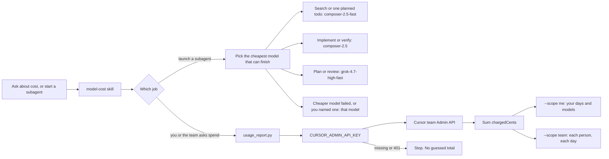

# Model cost

The `model-cost` skill does two jobs. It does not change the model already selected in the chat, and it does not invent a dollar amount.



Composer and Grok come first. Those Cursor models are not charged the extra token fee. A third-party thinking model is only the last box on the left.

The right side is the report. Run it from the repo root. The key is a team Admin API key. Do not commit it.

```bash
export CURSOR_ADMIN_API_KEY=...
export CURSOR_USER_EMAIL=you@example.com
python3 .cursor/skills/model-cost/scripts/usage_report.py
python3 .cursor/skills/model-cost/scripts/usage_report.py --scope team --days 7
```

`--scope me` is one person, by day and model. `--scope team` is one row per person per day, for a team lead. The window is 1–30 days. People with no events in that window are omitted. `chargedCents` is the figure that matches the billing dashboard.
