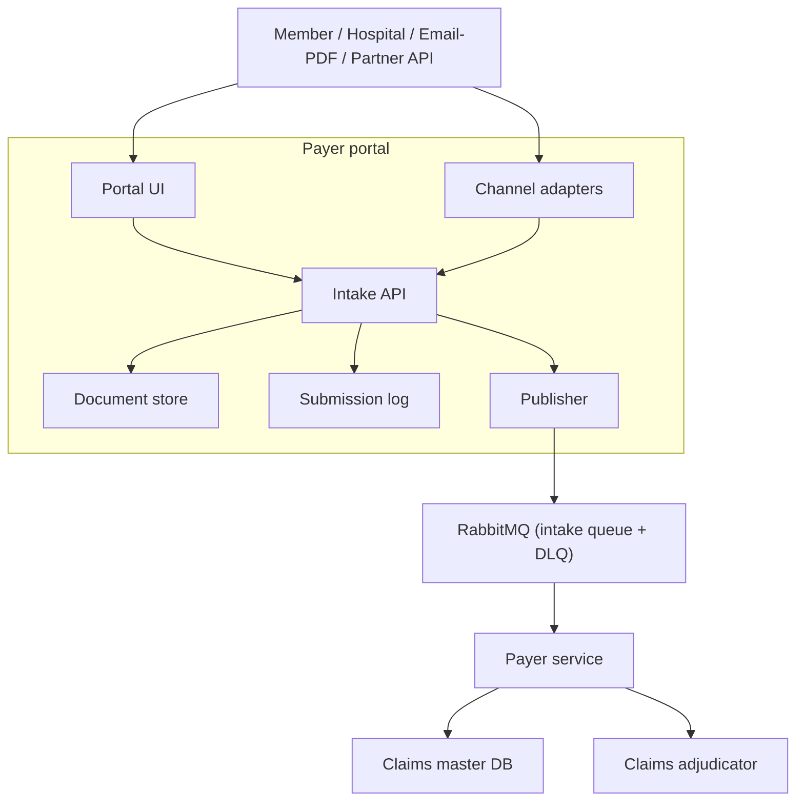

# Payer Portal — Design

Part of the Claims Adjudication Autonomous AI Agent (ClaimsAI Sentinel).
Session date: 2026-10-25. Status: design agreed; implementation not started.

## 1. Scope and assumptions

- **Insurance style:** US professional claims (CMS-1500 / 837P style): CPT procedure codes, ICD-10 diagnosis codes, provider NPIs.
- **Submitters:** mainly providers, with members also able to submit.
- **Build target:** a local learning build. The behaviour should be correct and data should stay consistent, but scaling and availability are out of scope. All data is synthetic.
- **What the portal owns:** intake only. It accepts submissions and documents, records each submission, and publishes one message per submission to RabbitMQ.
- **What it does not own:** business validation, document extraction, the claims master DB and adjudication. All of those belong to the payer service (next session).

## 2. Where the portal sits



The portal never keeps its own copy of claim state. The status view reads it from the payer service.

## 3. Portal components

| Component | Local stand-in | Responsibility |
|---|---|---|
| Portal UI | React form or Streamlit page | Submit a claim, upload documents, track status |
| Intake API | FastAPI | One entry point for every channel; schema-level checks only |
| Channel adapters | Folder watcher (email/PDF), partner REST endpoint | Turn other channels into the same message |
| Document store | Local folder or MinIO | Hold uploaded files; messages carry references only |
| Submission log | Postgres table `submission_log` | Idempotency key and outbox |
| Queue publisher | Small loop or worker | Publish pending log rows to RabbitMQ and mark them published |

## 4. Design rules

- **Thin portal:** the portal checks only the shape of a submission (JSON schema, required fields, file type and size). Business rules belong to the payer service.
- **Idempotency:** the portal generates `submission_id`, which is the idempotency key. A resubmission with the same ID is rejected as a duplicate.
- **Outbox pattern:** the `submission_log` row is written with `publish_status = pending` in the same transaction that accepts the upload. The publisher sends pending rows and marks them `published`. A crash between the database write and the publish therefore leads to a retry, never a lost claim.
- **One message shape:** every channel produces the same `claim.submitted` message.

## 5. Message contract — `claim.submitted` v1

```json
{
  "message_type": "claim.submitted",
  "schema_version": "1.0",
  "message_id": "6f1c2a9e-3b7d-4e1a-9c55-0d2b8f7e4a11",
  "submission_id": "SUB-20261025-000123",
  "submitted_at": "2026-10-25T09:10:00Z",
  "channel": "portal",
  "submitter": { "type": "provider", "id": "PRV-0042" },
  "extraction_required": false,
  "claim": {
    "claim_type": "professional",
    "member": {
      "member_id": "MBR-100231",
      "first_name": "Jane",
      "last_name": "Doe",
      "dob": "1984-03-12"
    },
    "group_number": "GRP-7781",
    "billing_provider": { "npi": "1234567893", "name": "Lakeside Family Clinic" },
    "rendering_npi": "1987654321",
    "place_of_service": "11",
    "service_from": "2026-10-20",
    "service_to": "2026-10-20",
    "diagnosis_codes": ["E11.9", "I10"],
    "lines": [
      {
        "line_no": 1,
        "cpt_code": "99214",
        "modifiers": [],
        "units": 1,
        "billed_amount": "185.00",
        "service_date": "2026-10-20",
        "diagnosis_pointers": [1, 2]
      },
      {
        "line_no": 2,
        "cpt_code": "83036",
        "modifiers": [],
        "units": 1,
        "billed_amount": "45.00",
        "service_date": "2026-10-20",
        "diagnosis_pointers": [1]
      }
    ],
    "total_billed": "230.00"
  },
  "documents": [
    {
      "document_id": "DOC-55410",
      "doc_type": "medical_record",
      "content_type": "application/pdf",
      "storage_uri": "s3://claims-docs/SUB-20261025-000123/visit-note.pdf",
      "sha256": "9b2e…"
    }
  ]
}
```

### Contract rules

- **The message is a fact, not a request.** It is immutable. A corrected claim is a new submission.
- **Email and PDF intake:** `extraction_required: true` with `claim: null`, and only `documents` filled in. The payer service does the extraction.
- **Formats:** money is a decimal string, never a float. Dates are ISO 8601. Timestamps are UTC.
- **Files travel by reference:** each document carries `storage_uri` and `sha256`, never the file bytes.
- **RabbitMQ settings:** persistent delivery, `message_id` set in the AMQP properties, routing key `claim.submitted`. A message that fails 3 times goes to the dead-letter queue.
- **Versioning:** adding an optional field is a minor version bump (1.1). Renaming or removing a field is a major bump (2.0), and consumers accept both versions during the switchover.

### Who validates what

| Portal (shape) | Payer service (business rules) |
|---|---|
| JSON schema, required fields | Member exists |
| File type and size | Policy active on the service date |
| Duplicate `submission_id` | NPI valid; CPT and ICD-10 codes valid |
| | Line amounts sum to `total_billed` |

## 6. Data model

> **Updated model:** later sessions added tables and columns (payer service, policy compliance, fraud detection, medical necessity). The current, complete data model is in `consolidated-design.md`, section 7. This section is the original starting point.

`submission_log` is owned and written by the **portal**. Every other table belongs to the **claims master DB**, which the **payer service** owns and is the only component allowed to write.

### Relationships

- submission_log 1 → 0..1 claim
- member 1 → N policy
- member 1 → N claim (as the patient)
- policy 1 → N claim
- provider 1 → N claim (as the billing provider)
- claim 1 → 1..N claim_line
- claim 1 → N claim_document
- claim 1 → N claim_status_history

### Tables

**submission_log** (portal)

| Column | Type | Notes |
|---|---|---|
| submission_id | text | PK, idempotency key |
| channel | text | portal, email, api |
| submitter_type | text | provider, member |
| submitter_id | text | |
| payload_sha256 | text | |
| publish_status | text | pending, published, failed |
| created_at | timestamptz | |
| published_at | timestamptz | |

**member** (reference data)

| Column | Type | Notes |
|---|---|---|
| member_id | text | PK |
| first_name | text | |
| last_name | text | |
| dob | date | |
| gender | text | |

**policy** (reference data)

| Column | Type | Notes |
|---|---|---|
| policy_id | text | PK |
| member_id | text | FK → member |
| plan_code | text | |
| group_number | text | |
| effective_date | date | |
| termination_date | date | |
| status | text | |

**provider** (reference data)

| Column | Type | Notes |
|---|---|---|
| provider_id | text | PK |
| npi | text | unique |
| name | text | |
| taxonomy_code | text | |
| network_status | text | in, out |
| quality_rating | smallint | 1–5, nullable; read by the medical necessity agent to flag low-quality providers |
| city | text | |
| state | text | two-letter code |

**claim**

| Column | Type | Notes |
|---|---|---|
| claim_id | text | PK |
| submission_id | text | FK → submission_log, unique (a redelivered message cannot create a second claim) |
| member_id | text | FK → member |
| policy_id | text | FK → policy |
| billing_provider_id | text | FK → provider |
| rendering_npi | text | |
| place_of_service | text | |
| diagnosis_codes | text[] | ICD-10, ordered (lines point at positions) |
| service_from | date | |
| service_to | date | |
| total_billed | numeric(12,2) | |
| status | text | see status values |
| received_at | timestamptz | |

**claim_line**

| Column | Type | Notes |
|---|---|---|
| claim_id | text | PK, FK → claim |
| line_no | int | PK |
| cpt_code | text | |
| modifiers | text[] | |
| units | int | |
| billed_amount | numeric(12,2) | |
| service_date | date | |
| diagnosis_pointers | int[] | positions in `claim.diagnosis_codes` |

Later, for adjudication: add `allowed_amount` and `line_status`.

**claim_document**

| Column | Type | Notes |
|---|---|---|
| document_id | text | PK |
| claim_id | text | FK → claim |
| doc_type | text | |
| storage_uri | text | |
| sha256 | text | |
| uploaded_at | timestamptz | |

**claim_status_history** (append-only; drives the status view and starts the audit trail)

| Column | Type | Notes |
|---|---|---|
| id | bigint | PK |
| claim_id | text | FK → claim |
| from_status | text | |
| to_status | text | |
| actor | text | |
| reason | text | |
| changed_at | timestamptz | |

### Claim status values

`RECEIVED → VALIDATING → PENDING_INFO | REJECTED → IN_ADJUDICATION → PENDING_REVIEW → APPROVED | DENIED → PAID`

## 7. Hand-off to the payer service (next session)

The payer service:

1. Consumes `claim.submitted` from RabbitMQ, retrying failures and sending repeated failures to the dead-letter queue.
2. Runs document extraction when `extraction_required` is true.
3. Applies the business validation rules.
4. Writes `claim`, `claim_line`, `claim_document` and `claim_status_history` in one transaction.
5. Sends incomplete claims to `PENDING_INFO` and the missing-info chatbot.
6. Starts adjudication **asynchronously**, by publishing `claim.ready_for_adjudication` or starting a LangGraph run with the `claim_id`. It does not wait for a result, because adjudication can pause for hours at human review.

## 8. Middle flow (reference, updated)

- The claims adjudicator fans out **policy compliance** ("is it covered?") and **fraud detection** ("is it genuine?") in parallel.
- **Adjudicator join:** waits for both results, then routes:
  - Not covered and fraud clear → back to the claimant.
  - Covered and fraud clear → **medical necessity** → human review.
  - Fraud flagged → **investigation**. If cleared, the claim continues to medical necessity.
- **Open case:** a claim that is not covered *and* fraud flagged. If investigation clears it, it should go back to the claimant as not covered, not on to medical necessity; if fraud is confirmed, it is denied. The adjudicator's join-rule table needs this row.

## 9. Still open for the portal

- Intake API endpoints, request shapes and error responses
- Portal screens: submit, upload, track status
- Shared schema code: Pydantic models for the contract and DDL for `submission_log`
- Channel adapters for email/PDF folder drops and partner API calls
