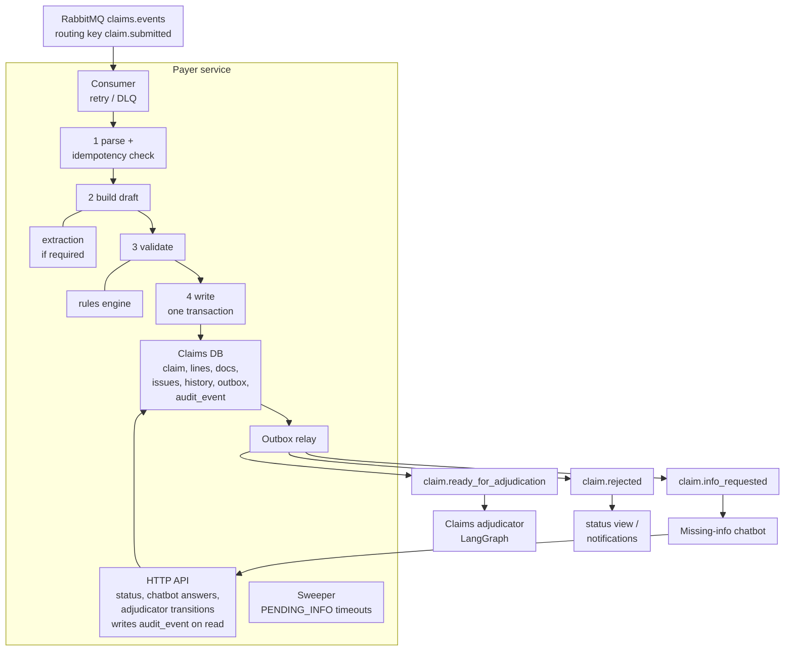

# Payer Service — Design

Part of the Claims Adjudication Autonomous AI Agent (ClaimsAI Sentinel).
Session date: 2026-10-25. Status: design proposed; implementation not started.
Builds on `payer-portal-design.md` (the `claim.submitted` v1 contract and the claims master DB data model).

## 1. Scope and assumptions

- **What the payer service owns:** everything between the queue and the adjudicator. It consumes `claim.submitted`, extracts claims from documents, runs business validation, is the **only writer** of the claims master DB, hands incomplete claims to the missing-info chatbot, and starts adjudication asynchronously.
- **What it does not own:** intake and `submission_log` (portal), the chatbot conversation itself (chatbot service), and adjudication decisions (claims adjudicator).
- **Build target:** same as the portal — a local learning build in Python. Correctness and consistency matter; scale and availability do not. All data is synthetic.
- **Stack:** Python 3.12, `aio-pika` (RabbitMQ), SQLAlchemy 2 + Postgres, Pydantic v2, FastAPI for the small HTTP API, an LLM with structured output for extraction.

## 2. Where the service sits



### Components

| Component | Local stand-in | Responsibility |
|---|---|---|
| Consumer | `aio-pika` worker, manual ack, prefetch 1 | Receive `claim.submitted`, run the pipeline, retry or dead-letter failures |
| Extraction | PDF text layer, then a vision-capable LLM for scans | Turn documents into a claim draft with evidence for every field |
| Rules engine | Plain Python rule functions | Business validation; returns every issue, not just the first |
| Repository | SQLAlchemy | The one-transaction write and the `transition()` function |
| Outbox relay | Async loop polling the `outbox` table | Publish events committed with claim changes |
| HTTP API | FastAPI | Status view for the portal, answers from the chatbot, status transitions from the adjudicator |
| Sweeper | Periodic task (every 15 min) | Reject PENDING_INFO claims past their reply deadline |
| DLQ tools | Two CLI scripts | Inspect and replay dead-lettered messages |

For local runs, the consumer, relay, API and sweeper can be asyncio tasks in one process.

## 3. Design rules

- **Business outcomes are not errors.** A claim that fails a business rule is a successful run that ends in `REJECTED` or `PENDING_INFO`, and its message is acked. Retries and the dead-letter queue are only for messages the service *could not process*.
- **Idempotent by `submission_id`.** Delivery is at-least-once. `claim.submission_id` is unique, so a redelivered message can never create a second claim.
- **Commit, then ack.** The RabbitMQ message is acked only after the claim transaction commits. A crash between the two causes a redelivery, which the idempotency check absorbs.
- **No network calls inside the transaction.** Extraction and document fetching happen before the transaction opens; inside it there are only database reads and writes.
- **Events leave through an outbox.** Every event (ready for adjudication, info requested, rejected) is written to the `outbox` table in the same transaction as the claim change, then published by the relay. Same pattern as the portal.
- **One state machine, one place.** Every status change goes through `transition()`, which checks the allowed-transitions table and writes `claim_status_history`. Nothing updates `claim.status` directly.
- **AI proposes, code decides.** The LLM extracts and the chatbot converses, but deterministic code decides whether a field is valid and whether a claim is complete.

## 4. Consuming from RabbitMQ

### Topology

| Object | Type | Settings |
|---|---|---|
| `claims.events` | topic exchange, durable | The portal publishes `claim.submitted` here |
| `payer.claim_submitted` | quorum queue | Bound to `claim.submitted`. `x-delivery-limit: 5`, `x-dead-letter-exchange: claims.dlx`, `x-dead-letter-routing-key: payer.claim_submitted` |
| `claims.retry` | direct exchange | Routes to the delay queues |
| `payer.claim_submitted.retry.10s` | queue | `x-message-ttl: 10000`, dead-letters to the default exchange (`""`) with routing key `payer.claim_submitted` |
| `payer.claim_submitted.retry.60s` | queue | Same, with `x-message-ttl: 60000` |
| `claims.dlx` | direct exchange | Dead-letter exchange |
| `payer.claim_submitted.dlq` | quorum queue | No consumer; inspected and replayed by hand |

Dead-lettering from a delay queue to the default exchange with the queue name as routing key sends the retry back to the payer's queue only, not to any other subscriber of `claim.submitted`.

### Consumer settings

- Manual ack, `prefetch_count = 1` (extraction can take tens of seconds; one claim at a time per worker).
- Run one or two workers; correctness never depends on how many.
- Log `message_id`, `submission_id` and `claim_id` on every line; never log claim content (it is PHI, even when synthetic — build the habit).

### Retry and dead-letter policy

The contract says a message that fails 3 times goes to the dead-letter queue. That means **3 attempts in total**: the first delivery, a retry after 10 s, and a retry after 60 s.

Two mechanisms work together:

1. **Application retries (caught errors).** The consumer classifies the exception. For a retry, it republishes a copy to `claims.retry` with header `x-attempt: n+1`, waits for the publisher confirm, then acks the original. To dead-letter, it publishes to `claims.dlx` with error headers, waits for the confirm, then acks. Publishing by hand (rather than `nack(requeue=False)`) is what lets the DLQ message carry the error details.
2. **Broker delivery limit (crashes).** If the worker dies mid-message (out of memory, killed), the message is redelivered without the consumer ever catching anything. The quorum queue counts deliveries, and after 5 it dead-letters the message itself. This stops a poison message from crash-looping the worker forever.

If a publish to the retry or DLX exchange fails, the consumer does not ack; the broker redelivers and the delivery limit still applies.

| Failure | Class | Action |
|---|---|---|
| Postgres unavailable, deadlock, serialization failure | Transient | Retry |
| Document store unreachable | Transient | Retry |
| LLM / OCR timeout, rate limit, 5xx | Transient | Retry |
| Any unexpected exception | Transient | Retry (then DLQ) |
| Body is not valid JSON, or fails the contract schema | Permanent | DLQ immediately |
| Unsupported `schema_version` major version | Permanent | DLQ immediately |
| Document `sha256` does not match the stored file | Permanent | DLQ immediately (integrity problem; needs a person) |
| Unique violation on `submission_id` | Not a failure | Ack (already processed) |
| Any business rule failure | Not a failure | Write REJECTED or PENDING_INFO, ack |

DLQ message headers: `x-error-class`, `x-error`, `x-attempts`, `x-failed-at`, plus the original properties (`message_id` unchanged).

When a message is dead-lettered, the consumer also writes a best-effort row to `intake_error` so the portal's status view can show "processing failed, under investigation" instead of "processing" forever. Best effort, because the database may be the thing that failed.

**DLQ tools:** `dlq_inspect` lists messages with their error headers; `dlq_replay --message-id …` republishes one message to `payer.claim_submitted` with `x-attempt` reset to 1 and marks its `intake_error` row resolved. Replaying is always safe because processing is idempotent.

### Handler sketch

```python
async def on_message(msg: AbstractIncomingMessage) -> None:
    attempt = int(msg.headers.get("x-attempt", 1))
    try:
        sub = parse_contract(msg.body)                     # raises PermanentError
        if await repo.claim_exists(sub.submission_id):     # cheap check before expensive extraction
            await msg.ack(); return
        draft, docs = await build_draft(sub)               # fetch + verify docs, extraction if required
        async with db.begin() as tx:                       # the one transaction
            outcome = await rules.validate(draft, tx)      # reads reference data only
            await repo.write_intake(tx, sub, draft, docs, outcome)
        await msg.ack()
    except DuplicateClaim:                                 # unique violation: another worker won
        await msg.ack()
    except PermanentError as e:
        await dead_letter(msg, e, attempt); await msg.ack()
    except Exception as e:                                 # transient or unknown
        if attempt < 3:
            await schedule_retry(msg, attempt + 1)         # 10s queue, then 60s queue
        else:
            await dead_letter(msg, e, attempt)
        await msg.ack()
```

## 5. Document extraction

Runs only when `extraction_required: true` (email and PDF intake, where `claim` is `null`). When a portal submission includes documents with a filled-in `claim`, the documents are stored as `claim_document` rows and left for the adjudicator's agents (the medical necessity agent reads the medical record); they are not extracted here.

### Steps

1. **Fetch and verify.** Read each file from `storage_uri` and compare its SHA-256 with the message. A mismatch is a permanent failure.
2. **Check the cache.** Look up `document_extraction` by `(document_id, sha256, extractor_version)`. If a result exists — for example, from an attempt whose database write later failed — reuse it. Retries never pay for extraction twice.
3. **Classify.** Decide what each document is: claim form (CMS-1500), medical record, itemised bill, or other. Only claim forms and itemised bills feed the claim fields.
4. **Get text.** Use the PDF text layer when there is one (`pypdf` / `pdfplumber`). For scans or images, render the pages and send them to a vision-capable LLM. Tesseract is an option if you want to keep OCR separate from the LLM.
5. **Extract to the contract schema.** The LLM fills the same Pydantic `ClaimDraft` model as the `claim` block of the contract, using structured output. For every field it returns the value **and the source evidence** (page and quoted text). The prompt tells it to return `null` when a value is not present, never to guess.
6. **Normalise.** Dates to ISO 8601, money to `Decimal`, NPIs to 10 digits, ICD-10 codes with the dot (`E119` → `E11.9`), CPT codes as 5 characters.
7. **Ground-check each field.** A field counts as *confirmed* only if its quoted evidence actually appears in the document text, and it passes its format check (NPI check digit, code exists in the reference table, valid date). Fields that fail become `UNCONFIRMED_FIELD` issues, so the chatbot asks the claimant to confirm them rather than the system trusting them.
8. **Save the result** to `document_extraction` in its own small transaction (it is a cache and an audit record, not claim data).

LLM self-reported confidence scores are not calibrated, so this design relies on evidence plus deterministic checks instead. The extraction result stays on record, so a reviewer can always see what the AI read and where.

## 6. Business validation

### How the engine works

- Input: a `ClaimDraft` (from the message or from extraction, plus any chatbot amendments). The same code path runs on first intake and on every revalidation.
- Each rule returns zero or more **issues**: `field_path` (e.g. `lines[1].cpt_code`), `issue_code`, a plain-language message, and a severity.
- All rules run, so the claimant is asked for everything at once. Rules whose inputs are missing are skipped (no coverage check without a matched member).
- Rules read reference tables (`member`, `policy`, `provider`, `ref_cpt`, `ref_icd10`) inside the write transaction, so the policy used for validation is the one recorded on the claim.

### Severity and outcome

| Severity | Meaning | Outcome |
|---|---|---|
| `REJECT` | The claim cannot proceed, and the claimant cannot fix it by answering a question | `REJECTED` |
| `MISSING_INFO` | The claimant can fix it | `PENDING_INFO` |
| `FLAG` | Worth telling the adjudicator, does not block | Continues, flag carried forward |

Outcome: any `REJECT` → `REJECTED` (asking for more information would be pointless). Otherwise any `MISSING_INFO` → `PENDING_INFO`. Otherwise → `VALIDATED`.

This matches US usage: a **rejected** claim failed front-end edits and never entered adjudication, so it can be resubmitted; a **denied** claim was adjudicated.

### Rules

| Rule | Issue code | Severity |
|---|---|---|
| Required field missing (member, billing NPI, service dates, ≥ 1 diagnosis, ≥ 1 line; per line: CPT, units, amount, pointer) | `MISSING_FIELD` | MISSING_INFO |
| Extracted field failed its ground check | `UNCONFIRMED_FIELD` | MISSING_INFO |
| `member_id` not found, or name / DOB do not match it | `MEMBER_NOT_MATCHED` | MISSING_INFO |
| No policy active for the member across `service_from`–`service_to` | `NO_ACTIVE_COVERAGE` | REJECT |
| More than one active policy and `group_number` does not pick one | `POLICY_AMBIGUOUS` | MISSING_INFO |
| `group_number` differs from the active policy's | `GROUP_MISMATCH` | FLAG |
| Billing or rendering NPI fails the check digit (Luhn over `80840` + first 9 digits) | `INVALID_NPI` | MISSING_INFO |
| Billing NPI valid but not in `provider` | `PROVIDER_NOT_ON_FILE` | REJECT |
| CPT code not in `ref_cpt`; ICD-10 code unknown or not billable (a category such as `E11`) | `INVALID_CODE` | MISSING_INFO |
| Sum of line `billed_amount` ≠ `total_billed`; any amount ≤ 0; units < 1 | `AMOUNT_MISMATCH` | MISSING_INFO |
| `service_from` > `service_to`, line date outside that range, or a date in the future | `INVALID_DATE` | MISSING_INFO |
| Diagnosis pointer outside `1..len(diagnosis_codes)`; more than 4 pointers per line or 12 diagnoses (CMS-1500 limits) | `INVALID_POINTER` | MISSING_INFO |
| Submitted more than the timely-filing limit after `service_to` (configurable, default 365 days) | `TIMELY_FILING` | REJECT |
| Same member, billing provider, dates and lines as an existing claim | `POSSIBLE_DUPLICATE` | FLAG (the fraud agent sees it) |
| No reply within the PENDING_INFO window | `INFO_TIMEOUT` | REJECT (set by the sweeper) |

Notes:

- Out-of-network providers are not rejected here. Network status is an adjudication question.
- A member ID that is not found is `MISSING_INFO`, not `REJECT`, because it is most often a typo. The service never auto-matches by name and DOB alone; it asks.
- Exact duplicates are flagged rather than rejected, because the contract treats a corrected claim as a new submission and a correction looks like a duplicate. See open question 2.
- CPT is licensed by the AMA, so seed `ref_cpt` with only the codes your synthetic data uses. ICD-10-CM is public from CMS and can be loaded in full.

## 7. Writing the claim in one transaction

### Draft first, relational when valid

A claim in `PENDING_INFO` or `REJECTED` can have missing or wrong values, which do not fit the strict columns and foreign keys of `claim` and `claim_line`. So:

- Every claim row is written at intake, holding the raw message in `source_message` and the current working copy in `draft` (JSON, the `ClaimDraft` model).
- The relational columns (`member_id`, `policy_id`, `billing_provider_id`, dates, `total_billed`, …) and the `claim_line` rows are written **when the claim reaches `VALIDATED`**, from the draft.
- A `CHECK` constraint makes those columns non-null for every status from `VALIDATED` onwards.

Validated data is strict and relational; unvalidated data is a draft. The validation code always reads the draft, so there is one code path.

### The transaction

```
BEGIN
  validate(draft)                         -- reads member, policy, provider, ref tables
  INSERT claim (... status = <outcome>, draft, source_message, flags)
         ON CONFLICT (submission_id) DO NOTHING RETURNING claim_id
         -- no row returned → ROLLBACK, raise DuplicateClaim → ack
  INSERT claim_document  (one per document in the message)
  INSERT claim_line      (only if VALIDATED)
  INSERT claim_issue     (one per issue)
  INSERT claim_status_history  (NULL → RECEIVED), (RECEIVED → <outcome>)
  INSERT outbox          (claim.ready_for_adjudication | claim.info_requested | claim.rejected)
COMMIT
→ ack the RabbitMQ message
```

If anything fails before `COMMIT`, nothing is written and the message goes through the retry policy.

### State transitions

`transition(tx, claim_id, from_status, to_status, actor, reason_code, reason)` runs:

```sql
UPDATE claim SET status = :to, version = version + 1
WHERE claim_id = :id AND status = :from;
```

Zero rows updated means someone else moved the claim first (for example, the chatbot's last answer and the sweeper's timeout at the same moment), and the caller gets a conflict instead of overwriting. It then appends the `claim_status_history` row.

Transitions the payer service performs:

| From | To | Trigger |
|---|---|---|
| (new) | `RECEIVED` → `VALIDATED` / `PENDING_INFO` / `REJECTED` | Intake |
| `PENDING_INFO` | `VALIDATED` / `PENDING_INFO` / `REJECTED` | Revalidation after chatbot answers |
| `PENDING_INFO` | `REJECTED` | Sweeper timeout |
| `VALIDATED` | `IN_ADJUDICATION` and later statuses | Requested by the adjudicator through the transitions API (below) |

### Transitions API (decided 2026-10-25)

The payer service stays the **only writer** of the claims master DB. The adjudicator never updates `claim.status` itself; it asks the payer service, which enforces the state machine.

`POST /claims/{claim_id}/transitions`

```json
{
  "from_status": "VALIDATED",
  "to_status": "IN_ADJUDICATION",
  "actor": "adjudicator:run/CLM-20261025-000087",
  "reason_code": "ADJUDICATION_STARTED",
  "reason": "LangGraph run started",
  "idempotency_key": "CLM-20261025-000087:VALIDATED->IN_ADJUDICATION"
}
```

| Response | Meaning |
|---|---|
| `200` | Transition applied, or already applied with the same `idempotency_key` (safe to retry) |
| `409 Conflict` | The claim is no longer in `from_status`; the body returns the current status |
| `422` | Transition not allowed for this caller, or `reason_code` missing |

Transitions the adjudicator may request:

| From | To |
|---|---|
| `VALIDATED` | `IN_ADJUDICATION` |
| `IN_ADJUDICATION` | `PENDING_REVIEW`, `DENIED`, `PENDING_INFO` (added 2026-10-25; the request carries `issues`, see the orchestrator doc section 5.1) |
| `PENDING_REVIEW` | `APPROVED`, `DENIED` |

`APPROVED → PAID` is reserved for the payment step. Each accepted call runs `transition()` and writes `claim_status_history` with the caller as `actor`. Adjudication results (agent outputs, rationale, reviewer decision) are not stored through this endpoint; their tables are designed in the adjudicator session.

## 8. Missing-info chatbot hand-off

### Hand-off

1. Intake ends in `PENDING_INFO`. The transaction has written one `claim_issue` row per problem and an outbox event `claim.info_requested` with a reply deadline (`respond_by`, configurable, e.g. 14 days).
2. The chatbot service consumes the event and opens a conversation with the submitter: the portal chat widget for portal users, a link by email for email submissions.
3. The chatbot turns each open issue into a natural question, using the issue's field path and message ("Line 2's procedure code 8303 isn't valid — could you check it? It may be 83036.").

### The chatbot never writes the claim

It calls the payer service API as tools:

| Endpoint | Purpose |
|---|---|
| `GET /claims/{claim_id}/issues?status=open` | What still needs answering |
| `POST /claims/{claim_id}/issues/{issue_id}/answers` | Body: `value`, `conversation_id`, the claimant's original words. The payer service runs that field's rules. `200` resolves the issue; `422` returns a message the bot relays ("that NPI fails its check digit"). |
| `POST /claims/{claim_id}/documents` | Attach a document the claimant uploaded through the portal (already in the document store) |

**For the medical necessity agent:** `GET /claims/{claim_id}/medical-records` returns `[{document_id, received_at, text}]` for every `medical_record` document (PDF text layer). Read-only; each read writes an `audit_event`. See `medical-necessity-agent-design.md`, section 3.

On each accepted answer, the payer service patches the draft, writes a `claim_amendment` row (old value, new value, source, conversation), and resolves the issue — in one transaction. When the last open issue is resolved, the same transaction **revalidates the whole draft**, because one fix can expose another issue (a corrected member ID can reveal no active coverage). The result moves the claim to `VALIDATED`, `REJECTED`, or stays `PENDING_INFO` with new issues and a new `claim.info_requested` event.

### Guard rails

- Only fields with an open issue can be changed through the chatbot. Anything bigger is a new submission.
- The API checks that the conversation belongs to the claim's submitter.
- Claimant text is data, not instructions. The LLM only proposes a value; the field's rule decides whether it is valid.
- The original `claim.submitted` message is never changed. The claim evolves through recorded amendments, so the contract's "a message is a fact" rule still holds.
- The sweeper rejects claims past `respond_by` with `INFO_TIMEOUT`. Reminders are the chatbot service's job, using `respond_by`.

### `claim.info_requested` v1

```json
{
  "message_type": "claim.info_requested",
  "schema_version": "1.0",
  "message_id": "1d0e7c3a-5a1f-4b8e-9f20-6c2a9b0e5d77",
  "claim_id": "CLM-20261025-000087",
  "submission_id": "SUB-20261025-000123",
  "channel": "portal",
  "submitter": { "type": "provider", "id": "PRV-0042" },
  "respond_by": "2026-11-08T09:10:00Z",
  "issues": [
    {
      "issue_id": 5512,
      "field_path": "lines[2].cpt_code",
      "issue_code": "INVALID_CODE",
      "message": "Procedure code 8303 is not a valid CPT code."
    }
  ]
}
```

## 9. Starting the adjudicator asynchronously

### Decision: event through the outbox, not a direct call

The `VALIDATED` transaction writes `claim.ready_for_adjudication` to the outbox. The relay publishes it to `claims.events`. The adjudicator consumes it and starts a LangGraph run.

Why not start the LangGraph run directly from the payer service:

- A crash between the commit and the call would leave the claim `VALIDATED` with nothing running. The outbox makes the start as durable as the claim.
- If the adjudicator is down, events wait in its queue instead of failing intake.
- The payer service stays unaware of LangGraph.

### What the adjudicator does with it (for the adjudicator session)

- Uses `claim_id:adjudication_attempt` as the LangGraph `thread_id` with a Postgres checkpointer (changed 2026-10-25 so a claim answered after PENDING_INFO can be adjudicated again; `adjudication_attempt` is added to the event in v1.1, see the orchestrator doc section 5.1). If a checkpoint for that thread already exists, the event is a redelivery and is acked without starting a second run.
- Calls the transitions API to move the claim `VALIDATED → IN_ADJUDICATION` when the run actually starts. A claim sitting in `VALIDATED` for long therefore means the adjudicator is not picking up work, which is easy to spot.
- Because runs are checkpointed, a run that pauses for hours at human review survives restarts. The payer service never waits for a result.

### `claim.ready_for_adjudication` v1

```json
{
  "message_type": "claim.ready_for_adjudication",
  "schema_version": "1.0",
  "message_id": "a3f9e2b1-77c4-4d0a-8e15-2b6f0c9d4e38",
  "claim_id": "CLM-20261025-000087",
  "submission_id": "SUB-20261025-000123",
  "validated_at": "2026-10-25T09:10:42Z",
  "flags": ["POSSIBLE_DUPLICATE"]
}
```

The event is thin on purpose: it carries IDs, not claim data. The adjudicator reads the claim through the payer API (not a direct database role), so it always sees the committed version and its reads are logged (section 12.3). Same RabbitMQ settings as `claim.submitted`: persistent, `message_id` in the AMQP properties, its own quorum queue with retries and DLQ on the adjudicator side.

### Outbox relay

- Polls `SELECT … FROM outbox WHERE published_at IS NULL ORDER BY id LIMIT 50 FOR UPDATE SKIP LOCKED` every second (or wakes on Postgres `LISTEN/NOTIFY`).
- Publishes each row with publisher confirms, then sets `published_at`.
- A crash after publishing but before marking means the event is sent twice; every consumer is idempotent on `message_id` or `claim_id`, so that is harmless.

## 10. Status view API (for the portal)

`GET /submissions/{submission_id}/status` returns:

- No claim yet, no `intake_error` → `PROCESSING`.
- No claim, open `intake_error` → `FAILED_PROCESSING` ("we're looking into it").
- Otherwise the claim's status, its history, and any open issues in plain language.

## 11. Data model changes

### Changes to existing tables

**claim**

| Change | Why |
|---|---|
| `member_id`, `policy_id`, `billing_provider_id`, `service_from`, `service_to`, `total_billed`, `diagnosis_codes` become nullable, with `CHECK (status IN ('RECEIVED','PENDING_INFO','REJECTED') OR (all of them NOT NULL))` | PENDING_INFO and REJECTED claims may not have valid values |
| Add `draft jsonb NOT NULL` | Current working copy (`ClaimDraft`) |
| Add `source_message jsonb NOT NULL` | The original `claim.submitted` message, never changed |
| Add `channel text`, `submitter_type text`, `submitter_id text` | Needed for the chatbot hand-off without reading `submission_log` |
| Add `flags text[] NOT NULL DEFAULT '{}'` | e.g. `POSSIBLE_DUPLICATE`, `GROUP_MISMATCH` |
| Add `respond_by timestamptz` | PENDING_INFO deadline |
| Add `version int NOT NULL DEFAULT 0` | Guard for concurrent transitions |
| Add `reference_snapshot jsonb` | Member, policy and provider rows as used by the last validation (section 12.2) |
| `submission_id` FK → `submission_log` | Keep only if both live in one Postgres database (recommended: one instance, schemas `portal` and `claims`). Otherwise keep it unique without the FK. |

**claim_line**: unchanged. Rows exist only from `VALIDATED` onwards. ("A validated claim has ≥ 1 line" is enforced in code; a deferred constraint trigger can enforce it in the database if you want.)

**claim_status_history**: add `reason_code text` next to `reason`, and `details jsonb` (e.g. the reference snapshot used). Append-only (section 12.1).

**audit_event**: new, defined in section 12. **claim_audit_trail**: new view, section 12.5.

### Status values (updated)

`RECEIVED → VALIDATED | PENDING_INFO | REJECTED`, `PENDING_INFO → VALIDATED | REJECTED`, `VALIDATED → IN_ADJUDICATION → PENDING_REVIEW → APPROVED | DENIED → PAID`

- **Added `VALIDATED`:** validated and queued, but the adjudicator has not started yet.
- **Removed `VALIDATING`:** with one transaction it is never visible in the database. Work in progress shows as `PROCESSING` from the status API.
- `RECEIVED` is kept as the first history row, so the audit trail starts at intake.

### New tables

**claim_issue**

| Column | Type | Notes |
|---|---|---|
| issue_id | bigint | PK |
| claim_id | text | FK → claim |
| field_path | text | e.g. `lines[2].cpt_code` |
| issue_code | text | from the rules table |
| severity | text | REJECT, MISSING_INFO, FLAG |
| message | text | plain language, shown to the claimant |
| status | text | open, resolved, superseded |
| created_at | timestamptz | |
| resolved_at | timestamptz | |

**claim_amendment**

| Column | Type | Notes |
|---|---|---|
| amendment_id | bigint | PK |
| claim_id | text | FK → claim |
| issue_id | bigint | FK → claim_issue |
| field_path | text | |
| old_value | jsonb | |
| new_value | jsonb | |
| source | text | chatbot, document |
| conversation_id | text | |
| claimant_text | text | the claimant's words, for the audit trail |
| created_at | timestamptz | |

**document_extraction**

| Column | Type | Notes |
|---|---|---|
| document_id | text | PK (with the next two) |
| sha256 | text | PK |
| extractor_version | text | PK; prompt + model + code version |
| doc_class | text | cms1500, medical_record, itemized_bill, other |
| result | jsonb | fields, values, evidence, ground-check results |
| created_at | timestamptz | |

**outbox**

| Column | Type | Notes |
|---|---|---|
| id | bigint | PK |
| message_id | uuid | unique |
| routing_key | text | |
| claim_id | text | |
| payload | jsonb | |
| created_at | timestamptz | |
| published_at | timestamptz | null until published |

**intake_error**

| Column | Type | Notes |
|---|---|---|
| message_id | uuid | PK |
| submission_id | text | |
| error_class | text | |
| error | text | |
| attempts | int | |
| dead_lettered_at | timestamptz | |
| resolved_at | timestamptz | set by `dlq_replay` |

**Reference tables:** `ref_cpt (code, description, active)`, `ref_icd10 (code, description, billable)`. Optional: `ref_place_of_service`.

## 12. Audit trail

### Do we need a separate table?

Mostly no. The tables that already exist **are** the audit trail for what happened to a claim, and they are typed and easy to query:

| What happened | Where it is recorded |
|---|---|
| Claim received (original message) | `claim.source_message` |
| What the AI extracted, with evidence | `document_extraction` |
| Problems found and resolved | `claim_issue` |
| Corrections from the claimant | `claim_amendment` |
| Every status change, who made it and why | `claim_status_history` |
| Events sent to other services | `outbox` |
| Processing failures | `intake_error` |

Only **one new table** is needed, `audit_event`, for the two kinds of record that have no home yet: **reads** (who looked at a claim) and **operator actions** (DLQ replays and other manual fixes). A view, `claim_audit_trail`, joins everything into one timeline per claim, so there is no need to copy data into a single table.

### 12.1 Append-only, enforced by the database

These tables can only be added to: `claim_status_history`, `claim_amendment`, `document_extraction`, `audit_event`.

- **Two database roles.** `claims_owner` owns the schema and is used only for migrations. `payer_app` is what the service connects as.
- **Grants.** `payer_app` gets `SELECT, INSERT` on the append-only tables, with no `UPDATE` or `DELETE`.
- **Trigger as a second guard.** A `BEFORE UPDATE OR DELETE` trigger on each append-only table raises an error. This also stops the owner role by accident (grants do not apply to the owner).
- **The original message cannot change.** A trigger on `claim` rejects any update that changes `source_message`.

`claim_issue` is not append-only (issues move from open to resolved); its history is covered by `claim_amendment` and the timestamps on the issue.

### 12.2 What the claim was checked against

Validation reads `member`, `policy` and `provider`, and those rows can be edited later (a policy's termination date corrected, a provider leaving the network). So each validation saves the rows it used:

- New column `claim.reference_snapshot jsonb`: the member, policy and provider rows exactly as read in the validation transaction, plus the time they were read.
- Written on every validation (first intake and each revalidation). Every status change also copies the snapshot it was based on into `claim_status_history.details`, so earlier snapshots are not lost when a later validation overwrites the column.

This is simpler than versioning the reference tables and answers the question an auditor asks: "what did the policy say when you made this decision?"

### 12.3 Who read what

Every API endpoint that returns claim data writes an `audit_event` row **before** returning the data, with `action` such as `claim.read`, `claim.issues.read`, `document.url_issued`.

- Covers the portal status view, the chatbot, and the adjudicator.
- **The adjudicator reads claims through the payer API, not a direct database role**, so its reads are logged too.
- Documents are fetched from the document store with short-lived signed URLs issued by the API, and issuing the URL is what gets logged.
- **Fail closed:** if the `audit_event` insert fails, the request fails. Data is never returned without a log.
- Record who, in which role, what, and when — not the data that was returned.

### 12.4 Operator actions

Anything a person does outside the normal flow writes an `audit_event` row:

- `dlq_replay` and `dlq_discard` require `--actor` and `--reason` and log both, with the `message_id` and attempt count.
- Any manual status correction goes through the transitions API with an operator actor, so it lands in `claim_status_history` like any other change.
- Reference data loads (seeding members, policies, codes) log who loaded what file.

### 12.5 One correlation ID across services

`submission_id` is the correlation ID for the claim's whole life, because it exists from the moment the portal accepts the submission.

- RabbitMQ: every message carries `correlation_id = submission_id` in the AMQP properties (the events already carry it in the body as well).
- HTTP: every call between services carries `X-Correlation-ID: <submission_id>`.
- Logs: every structured log line has `correlation_id`, plus `claim_id` once it exists.
- `audit_event.correlation_id` stores it, so database records and logs can be joined.

The `claim_audit_trail` view unions `claim_status_history`, `claim_amendment`, `claim_issue`, `document_extraction`, `outbox` and `audit_event` by `claim_id`, ordered by time. One query shows a claim's full story. The portal's `submission_log` row joins on `submission_id`.

### 12.6 Optional: tamper evidence (hash chain)

Grants and triggers stop the application from editing history; they do not stop someone with full database access. To make such edits **detectable**:

- Add `prev_hash` and `row_hash` to `claim_status_history` and `audit_event`.
- `row_hash = sha256(prev_hash || canonical JSON of the row)`, chained per claim (per day for rows without a claim).
- A `verify_audit_chain` script recomputes the chain and reports the first broken link.
- To catch someone rewriting a whole chain, write the latest hash to a file outside the database once a day.

Skip this for the first build; add it if you want to demonstrate tamper evidence.

### `audit_event`

| Column | Type | Notes |
|---|---|---|
| event_id | bigint | PK |
| occurred_at | timestamptz | |
| actor_type | text | user, service, operator |
| actor_id | text | e.g. `PRV-0042`, `adjudicator`, `ops:ravi` |
| actor_role | text | provider, member, reviewer, service, ops |
| action | text | `claim.read`, `document.url_issued`, `dlq_replay`, `reference.load` |
| claim_id | text | nullable |
| submission_id | text | nullable |
| correlation_id | text | |
| reason | text | required for operator actions |
| details | jsonb | e.g. endpoint, message_id; never claim content |
| prev_hash, row_hash | text | only if 12.6 is adopted |

## 13. Tests that prove the design

- The same message delivered twice creates one claim.
- Kill the worker after `COMMIT` and before ack: on restart, the redelivery is acked with no second claim.
- A transient failure 3 times in a row ends in the DLQ with error headers and an `intake_error` row; `dlq_replay` then succeeds.
- A malformed message goes to the DLQ on the first attempt.
- A crash-looping message is dead-lettered by the broker after 5 deliveries.
- Extraction is not repeated on retry (cache hit).
- An extracted value whose evidence is not in the document becomes `UNCONFIRMED_FIELD`.
- One test per validation rule, plus outcome precedence (REJECT beats MISSING_INFO).
- Chatbot answer → revalidation → `VALIDATED` → exactly one `claim.ready_for_adjudication` event.
- A chatbot answer and a sweeper timeout racing on the same claim: one wins, the other gets a conflict.
- The outbox relay publishing twice does not start two adjudicator runs.
- `payer_app` cannot update or delete a `claim_status_history` row, and the trigger blocks the owner role too.
- Editing a policy after validation does not change the claim's `reference_snapshot`.
- Reading a claim through the API writes an `audit_event` row; if that insert fails, the read fails.
- `dlq_replay` without `--reason` refuses to run.
- `claim_audit_trail` for one claim returns intake, issues, amendments and every status change in order.

## 14. Open questions

1. ~~Who writes status after `VALIDATED`?~~ **Decided 2026-10-25:** the adjudicator asks the payer service through `POST /claims/{claim_id}/transitions` (section 7). The payer service remains the only writer.
2. **Corrected and replacement claims.** Add an optional `replaces_claim_id` to the contract (a minor bump to v1.1, like the 837's frequency code 7), so a correction is linked to the original rather than flagged as a possible duplicate.
3. **Reply window** for PENDING_INFO: 14 days is a placeholder.
4. **Coverage spanning a policy change** (service dates cross a renewal): currently rejected as `NO_ACTIVE_COVERAGE`; may need line-level checks later.
5. **Design-notes alignment:** the earlier design notes had the adjudicator owning the completeness rules and the chatbot. This design moves both to the payer service, as agreed in the portal session, so the adjudicator only ever sees complete claims.

## 15. Still open for the payer service

- Pydantic models: `ClaimSubmittedV1`, `ClaimDraft`, and the three outbound events
- DDL for the changed and new tables, plus seed data for reference tables
- The extraction prompt and the `extractor_version` scheme
- RabbitMQ topology declaration script
