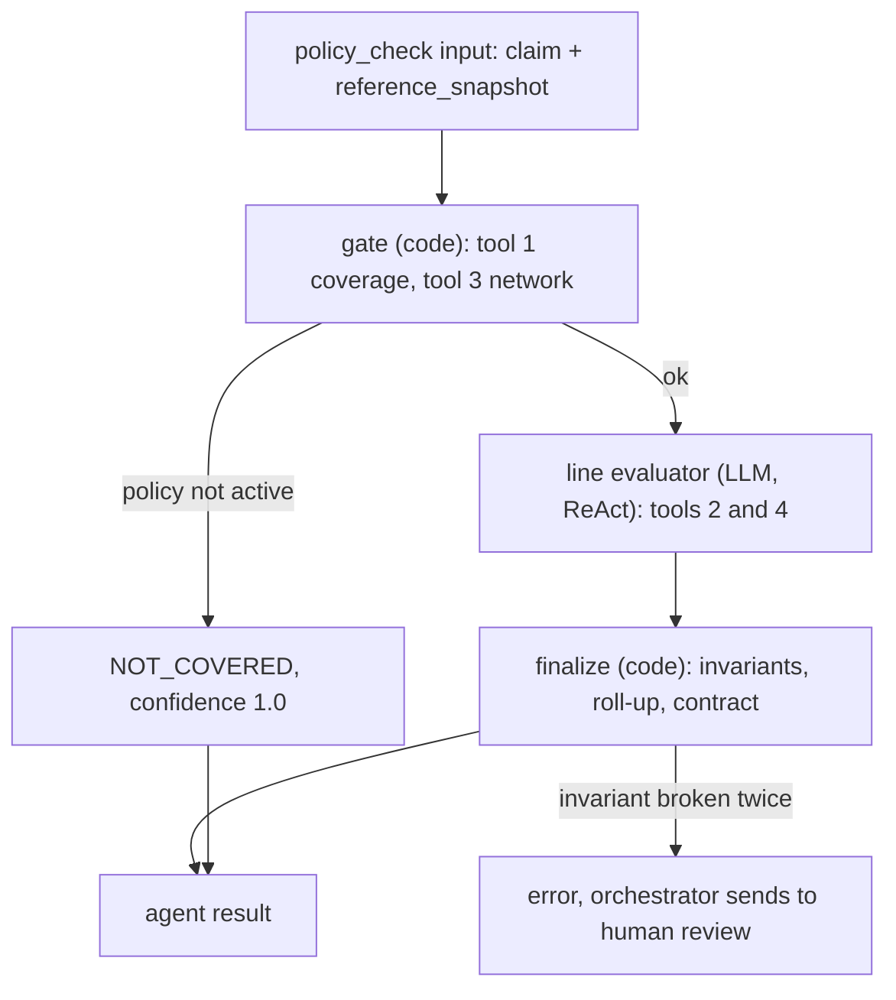

# Policy Compliance Agent — Design

Part of the Claims Adjudication Autonomous AI Agent (ClaimsAI Sentinel).
Session date: 2026-10-25. Status: design agreed; implementation not started.
Builds on `claims-adjudicator-orchestrator.md` (agent result contract, routing rules) and `payer-service-design.md` (reference tables, `reference_snapshot`, business validation).

## 1. Scope and assumptions

- **Question it answers:** "Is this claim covered by the member's plan?" It runs in parallel with fraud detection, inside the adjudicator's `policy_check` node.
- **Read-only.** The agent never writes to the claims master DB. It reads reference data through the payer service and returns a verdict to the orchestrator.
- **Deterministic facts, agentic judgment.** Facts (is the policy active, is the provider in network, what does the benefit table say) come from data, never from the LLM. The LLM is used where a rules engine does badly: reading policy text, applying exclusions with conditions, and explaining the verdict with citations.
- **Deliberately small for the learning build:** 4 tools and 1 new table. Checks dropped for now are listed in section 10 and can each come back as one more tool.

## 2. Synergy with the payer service

The payer service already does part of what a compliance check usually does, so the agent does not repeat it:

| Check | Already done by | What the agent does |
|---|---|---|
| Member exists and matches | Payer validation (`MEMBER_NOT_MATCHED`) | Nothing |
| Policy active across the service dates | Payer validation (`NO_ACTIVE_COVERAGE`, REJECT) | Defensive recheck in the gate, from the snapshot |
| Timely filing | Payer validation (`TIMELY_FILING`, REJECT) | Nothing (dropped from the agent) |
| CPT and ICD-10 codes valid | Payer validation (`INVALID_CODE`) | Nothing (dropped from the agent) |
| Provider on file | Payer validation (`PROVIDER_NOT_ON_FILE`) | Reads `network_status` from the snapshot |
| Benefit coverage per CPT | — | Tool 2, new `plan_benefit` table |
| Exclusions, network exceptions | — | Tool 4, plan documents (RAG) |

Two consequences:

- **No new `members` table.** The agent uses the payer service's existing `member`, `policy` and `provider` tables.
- **No extra calls for member, policy and provider.** The orchestrator's `load_claim` already fetches `GET /claims/{id}`, which carries `claim.reference_snapshot`: the member, policy and provider rows exactly as the payer service validated them. The agent checks against the same rows, which also answers the auditor's question "what did the policy say when you decided?"

## 3. Tools

| # | Tool | Reads | Runs in | What it answers |
|---|---|---|---|---|
| 1 | `get_member_coverage(claim)` | `reference_snapshot.member`, `.policy` | Gate (code) | Is the policy active across the service dates, and what is its `plan_code`? If not active: NOT_COVERED, stop. |
| 2 | `get_plan_benefit(plan_code, cpt_code)` | `plan_benefit` (new) via payer API | Line evaluator (LLM) | Is the CPT covered or excluded, and does it need prior auth? Which policy section governs it? |
| 3 | `check_provider_network(claim)` | `reference_snapshot.provider` | Gate (code) | Is the billing provider in or out of network? |
| 4 | `search_policy_documents(plan_code, query)` | Plan documents in pgvector | Line evaluator (LLM) | Exclusions with conditions, out-of-network exceptions, CPTs with no benefit row. |

Tools 1 and 3 are deterministic and claim-level (`claim_line` has no provider of its own), so the gate calls them directly with no LLM. Their results are handed to the line evaluator as facts. The LLM only gets tools 2 and 4.

### Tool contracts

```python
class MemberCoverage(BaseModel):
    active: bool
    plan_code: str | None
    policy_id: str | None
    effective_date: date | None
    termination_date: date | None

class ProviderNetwork(BaseModel):
    npi: str
    network_status: Literal["in", "out"]

class PlanBenefit(BaseModel):
    found: bool                     # False → no row for this plan + CPT
    plan_code: str
    cpt_code: str
    benefit_category: str | None
    is_covered: bool | None
    requires_prior_auth: bool | None
    policy_section: str | None      # e.g. "§5.2", the citation and a hint for tool 4

class PolicyPassage(BaseModel):
    plan_code: str
    section: str                    # e.g. "§3.2"
    heading: str
    text: str
    score: float
```

## 4. Data

### One new table: `plan_benefit`

Lives in the claims master DB next to `policy`, as reference data. The payer service owns it, like the other reference tables.

```sql
CREATE TABLE plan_benefit (
    plan_code            TEXT NOT NULL,          -- joins to policy.plan_code
    cpt_code             TEXT NOT NULL REFERENCES ref_cpt(code),
    benefit_category     TEXT NOT NULL,          -- office_visit, imaging, surgery ...
    is_covered           BOOLEAN NOT NULL,
    requires_prior_auth  BOOLEAN NOT NULL DEFAULT FALSE,
    policy_section       TEXT NOT NULL,          -- pointer into the plan document
    PRIMARY KEY (plan_code, cpt_code)
);
```

There is no `plan` table. `plan_code` is the key shared by `policy`, `plan_benefit` and the plan documents.

### Plan documents

Two short Evidence of Coverage style documents (appendix A and B). For the build they are copied to `data/plan_documents/<plan_code>.md` and indexed by `scripts/index_payer_docs.py`:

- One chunk per numbered section, so every passage carries a citable `section`.
- Stored in pgvector in the shared `payer_doc_chunk` table (`doc_type = 'eoc'`), with `plan_code`, `section`, `heading`. Medical policies for the medical necessity agent live in the same table (`doc_type = 'medical_policy'`); see `medical-necessity-agent-design.md`, section 2.
- `search_policy_documents` always filters by `doc_type = 'eoc'` and `plan_code`, so one plan's text can never answer for another, and medical policies never answer a coverage question.
- The index belongs to the adjudicator (read-only for the agent). Re-indexing is a script run, not an API.

### Seed data for `plan_benefit`

Two plans: `SILVER-PPO-01` (PPO, out-of-network covered) and `BRONZE-HMO-01` (HMO, in-network only, with exceptions). Add each CPT below to `ref_cpt` too.

| CPT | Description | Category | PPO covered | PPO prior auth | PPO section | HMO covered | HMO prior auth | HMO section |
|---|---|---|---|---|---|---|---|---|
| 99213 | Office visit, established, low | office_visit | yes | no | §4.1 | yes | no | §4.1 |
| 99214 | Office visit, established, moderate | office_visit | yes | no | §4.1 | yes | no | §4.1 |
| 99285 | Emergency department visit, high | emergency | yes | no | §4.2 | yes | no | §4.2 |
| 71046 | Chest X-ray, 2 views | imaging | yes | no | §4.3 | yes | no | §4.3 |
| 70553 | MRI brain without and with contrast | advanced_imaging | yes | **yes** | §4.3 | yes | **yes** | §4.3 |
| 72148 | MRI lumbar spine without contrast | advanced_imaging | yes | **yes** | §4.3 | yes | **yes** | §4.3 |
| 97110 | Therapeutic exercise (PT) | rehab_therapy | yes | no | §4.4 | yes | no | §4.4 |
| 90837 | Psychotherapy, 60 minutes | mental_health | yes | no | §4.5 | yes | no | §4.5 |
| 43644 | Laparoscopic gastric bypass | bariatric_surgery | yes | **yes** | §4.6 | **no** | no | §5.3 |
| 19357 | Breast reconstruction with tissue expander | reconstructive | yes | no | §4.7 | yes | no | §4.7 |
| 15823 | Upper eyelid blepharoplasty, excessive skin | cosmetic | **no** | no | §5.2 | **no** | no | §5.2 |
| 97810 | Acupuncture, initial 15 minutes | acupuncture | yes | no | §4.8 | **no** | no | §5.4 |

`93000` (ECG) goes into `ref_cpt` but **deliberately not** into `plan_benefit`, to exercise the "no benefit row" path.

```sql
INSERT INTO plan_benefit VALUES
('SILVER-PPO-01','99213','office_visit',true,false,'§4.1'),
('SILVER-PPO-01','99214','office_visit',true,false,'§4.1'),
('SILVER-PPO-01','99285','emergency',true,false,'§4.2'),
('SILVER-PPO-01','71046','imaging',true,false,'§4.3'),
('SILVER-PPO-01','70553','advanced_imaging',true,true,'§4.3'),
('SILVER-PPO-01','72148','advanced_imaging',true,true,'§4.3'),
('SILVER-PPO-01','97110','rehab_therapy',true,false,'§4.4'),
('SILVER-PPO-01','90837','mental_health',true,false,'§4.5'),
('SILVER-PPO-01','43644','bariatric_surgery',true,true,'§4.6'),
('SILVER-PPO-01','19357','reconstructive',true,false,'§4.7'),
('SILVER-PPO-01','15823','cosmetic',false,false,'§5.2'),
('SILVER-PPO-01','97810','acupuncture',true,false,'§4.8'),
('BRONZE-HMO-01','99213','office_visit',true,false,'§4.1'),
('BRONZE-HMO-01','99214','office_visit',true,false,'§4.1'),
('BRONZE-HMO-01','99285','emergency',true,false,'§4.2'),
('BRONZE-HMO-01','71046','imaging',true,false,'§4.3'),
('BRONZE-HMO-01','70553','advanced_imaging',true,true,'§4.3'),
('BRONZE-HMO-01','72148','advanced_imaging',true,true,'§4.3'),
('BRONZE-HMO-01','97110','rehab_therapy',true,false,'§4.4'),
('BRONZE-HMO-01','90837','mental_health',true,false,'§4.5'),
('BRONZE-HMO-01','43644','bariatric_surgery',false,false,'§5.3'),
('BRONZE-HMO-01','19357','reconstructive',true,false,'§4.7'),
('BRONZE-HMO-01','15823','cosmetic',false,false,'§5.2'),
('BRONZE-HMO-01','97810','acupuncture',false,false,'§5.4');
```

## 5. Read-only endpoints

### Payer service (new)

| Endpoint | Returns | Notes |
|---|---|---|
| `GET /reference/plan-benefits/{plan_code}/{cpt_code}` | One `PlanBenefit` row, or `404` | Tool 2. The agent turns `404` into `found: false`, not an error. |
| `GET /reference/plan-benefits/{plan_code}` | All rows for a plan | Optional, for debugging and the review UI. |

Both are read-only and follow the payer service's existing audit rule: each read writes an `audit_event` row with actor `adjudicator:policy_compliance` and the `correlation_id`.

### Payer service (existing, reused)

| Endpoint | Used for |
|---|---|
| `GET /claims/{claim_id}` | Already called by the orchestrator's `load_claim`. Carries the claim, lines, diagnoses and `reference_snapshot`, which tools 1 and 3 read. |

### Adjudicator (internal, no HTTP)

`search_policy_documents` queries the adjudicator's own pgvector index directly. No endpoint is needed in the learning build.

## 6. How the agent runs

The agent is a LangGraph subgraph used as the orchestrator's `policy_check` node.



### Gate (no LLM)

1. `get_member_coverage`: the policy in the snapshot must be active across `service_from` to `service_to`. The payer service already rejects claims that fail this, so a failure here means data drifted. It returns NOT_COVERED with confidence 1.0 and the LLM is never called.
2. `check_provider_network`: records `in` or `out` as a fact for the evaluator.

### Line evaluator (LLM, ReAct)

Input: the lines (including any `prior_auth_number`), diagnosis codes (resolved through the pointers), `plan_code` and network status. Bound tools: 2 and 4. The prompt tells it to:

- call `get_plan_benefit` for **every** line;
- call `search_policy_documents` only when the benefit row does not settle the line: excluded with a section that may hold an exception, no benefit row, or an out-of-network provider;
- return one `LineVerdict` per line with evidence.

Typical cost: a routine in-network office visit needs one tool call per line and no RAG.

### Finalize (no LLM): invariants

The LLM cannot talk itself past a fact. Finalize checks every line against the tool trace:

| Invariant | If broken |
|---|---|
| Every line has a `get_plan_benefit` call in the trace | Retry once, then `error` |
| Row says covered, no prior auth, provider in network → line must be `covered` | Retry once, then `error` |
| Row says `requires_prior_auth` and the line has no `prior_auth_number` → line must be `needs_info` | Overwrite to `needs_info` |
| A verdict that differs from the row (an exception applied) must cite a passage returned by tool 4 | Retry once, then `error` |
| Every `not_covered` line has at least one evidence item | Retry once, then `error` |

`error` follows the orchestrator's existing rule: human review, never an automatic denial.

### Line rules

| Situation | Line verdict | Reason code (suggested CARC) |
|---|---|---|
| Covered, in network, no prior auth | `covered` | — |
| Covered, requires prior auth, `prior_auth_number` on the line | `covered`, with the number in evidence | — |
| Covered, requires prior auth, no `prior_auth_number` | `needs_info` | `PRIOR_AUTH_REQUIRED` (CO-197 if it later becomes a denial) |
| Excluded, no exception in the plan text applies | `not_covered` | `EXCLUDED_SERVICE` (CO-96) |
| Excluded, but the plan text's exception matches the diagnoses | `covered`, with the passage cited | — |
| Out of network on the HMO, no exception applies | `not_covered` | `OUT_OF_NETWORK` (CO-242) |
| Out of network on the HMO, emergency exception applies | `covered`, with §3.2 cited | — |
| No benefit row, plan text settles it | Verdict from the text, with the passage cited | — |
| No benefit row, plan text does not settle it | `needs_info` with low confidence → human review | `BENEFIT_UNDETERMINED` |

"Needs info" is never a denial. It says exactly what is missing.

### Confidence (computed, not self-reported)

| How the line was settled | Confidence |
|---|---|
| Benefit row alone | 1.0 |
| Plan text, with a cited passage | 0.8 |
| Nothing settled it | 0.5 |

The claim's confidence is the lowest line confidence. The orchestrator threshold is 0.7, so an unsettled line sends the claim to human review.

## 7. Output: the orchestrator's agent result contract

The agent returns the shared contract unchanged and puts line detail in an added `details` field. The orchestrator's routing table does not change.

### Claim-level roll-up

1. Any line `needs_info` → **NEEDS_INFO**, listing everything missing at once.
2. Otherwise, every line `not_covered` → **NOT_COVERED**.
3. Otherwise → **COVERED**. If some lines are `not_covered`, `covered_lines` lists the ones that are covered. Medical necessity reviews only those, and `decide` denies the rest. This handles partial coverage without a new verdict value.

```json
{
  "agent": "policy_compliance",
  "verdict": "COVERED",
  "confidence": 0.8,
  "reasons": ["Line 2 excluded as acupuncture (BRONZE-HMO-01 §5.4)"],
  "evidence": ["plan_benefit BRONZE-HMO-01/97810", "BRONZE-HMO-01 §5.4"],
  "error": null,
  "details": {
    "plan_code": "BRONZE-HMO-01",
    "network_status": "in",
    "covered_lines": [1],
    "lines": [
      {
        "line_no": 1,
        "cpt_code": "99213",
        "status": "covered",
        "reason_code": null,
        "reasons": ["Office visit covered under §4.1"],
        "evidence": [{"source": "plan_benefit", "ref": "BRONZE-HMO-01/99213"}],
        "confidence": 1.0
      },
      {
        "line_no": 2,
        "cpt_code": "97810",
        "status": "not_covered",
        "reason_code": "EXCLUDED_SERVICE",
        "carc": "CO-96",
        "reasons": ["Acupuncture is excluded"],
        "evidence": [{"source": "plan_document", "ref": "BRONZE-HMO-01 §5.4"}],
        "confidence": 1.0
      }
    ],
    "missing_info": []
  }
}
```

## 8. Code sketch

```python
from langgraph.graph import StateGraph, START, END
from langgraph.prebuilt import create_react_agent
from langchain_core.tools import tool

@tool
def get_plan_benefit(plan_code: str, cpt_code: str) -> dict:
    """Benefit row for a plan and CPT code. found=false if the plan has no row."""
    r = payer.get(f"/reference/plan-benefits/{plan_code}/{cpt_code}")
    if r.status_code == 404:
        return {"found": False, "plan_code": plan_code, "cpt_code": cpt_code}
    r.raise_for_status()
    return {"found": True, **r.json()}

@tool
def search_policy_documents(plan_code: str, query: str) -> list[dict]:
    """Search this plan's coverage document. Returns sections with citations."""
    return vector_store.search(query, filter={"plan_code": plan_code}, k=3)

line_evaluator = create_react_agent(
    llm, tools=[get_plan_benefit, search_policy_documents],
    prompt=LINE_EVALUATOR_PROMPT, response_format=LineVerdicts,
)

def gate(state):
    snap = state["claim"]["reference_snapshot"]
    cov = get_member_coverage(snap, state["claim"])        # plain functions
    net = check_provider_network(snap)
    return {"coverage": cov, "network": net}

def gate_route(state):
    return "evaluate" if state["coverage"].active else "not_covered"

g = StateGraph(PolicyState)
g.add_node("gate", gate)
g.add_node("evaluate", run_line_evaluator)   # invokes line_evaluator, keeps tool trace
g.add_node("not_covered", inactive_result)
g.add_node("finalize", finalize)             # invariants, roll-up, contract
g.add_edge(START, "gate")
g.add_conditional_edges("gate", gate_route, {"evaluate": "evaluate", "not_covered": "not_covered"})
g.add_edge("evaluate", "finalize")
g.add_edge("finalize", END)
g.add_edge("not_covered", END)
policy_compliance = g.compile()   # used as the orchestrator's policy_check node
```

`run_line_evaluator` keeps the messages of the ReAct run so finalize can check the tool trace. The retry-once on a broken invariant is a loop from finalize back to evaluate, capped at one.

## 9. Test scenarios (planted ground truth)

Each needs a synthetic claim on a member whose policy has the given `plan_code`.

| # | Plan | Provider | Lines (CPT) | Diagnoses | Expected verdict | Path exercised |
|---|---|---|---|---|---|---|
| T1 | PPO | in | 99213 | J06.9 | COVERED, 1.0 | Benefit row only, no RAG |
| T2 | PPO | in | 72148 | M54.50 | NEEDS_INFO (prior auth) | Prior auth rule |
| T3 | HMO | out | 99213 | J06.9 | NOT_COVERED, CO-242 | Out of network, no exception |
| T4 | HMO | out | 99285 | R07.9 | COVERED, 0.8, cites §3.2 | Emergency exception from plan text |
| T5 | PPO | in | 15823 | H02.831, H53.40 | COVERED, 0.8, cites §5.2(b) | Cosmetic exclusion, functional exception |
| T6 | PPO | in | 15823 | H02.831 | NOT_COVERED, CO-96 | Exclusion holds without a functional diagnosis |
| T7 | HMO | in | 43644 | E66.01 | NOT_COVERED, CO-96 | Plan-specific exclusion |
| T8 | PPO | in | 99214, 71046, 70553 | R51.9 | NEEDS_INFO (line 3 prior auth) | Multi-line roll-up |
| T9 | PPO | in | 93000 | R00.2 | COVERED, 0.8, cites §4.3 | No benefit row, settled by plan text |
| T10 | PPO | in | 19357 | Z90.11 | COVERED, 1.0 | Reconstructive after mastectomy |
| T11 | HMO | in | 99213, 97810 | M54.50 | COVERED, `covered_lines: [1]` | Partial coverage |
| T12 | PPO | in | 72148 with `prior_auth_number` | M54.50 | COVERED, 1.0 | Prior auth supplied (T2 after the claimant answers) |

Also test the invariants with a stubbed LLM that returns a wrong verdict for T1: finalize must retry, then return `error`.

## 10. Dropped for now (each can return as one more tool)

| Check | Why it can wait |
|---|---|
| Timely filing | Payer validation already rejects late claims |
| Code validity, age/sex edits, bundling | Payer validation covers validity; edits are a later refinement |
| Coordination of benefits | Needs another table; every synthetic member has one payer |
| Prior auth lookup | Needs a `prior_auth` table. For now the agent accepts the `prior_auth_number` on the line as given (section 11, item 1); verifying it is the later tool |
| Benefit limits and accumulators | Needs usage tracking across claims |
| Cost share (copay, coinsurance, deductible) | A payment concern, not a coverage one |

## 11. Open questions

1. ~~How a prior auth gets supplied.~~ **Decided 2026-10-25:** a new optional `prior_auth_number` on `claim_line`. This is an optional field, so it is a minor bump of the `claim.submitted` contract to v1.1, and a nullable column on `claim_line`. The claimant supplies it either on the original submission or later through the missing-info chatbot, as the answer to a `lines[n].prior_auth_number` issue.
2. ~~Return-to-claimant transition.~~ **Decided 2026-10-25:** the claims adjudicator (orchestrator) owns sending NEEDS_INFO back to the claimant, using a new allowed transition `IN_ADJUDICATION → PENDING_INFO`. See `claims-adjudicator-orchestrator.md`, section 5.1.
3. **Line-level denials in `decide`.** For partial coverage, `decide` must deny the non-covered lines. `claim_line.line_status` (planned in the portal data model) is the natural place; the transitions API will need to carry line results.
4. **Policy spanning a renewal** (open question 4 in the payer service doc) stays out of scope here; the gate trusts the single policy in the snapshot.

---

## Appendix A — SILVER-PPO-01 Evidence of Coverage (synthetic)

**§1 Definitions**
- *Emergency medical condition:* a condition with acute symptoms severe enough that a prudent layperson would expect serious harm without immediate care.
- *Cosmetic:* a service performed mainly to change or improve appearance rather than to restore or improve bodily function.
- *Experimental or investigational:* a service not generally accepted as safe and effective for the condition.

**§2 Eligibility.** Coverage applies to services received while the member's policy is active, as shown in the plan's enrollment records.

**§3 Network**
- §3.1 Services from in-network providers are covered at the in-network level.
- §3.2 Services from out-of-network providers are covered at the out-of-network level.
- §3.3 Emergency services are covered at the in-network level from any provider.

**§4 Covered services**
- §4.1 Office visits with a primary care provider or specialist.
- §4.2 Emergency department services for an emergency medical condition.
- §4.3 Diagnostic tests and imaging, including laboratory tests, electrocardiograms and X-rays. Advanced imaging (MRI, CT, PET) requires prior authorization.
- §4.4 Rehabilitation therapy (physical, occupational and speech therapy).
- §4.5 Mental health and substance use disorder services, covered on the same terms as medical services.
- §4.6 Bariatric surgery, with prior authorization.
- §4.7 Reconstructive surgery, including all stages of breast reconstruction after a mastectomy and surgery to correct a congenital anomaly or an accidental injury.
- §4.8 Acupuncture.

**§5 Exclusions**
- §5.1 Experimental or investigational services.
- §5.2 Cosmetic services. This exclusion does not apply to: (a) reconstructive services under §4.7; (b) surgery to correct a functional impairment, such as upper-eyelid surgery when excess skin obstructs the visual field; (c) repair of an accidental injury.

**§6 Prior authorization.** Services marked as requiring prior authorization must be approved before they are provided. A claim for such a service without an approval on file is pended for the authorization, not denied, unless the service was an emergency.

## Appendix B — BRONZE-HMO-01 Evidence of Coverage (synthetic)

**§1 Definitions.** As in SILVER-PPO-01 §1.

**§2 Eligibility.** Coverage applies to services received while the member's policy is active, as shown in the plan's enrollment records.

**§3 Network**
- §3.1 Only services from in-network providers are covered.
- §3.2 Exceptions: out-of-network services are covered at the in-network level for (a) emergency services for an emergency medical condition, (b) urgently needed care while the member is temporarily outside the service area, and (c) services the plan authorized in advance because no in-network provider was available.

**§4 Covered services**
- §4.1 Office visits with the member's primary care provider, or with a specialist on referral.
- §4.2 Emergency department services for an emergency medical condition.
- §4.3 Diagnostic tests and imaging, including laboratory tests, electrocardiograms and X-rays. Advanced imaging (MRI, CT, PET) requires prior authorization.
- §4.4 Rehabilitation therapy (physical, occupational and speech therapy).
- §4.5 Mental health and substance use disorder services, covered on the same terms as medical services.
- §4.7 Reconstructive surgery, including all stages of breast reconstruction after a mastectomy and surgery to correct a congenital anomaly or an accidental injury.

**§5 Exclusions**
- §5.1 Experimental or investigational services.
- §5.2 Cosmetic services. This exclusion does not apply to: (a) reconstructive services under §4.7; (b) surgery to correct a functional impairment, such as upper-eyelid surgery when excess skin obstructs the visual field; (c) repair of an accidental injury.
- §5.3 Bariatric surgery and other surgical treatment of obesity.
- §5.4 Acupuncture.

**§6 Prior authorization.** Services marked as requiring prior authorization must be approved before they are provided. A claim for such a service without an approval on file is pended for the authorization, not denied, unless the service was an emergency.
